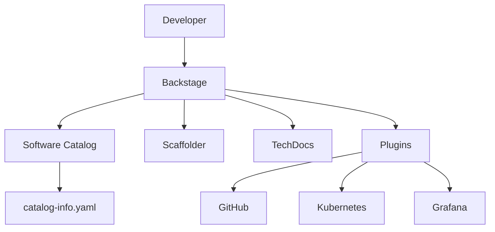

# Qué es Backstage

Tiempo estimado: 20 min
Nivel: Básico
Importancia para entrevista: CRÍTICO
Prioridad: CRÍTICO

## 1. Objetivo

Vas a poder explicar Backstage en menos de un minuto, con el problema de ACME como ejemplo, sin recitar la página de marketing.

## 2. Prerrequisitos

Sabes qué es un microservicio y qué es un repositorio Git. No necesitas haber abierto Backstage.

## 3. Concepto

Backstage es un framework para construir un **developer portal**. No es un catálogo cerrado ni un CI. Es una aplicación React + un backend Node que tú instalas en tu empresa y extiendes con plugins.

Tres piezas hacen casi todo el trabajo:

- **Software Catalog**: el inventario de servicios, APIs, bases de datos, sistemas, dominios y equipos.
- **Software Templates (Scaffolder)**: formularios que generan un repositorio siguiendo el estándar de la empresa.
- **TechDocs**: la documentación del servicio, renderizada dentro del portal, al lado de la ficha del servicio.

Todo lo demás (GitHub, Kubernetes, Grafana, el plugin que vas a escribir) son plugins encima de esas piezas.

Backstage lo creó Spotify y hoy es un proyecto de la CNCF. La instalación de este curso es **standalone**: una app tuya, no el monorepo de contribuidores.

## 4. ¿Por qué existe?

En una empresa con decenas o cientos de microservicios la información vive repartida:

- el repo está en GitHub
- el contrato está en un Swagger que nadie encuentra
- el dueño está en un mensaje de Slack de hace ocho meses
- el dashboard está en una carpeta de Grafana
- el "cómo creo un servicio nuevo" está en un wiki desactualizado

Backstage no reemplaza GitHub, Kubernetes ni Grafana. Pone una ficha por servicio y enlaza esas herramientas. El desarrollador deja de preguntar "¿quién es el dueño de orders?" y abre la ficha.

## 5. Arquitectura

En ACME el portal se llama `acme-developer-portal`. Detrás están `ms-auth`, `ms-orders` y `ms-payments`. Esos servicios no corren dentro de Backstage. Backstage los **describe**.

## 6. Ejemplo real

Ana, de commerce, necesita saber si `ms-orders` habla con pagos por HTTP o por Kafka. Sin portal abre tres repos y un hilo de Slack. Con portal abre `ms-orders` y ve:

- dueño: `commerce-team`
- API que expone: `orders-api`
- API que consume: `payments-api` y `auth-api`
- depende de: Postgres y Kafka
- docs: Overview, Architecture, API
- link: dashboard de Grafana

## 7. Laboratorio

Objetivo: ver un Backstage real antes de instalar el tuyo, y anotar qué pieza cubre cada dolor de ACME.

Preparación: navegador. No hace falta Node todavía.

1. Abre el demo público: [https://demo.backstage.io](https://demo.backstage.io).
2. Entra a **Catalog**.
3. Abre un Component de tipo `service`.
4. Anota, en un archivo `notas-lab-00.md` en la raíz de este repo, estas cuatro líneas:
   - qué pestaña enseña el código o las relaciones
   - si hay una sección de APIs
   - si hay Docs
   - si hay un botón **Create** en la barra

Dónde ejecutarlo: el editor, no una terminal.

Qué hace: te obliga a separar "producto" de "instalación". El demo ya tiene datos. El tuyo, en el lab 01, arranca casi vacío.

Resultado esperado: cuatro líneas escritas. Vas a reutilizarlas cuando compares tu portal con el demo.

## 8. Validación

Abre `notas-lab-00.md`. Tienes que poder señalar con el dedo, en el demo, Catalog, Docs y Create. Si Create no aparece, mira el menú lateral: en el demo el scaffolder está en **Create**.

## 9. Troubleshooting

### La demo pide login y no entra

¿Por qué ocurre? El demo a veces cambia el proveedor de guest.
¿Cómo diagnosticarlo? Mira si hay un botón Guest.
¿Cómo solucionarlo? Usa Guest. Si el demo está caído, sigue con el diagrama de este capítulo. La instalación local es el lab 01, no dependas del demo para aprobar el curso.

### Confundo Backstage con el catálogo

¿Por qué ocurre? La pantalla que más se ve es el catálogo.
¿Cómo diagnosticarlo? Pregúntate si Templates y TechDocs caben dentro de "un inventario".
¿Cómo solucionarlo? Di la frase: el catálogo es una feature. Backstage es el portal.

### Creo que Backstage despliega mis servicios

¿Por qué ocurre? Se parece a una consola de plataforma.
¿Cómo diagnosticarlo? Busca en este capítulo quién ejecuta el `kubectl apply`. No es el catálogo.
¿Cómo solucionarlo? Backstage enlaza el despliegue. El despliegue lo hace CI/CD o la plataforma que ya tengas.

## 10. Ejercicio

Escribe en voz alta, en 40 segundos: qué es Backstage, qué problema de ACME resuelve, y qué tres features nombrarías primero. Grábate. Si pasas de un minuto, corta adjetivos.

## 11. Preguntas de entrevista

### ¿Qué es Backstage?

Respuesta corta: un framework open source para construir el developer portal de una empresa.

Explicación: no es un SaaS que "enciendes". Generas una app con `create-app`, la configuras y la extiendes con plugins.

Qué mencionar: Catalog, Scaffolder, TechDocs, plugins, CNCF, app propia.

### ¿Backstage es un service mesh, un API gateway o un PaaS?

Respuesta corta: no.

Explicación: no mueve tráfico ni despliega por sí mismo. Describe software y estandariza cómo se crea.

Qué mencionar: integra Kubernetes y CI; no los reemplaza.

### ¿Qué problema resuelve?

Respuesta corta: el desarrollador no encuentra dueño, contrato, docs ni el camino para crear un servicio.

Explicación: con muchos microservicios esa información se fragmenta. El portal la reúne por servicio.

Qué mencionar: ownership, discoverability, golden paths. Usa ACME, no definiciones genéricas.

## 12. Conexión con arquitectura

- Microservicios: cada servicio es una ficha, no un proceso dentro de Backstage.
- Platform Engineering: el portal es la superficie de la plataforma.
- DevOps: no sustituye pipelines. Los enseña.
- CI/CD: el template puede dejar el workflow dentro del repo generado.
- Cloud: AWS, GCP o Azure entran como plugins e integraciones, no como el núcleo.
- Developer Experience: menos tiempo buscando, más tiempo construyendo.

## 13. Checklist

- [ ] Puedo explicar Backstage en menos de un minuto
- [ ] Separo portal, catálogo, templates y docs
- [ ] Puedo decir qué Backstage no hace
- [ ] Vi Catalog y Create en el demo, o dejé escrito por qué no pude entrar
