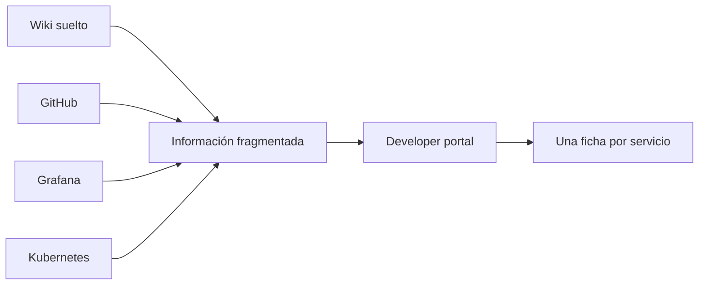

# Developer portal

Tiempo estimado: 15 min
Nivel: Básico
Importancia para entrevista: CRÍTICO
Prioridad: CRÍTICO

## 1. Objetivo

Diferenciar un developer portal de un wiki, de un dashboard de Grafana y de la consola de cloud.

## 2. Prerrequisitos

Leíste `01-what-is-backstage.md`.

## 3. Concepto

Un developer portal es la interfaz interna donde un ingeniero descubre software, entiende de quién es, lee cómo usarlo y crea piezas nuevas siguiendo el estándar de la empresa.

Backstage es una forma de construir ese portal. Hay otras (portales a medida, otros productos). En una entrevista de Backstage quieres esta definición, y después decir por qué Backstage encaja: catálogo basado en YAML en el repo, templates y plugins.

La unidad de navegación es la **entidad**. Un servicio, una API, una base de datos, un equipo. La ficha de la entidad junta lo que antes estaba en cinco herramientas.

## 4. ¿Por qué existe?

Un wiki documenta. Grafana observa. GitHub guarda código. Ninguno responde solo esta pregunta: "¿qué es este servicio, de quién es, qué contrato tiene y cómo lo opero?". El portal existe para esa pregunta.

## 5. Arquitectura

## 6. Ejemplo real

El portal de ACME no es la tienda que ve el cliente. Es la herramienta interna de Ana, Leo y el platform team.

Cuando alguien nuevo entra a commerce, no le mandan diez enlaces. Le dicen: abre `acme-developer-portal`, busca `ms-orders`.

## 7. Laboratorio

Objetivo: separar audiencias. Backstage no es el frontend de ACME.

Preparación: papel o `notas-lab-00.md`.

Escribe dos columnas:

| Lo ve el cliente de ACME | Lo ve un developer de ACME |
| --- | --- |
| checkout, login, listado de pedidos | ficha de `ms-orders`, template NestJS, docs, dashboard |

Añade una tercera línea: qué herramienta sigue siendo la fuente de verdad del código (GitHub) y cuál es solo el índice (Backstage).

Dónde: el archivo de notas, no el portal.

Resultado esperado: puedes explicar que el portal indexa. El repo sigue siendo la fuente del código.

## 8. Validación

Lee la tabla en voz alta. Si pusiste "Backstage guarda el código de `ms-orders`", está mal. El código vive en Git. El portal guarda metadata y, si el template publica, el scaffolder empuja archivos al repo. Después el repo manda.

## 9. Troubleshooting

### Llamo "portal" al catálogo y se me olvida Create

¿Por qué ocurre? El catálogo ocupa la pantalla principal.
¿Cómo diagnosticarlo? ¿Un developer nuevo puede crear `ms-inventory` desde ahí?
¿Cómo solucionarlo? Portal = catálogo + templates + docs + plugins.

### Quiero meter la lógica de pedidos dentro de Backstage

¿Por qué ocurre? Confundes el portal con un backend de negocio.
¿Cómo diagnosticarlo? ¿Ese código lo despliega el equipo de commerce o el de plataforma?
¿Cómo solucionarlo? `ms-orders` es NestJS. Backstage solo lo registra.

### Creo que cada microservicio necesita su propio Backstage

¿Por qué ocurre? Piensas en un portal por bounded context.
¿Cómo diagnosticarlo? ¿Ana puede ver pagos si su portal es solo commerce?
¿Cómo solucionarlo? Un portal por empresa (o por unidad grande). Los dominios viven dentro del catálogo.

## 10. Ejercicio

Explica la diferencia entre el frontend de la tienda ACME y `acme-developer-portal` usando solo `ms-orders` como ejemplo.

## 11. Preguntas de entrevista

### ¿Qué es un developer portal?

Respuesta corta: la interfaz interna para descubrir, entender y crear software de la empresa.

Explicación: una ficha por servicio junta dueño, contrato, docs y enlaces a operación.

Qué mencionar: no es el producto que ve el cliente. Backstage es el framework, el portal es el producto que construyes con él.

### ¿Por qué no basta un wiki?

Respuesta corta: un wiki no tiene relaciones ni un modelo de software.

Explicación: el catálogo sabe que `ms-orders` depende de Kafka y lo posee `commerce-team`. Un wiki lo escribe alguien y se pudre.

Qué mencionar: `catalog-info.yaml` vive junto al código, así que cambia en el mismo pull request.

## 12. Conexión con arquitectura

- Microservicios: el portal es el mapa, no el territorio.
- Platform Engineering: el portal es el producto del equipo de plataforma.
- DevOps: la ficha enlaza pipeline y runtime.
- CI/CD: el portal no corre el pipeline.
- Cloud: la consola de AWS sigue existiendo. El portal manda ahí cuando hace falta.
- Developer Experience: un sitio para arrancar, no diez bookmarks.

## 13. Checklist

- [ ] Distingo portal interno y producto de cara al cliente
- [ ] Sé que Git sigue siendo la fuente del código
- [ ] Puedo definir developer portal sin decir "es Backstage"
- [ ] Puedo corregir a quien reduce el portal al catálogo
