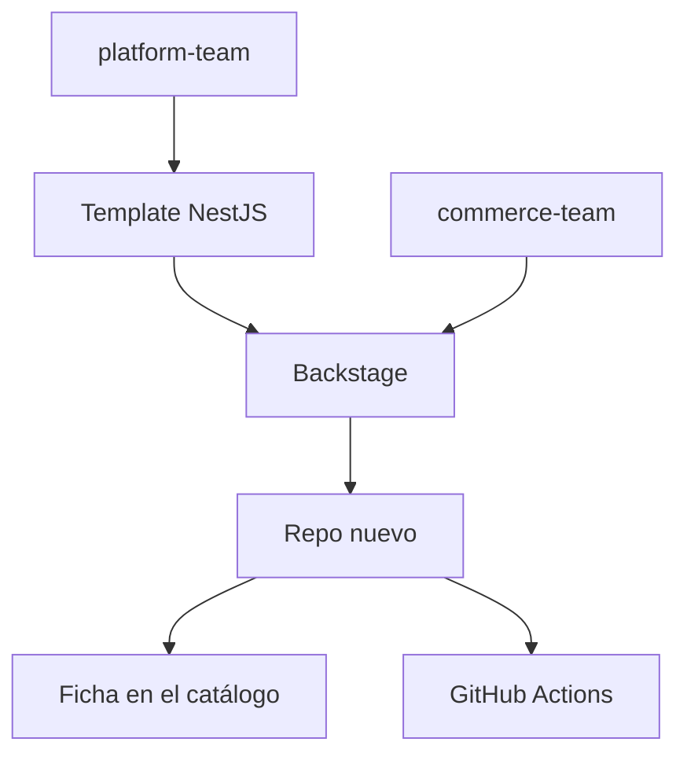

# Platform engineering

Tiempo estimado: 15 min
Nivel: Intermedio
Importancia para entrevista: CRÍTICO
Prioridad: ALTO

## 1. Objetivo

Explicar por qué un equipo de plataforma construye Backstage, y qué es un golden path sin haber escrito todavía el template.

## 2. Prerrequisitos

Capítulos 01 y 02 de esta carpeta. Experiencia tuya con microservicios: úsala.

## 3. Concepto

Platform engineering trata la plataforma interna como un producto. Los usuarios son los desarrolladores de los equipos de negocio.

El producto tiene una superficie: el developer portal. Tiene caminos soportados: los **golden paths**. Un golden path es la forma recomendada de hacer algo repetible, por ejemplo "crear un microservicio NestJS en ACME".

El equipo puede salirse del camino. El camino existe para que no tenga que inventar Dockerfile, CI, `catalog-info.yaml` y el layout del repo cada vez.

Backstage entra porque el Scaffolder es el formulario de ese camino, y el catálogo es donde el resultado queda visible.

## 4. ¿Por qué existe?

Sin plataforma, cada equipo NestJS de ACME elige su propia estructura, su propio CI y su propia forma de documentar. Tres servicios (`ms-auth`, `ms-orders`, `ms-payments`) ya bastan para que nadie sepa dónde está el health check.

Con plataforma, platform-team mantiene un template. Commerce y payments lo usan. La libertad que pierden es la de discutir el Dockerfile. La que ganan es la de escribir dominio.

Esto encaja con lo que ya haces. Arquitectura hexagonal, DDD y CQRS viven **dentro** del servicio. El golden path no reemplaza esas decisiones: deja el lugar donde van.

## 5. Arquitectura

## 6. Ejemplo real

ACME quiere que el próximo servicio, `ms-inventory`, nazca así:

1. El developer abre Create.
2. Pone nombre, descripción, owner y repositorio.
3. El Scaffolder genera `src/`, `test/`, `Dockerfile`, `README.md`, `catalog-info.yaml` y un workflow.
4. El servicio aparece en el catálogo con dueño y sistema.

Eso es el lab 09 y el lab 10. Aquí solo fijas el criterio: si el template no registra el servicio en el catálogo, no es un golden path de ACME. Es un generador de carpetas.

## 7. Laboratorio

Objetivo: escribir el golden path de ACME antes de implementar el YAML. Así, cuando leas el template, sabes qué paso sobra y cuál falta.

Preparación: crea `docs/backstage-course/labs/golden-path-notas.md`.

Escribe la secuencia numerada de ACME, de 7 pasos como máximo, desde "Ana necesita un servicio" hasta "el servicio tiene dueño en el catálogo y un pipeline".

Incluye qué **no** automatizas en la v1: lógica de dominio, topics de Kafka, esquemas de Postgres.

Dónde: ese archivo.

Resultado esperado: una lista que el capítulo `06-golden-path.md` pueda cumplir. Si tu lista pide "desplegar a producción sin revisión humana", tárala. ACME no hace eso en este curso.

## 8. Validación

La lista menciona: formulario, repo Git, `catalog-info.yaml`, CI, dueño. No menciona un cluster nuevo por servicio.

## 9. Troubleshooting

### Confundo golden path con "la única forma permitida"

¿Por qué ocurre? El nombre suena a policía.
¿Cómo diagnosticarlo? ¿Un equipo puede tener un servicio legado fuera del template?
¿Cómo solucionarlo? Es el camino soportado. Lo legado se registra en el catálogo igual. No se reescribe el primer día.

### Quiero meter Kafka, Redis y Postgres dentro del template

¿Por qué ocurre? Quieres un generador completo de plataforma.
¿Cómo diagnosticarlo? ¿El desarrollador entiende el formulario o solo pulsa Next?
¿Cómo solucionarlo? v1 genera el servicio. Las dependencias se declaran en `dependsOn` cuando existan. Menos magia.

### Creo que platform engineering es DevOps con otro nombre

¿Por qué ocurre? Los dos tocan CI y runtime.
¿Cómo diagnosticarlo? ¿Quién es el usuario y quién mide adopción del template?
¿Cómo solucionarlo? DevOps entrega el servicio. Platform engineering entrega el camino para que los equipos entreguen solos.

## 10. Ejercicio

Di qué parte de tu experiencia (hexagonal, DDD, NestJS) va dentro del servicio y qué parte va en el template. Una frase cada una.

## 11. Preguntas de entrevista

### ¿Qué es un golden path?

Respuesta corta: el camino soportado para una tarea repetible, expuesto como template en el portal.

Explicación: en ACME, crear un NestJS pasa por un formulario que deja repo, catálogo, docs y CI alineados.

Qué mencionar: lo mantiene platform-team. El equipo de negocio aporta dominio, no infraestructura de arranque.

### ¿Qué mide el éxito de Backstage?

Respuesta corta: adopción, no cantidad de plugins.

Explicación: servicios con owner, servicios creados desde el template, docs que existen el día uno.

Qué mencionar: `backstage.io/time-saved` en el template es un dato orientativo, no la métrica de negocio.

## 12. Conexión con arquitectura

- Microservicios: el path estandariza el esqueleto, no el bounded context.
- Platform Engineering: Backstage es la UI de la plataforma.
- DevOps: el workflow generado es DevOps repetible.
- CI/CD: entra en el repo el día cero.
- Cloud: el path puede publicar en la cuenta correcta. En este curso publica en GitHub y deja el manifiesto de Kubernetes como laboratorio aparte.
- Developer Experience: menos decisiones accidentales.

## 13. Checklist

- [ ] Puedo definir golden path con el ejemplo NestJS de ACME
- [ ] Sé qué queda fuera del template en la v1
- [ ] Distingo plataforma y DevOps
- [ ] Tengo escrita la secuencia en `golden-path-notas.md`
