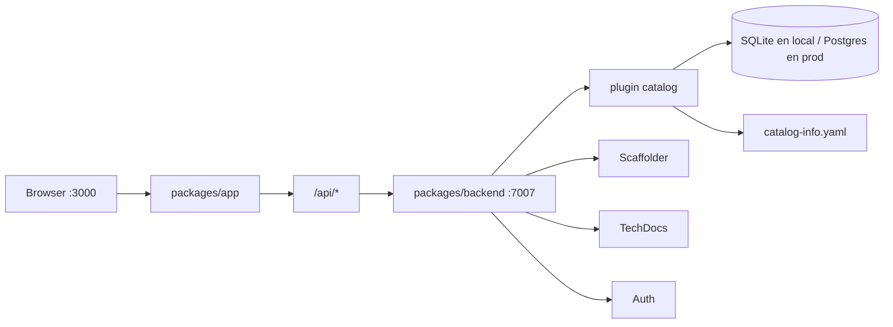

# Arquitectura de Backstage

Tiempo estimado: 25 min
Nivel: Intermedio
Importancia para entrevista: CRÍTICO
Prioridad: CRÍTICO

## 1. Objetivo

Dibujar el proceso de una app Backstage: frontend, backend, catálogo, base de datos y plugins. Saber qué proceso escucha en el puerto 3000 y cuál en el 7007.

## 2. Prerrequisitos

Los tres capítulos anteriores.

## 3. Concepto

Una app creada con `create-app` es un monorepo Yarn con dos paquetes que importan:

- `packages/app`: frontend React. En desarrollo escucha en el puerto **3000**.
- `packages/backend`: backend Node. En desarrollo escucha en el puerto **7007**.

`yarn start` levanta los dos. El navegador habla con el frontend. El frontend llama a `/api/...`, y el dev server se lo reenvía al backend.

El backend no es un solo controlador. Es un host de **plugins de backend**. Los que trae la app nueva, en 1.55, incluyen catalog, scaffolder, techdocs, auth, permission, search y kubernetes. Cada uno monta rutas bajo `/api/<pluginId>`.

La configuración vive en `app-config.yaml` en la raíz. Secretos no van ahí en claro: van como `${GITHUB_TOKEN}` y el proceso los lee del entorno. Para local se usa `app-config.local.yaml`, que `create-app` deja en `.gitignore`.

En local la base es **SQLite** en memoria o en fichero, según el `app-config` generado. No es el modo de producción. Producción usa PostgreSQL. Lo haces en el módulo 09.

Hay dos sistemas de frontend. El clásico registra plugins en `packages/app/src/App.tsx`. El nuevo instala features con `createFrontendPlugin`. Antes de escribir un plugin, mira qué import tiene tu `App.tsx`. El capítulo de plugins te da el comando.

## 4. ¿Por qué existe?

Hace falta un proceso que ingiera YAML, guarde entidades, ejecute templates y sirva docs, separado de la UI. Si todo viviera en el browser, no podrías guardar un token de GitHub ni hablar con el API de Kubernetes sin exponer credenciales.

Esa es la misma razón por la que en NestJS no llamas a la base desde el browser. El backend de Backstage es el adapter. El catálogo es el modelo.

## 5. Arquitectura



Modelo de entidad, el mismo para casi todo:

```text
apiVersion
kind
metadata
spec
```

`kind` dice qué es: Component, API, Resource, System, Domain, User, Group, Template, Location.

## 6. Ejemplo real

`acme-developer-portal` tendrá:

| Ruta del repo | Rol |
| --- | --- |
| `app-config.yaml` | Catálogo ACME, integraciones, techdocs |
| `packages/app` | UI |
| `packages/backend` | Host de plugins |
| `catalog/` | YAML de ACME, copiado desde este curso |
| `plugins/service-health` | UI del lab 13 |
| `plugins/service-health-backend` | API del lab 14 |

Los NestJS de negocio no están dentro de este repo. El template los genera en repos aparte. En el curso, el esqueleto vive en `labs/catalog/templates/nestjs-service/skeleton` para que puedas leerlo sin generar un repo.

## 7. Laboratorio

Objetivo: dejar escrito el mapa de procesos antes de instalar, para que la primera vez que veas logs sepas qué estás leyendo.

Preparación: ninguna herramienta.

Copia este bloque en `notas-lab-00.md` y completa los puertos de memoria, sin mirar:

```text
frontend: 
backend:
config:
db local:
db prod:
dónde vive un plugin de UI:
dónde vive un plugin que llama a una API externa:
```

Después contrasta con la sección 5. Corrige lo que hayas puesto al revés.

Resultado esperado: backend en 7007, frontend en 3000, secretos fuera del YAML commiteado, plugin de API en el backend.

## 8. Validación

Tapas el capítulo y dibujas el diagrama en un papel en menos de tres minutos. Tienen que aparecer browser, app, backend, catalog y el YAML.

## 9. Troubleshooting

### Creo que el frontend lee `catalog-info.yaml`

¿Por qué ocurre? El YAML está en el repo y la UI lo muestra.
¿Cómo diagnosticarlo? ¿El browser tiene acceso al disco del desarrollador?
¿Cómo solucionarlo? El backend de catalog lee el fichero, lo guarda y expone `/api/catalog`. El frontend consume esa API.

### Pongo el token de GitHub en el frontend

¿Por qué ocurre? Es el primer sitio donde "se ve" GitHub.
¿Cómo diagnosticarlo? ¿Ese valor acaba en el bundle de React?
¿Cómo solucionarlo? Integraciones y tokens viven en el backend. `app-config` con `${ENV}` y visibilidad `secret`.

### Trato el backend de Backstage como un monolito NestJS de negocio

¿Por qué ocurre? Es Node y tiene módulos.
¿Cómo diagnosticarlo? ¿Hay un módulo de "orders"?
¿Cómo solucionarlo? Los módulos de este backend son plugins de plataforma. El negocio sigue en `ms-orders`.

## 10. Ejercicio

Explica dónde pondrías un cliente HTTP hacia una API interna de salud de servicios, y por qué no en el componente React.

## 11. Preguntas de entrevista

### ¿Cuál es la arquitectura de una app Backstage?

Respuesta corta: frontend React en 3000, backend Node en 7007, plugins a ambos lados, catálogo persistido, config en YAML.

Explicación: `yarn start` arranca los dos paquetes. El backend hospeda catalog, scaffolder, auth y el resto.

Qué mencionar: SQLite solo en local. Postgres en producción. Secretos por entorno.

### ¿Qué es un plugin?

Respuesta corta: un paquete que añade UI, API, o las dos, sin modificar el núcleo.

Explicación: GitHub y Kubernetes son plugins. Service Health, en este curso, también.

Qué mencionar: frontend y backend se hablan por `/api/<pluginId>`. El token del usuario lo adjunta el frontend. El secreto de la API externa se queda en el backend.

### ¿Dónde se configura?

Respuesta corta: `app-config.yaml`, más `app-config.local.yaml` y `app-config.production.yaml`.

Explicación: el local está gitignored. El de producción no lleva secretos en claro.

Qué mencionar: no uses `process.env` repartido por los plugins. Lee `coreServices.rootConfig`.

## 12. Conexión con arquitectura

- Microservicios: Backstage es otro desplegable. No es el runtime de ACME.
- Platform Engineering: este repo es el producto de plataforma.
- DevOps: hay un Dockerfile generado por `create-app`.
- CI/CD: el portal se construye en su propio pipeline, distinto del pipeline de `ms-orders`.
- Cloud: el backend es el único que debe tener rol IAM si un plugin habla con AWS.
- Developer Experience: un origen (`localhost:3000` o el DNS interno) para todo.

## 13. Checklist

- [ ] Sé qué hay en el puerto 3000 y en el 7007
- [ ] Sé qué proceso lee el YAML
- [ ] Sé dónde vive un secreto
- [ ] Puedo justificar por qué la llamada a una API externa sale del backend
