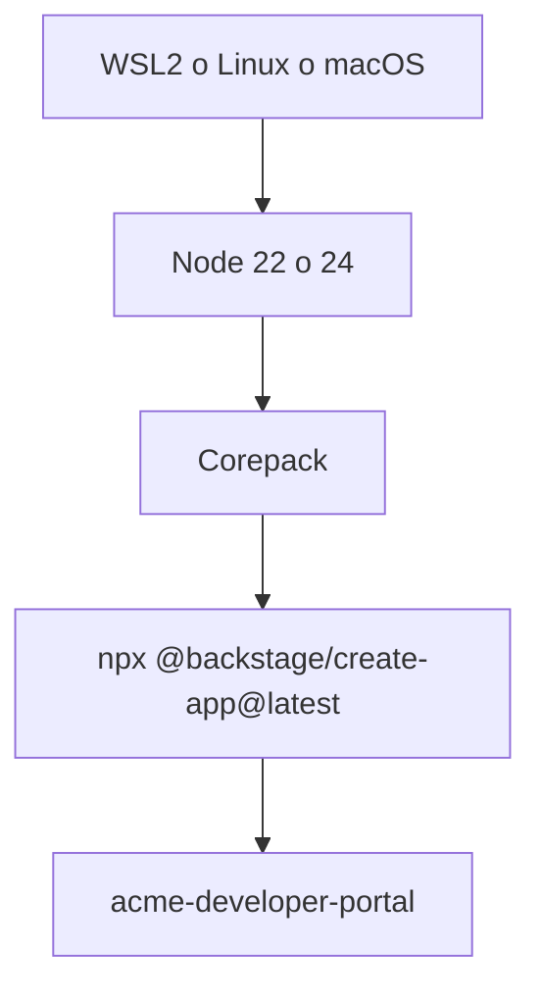

# Prerrequisitos

Tiempo estimado: 20 min
Nivel: Básico
Importancia para entrevista: MEDIO
Prioridad: ALTO

## 1. Objetivo

Dejar la máquina lista para `create-app` sin descubrir a mitad de instalación que Node o el sistema operativo no valen.

## 2. Prerrequisitos

Terminal bash. En Windows, WSL2 Ubuntu. Derechos para instalar Node y, más adelante, Docker.

## 3. Concepto

Backstage 1.55 pide:

- Node.js **22 o 24** (Active LTS). La guía oficial recomienda `nvm`.
- Yarn **4** mediante Corepack. No uses Yarn 1.
- git
- Disco: la guía pide un mínimo de 20 GB libres para una app con datos de demo. Con este curso basta menos, pero `node_modules` pesa.
- Memoria: la guía pide 6 GB como mínimo.
- Sistema: Linux, macOS o **WSL**. No prometas una instalación nativa en Windows. `better-sqlite3` y el toolchain de compilación son la causa.

La guía de getting started todavía dice "Yarn 4.4.1". El changelog de `@backstage/create-app` dice que las apps **nuevas** usan Yarn **4.13.0** y `npmMinimalAgeGate: 3d` (no instala paquetes npm publicados hace menos de 3 días, salvo `@backstage/*`). Las dos frases son ciertas y hablan de cosas distintas. Tú no fijas la versión a mano: `create-app` escribe `packageManager` en el `package.json`.

Docker no hace falta para el lab 01. Hace falta para TechDocs con generador Docker, para Grafana y para Kubernetes.

## 4. ¿Por qué existe?

`create-app` compila addons nativos y baja cientos de paquetes. Un Node 18 o un Yarn classic falla con errores que parecen de Backstage y no lo son.

## 5. Arquitectura



## 6. Ejemplo real

Vas a crear la app **al lado** de este material, no dentro de `docs/`:

```text
backstage/                         <- este repo, el curso
  docs/backstage-course/
  acme-developer-portal/           <- lo genera el lab siguiente
    packages/app
    packages/backend
    catalog/                       <- lo copias tú
```

Si este repo ya se llama `backstage`, crea la app aquí dentro. El catálogo del curso se copia a `acme-developer-portal/catalog`.

## 7. Laboratorio

Objetivo: comprobar versiones antes de crear la app.

Dónde: WSL, en cualquier carpeta.

```bash
node -v
npm -v
git --version
corepack --version
```

Qué hace cada uno: imprime la herramienta. No instala Backstage.

Resultado esperado:

- `node -v` → `v22.*` o `v24.*`
- `corepack --version` existe (viene con Node moderno)
- `git --version` imprime una versión

Si Node no es 22 ni 24:

```bash
# con nvm ya instalado
nvm install 22
nvm use 22
node -v
```

Activa Corepack:

```bash
corepack enable
```

No ejecutes `yarn set version 4.4.1` en el directorio del curso. No hay un `package.json` de Backstage todavía, y la app nueva trae su propia versión de Yarn.

Comprueba disco y que no tienes ya algo en los puertos del lab:

```bash
df -h .
ss -ltnp | grep -E ':3000|:7007' || true
```

`ss` puede no existir. Alternativa: `lsof -i :3000` o, en PowerShell fuera de WSL, no mezcles. Quédate en WSL.

## 8. Validación

`node -v` muestra 22 o 24. `corepack enable` termina sin error. Anotas el sistema: WSL2, Linux o macOS.

## 9. Troubleshooting

### `node: command not found` dentro de WSL y en Windows sí existe

¿Por qué ocurre? Son dos Node distintos. El de Windows no está en el PATH de Ubuntu.
¿Cómo diagnosticarlo? `which node` dentro de WSL.
¿Cómo solucionarlo? Instala Node 22 dentro de WSL con nvm. No llames al `node.exe` de Windows desde un path `/mnt/c`.

### `better-sqlite3` o `node-gyp` fallan más adelante

¿Por qué ocurre? Faltan compiladores, o estás en Windows nativo.
¿Cómo diagnosticarlo? El log menciona `node-gyp`, `make` o `MSBuild`.
¿Cómo solucionarlo? En Ubuntu/WSL: `sudo apt-get update && sudo apt-get install -y build-essential python3`. Vuelve a correr el lab de instalación desde cero en WSL.

### Corepack pide una versión de Yarn y se queda esperando

¿Por qué ocurre? Corepack quiere descargar Yarn y la red o la firma no acompañan.
¿Cómo diagnosticarlo? Lee si el error es de red o de "packageManager".
¿Cómo solucionarlo? Este paso solo necesita `corepack enable`. La descarga de Yarn ocurre dentro de `create-app`. Si falla ahí, reintenta con red y sin proxy corporativo interceptando npm.

## 10. Ejercicio

Escribe la diferencia entre el Node de Windows y el Node de WSL, y por qué este curso exige uno de los dos.

## 11. Preguntas de entrevista

### ¿Qué runtime pide Backstage?

Respuesta corta: Node 22 o 24, Yarn 4, una app generada con `create-app`.

Explicación: no es un `npm install -g @backstage/cli` suelto para tener el portal.

Qué mencionar: Yarn 4.13 en apps nuevas, la guía aún cita 4.4.1, no mezcles Yarn 1.

### ¿Por qué SQLite en local y Postgres después?

Respuesta corta: la app nueva arranca sin infraestructura. Producción necesita una base de verdad compartida.

Explicación: varios pods no pueden compartir el fichero SQLite.

Qué mencionar: lo verás en el módulo de producción. No digas que SQLite es el diseño final.

## 12. Conexión con arquitectura

- Microservicios: el portal es un servicio más, con su propio runtime Node.
- Platform Engineering: el equipo de plataforma fija la versión de Node del portal.
- DevOps: el Dockerfile de la app usará una imagen Node alineada.
- CI/CD: el pipeline del portal debe usar Node 22 o 24, la misma que en local.
- Cloud: nada de esto requiere AWS todavía.
- Developer Experience: un README de prerequisitos evita un día perdido en `node-gyp`.

## 13. Checklist

- [ ] Node 22 o 24 dentro de WSL o Linux o macOS
- [ ] Corepack habilitado
- [ ] Sé que no debo forzar Yarn 4.4.1
- [ ] Sé qué puertos voy a ocupar: 3000 y 7007
