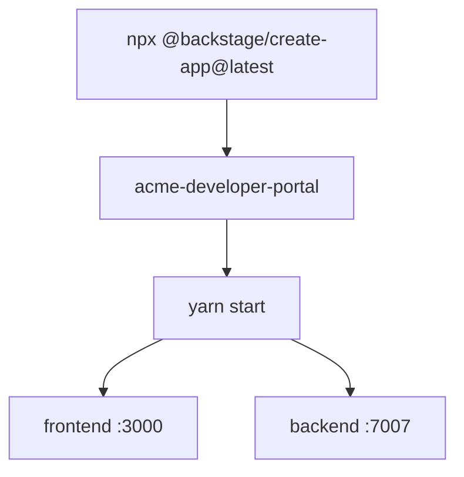

# Instalación — LAB 01

Tiempo estimado: 40 min
Nivel: Básico
Importancia para entrevista: CRÍTICO
Prioridad: CRÍTICO

## 1. Objetivo

Crear `acme-developer-portal` y abrirlo en http://localhost:3000.

## 2. Prerrequisitos

`02-installation/01-prerequisites.md` validado.

## 3. Concepto

`npx @backstage/create-app@latest` copia el template de app, instala dependencias con Yarn 4 y corre un chequeo de TypeScript. El nombre que escribas es el directorio.

La app incluye contenido de ejemplo. No es ACME todavía. El lab 02 sustituye ese contenido por el catálogo del curso.

`yarn start` ejecuta frontend y backend en la misma terminal. En el log verás procesos `[0]` y `[1]`. Cuando aparezca `Rspack compiled successfully`, el frontend está listo. Si el navegador no se abre solo, entra tú a la URL.

El usuario local por defecto es el **guest**: `user:development/guest`. Sirve para desarrollar. No sirve para producción.

## 4. ¿Por qué existe?

Instalar a mano el monorepo de Backstage es el modo contribuidor. Tú vas a operar un portal, así que usas `create-app`. Es el mismo criterio que `nest new`: un esqueleto opinado, no el repo del framework.

## 5. Arquitectura



## 6. Ejemplo real

El portal de ACME nace vacío de negocio y lleno de demo. Eso está bien durante veinte minutos. A partir del lab 02 la demo estorba y la quitas de `catalog.locations`.

## 7. Laboratorio

Objetivo: app creada y en marcha.

Dónde: la raíz de este repo (`backstage/`), dentro de WSL. Si tu ruta de Windows es `C:\Users\andre\Documents\Proyectos\backstage`, en WSL suele ser `/mnt/c/Users/andre/Documents/Proyectos/backstage`.

```bash
cd /mnt/c/Users/andre/Documents/Proyectos/backstage
npx @backstage/create-app@latest
```

Qué hace: descarga el CLI y pregunta el nombre.

Cuando pregunte:

```text
? Enter a name for the app [required]
```

escribe `acme-developer-portal`.

Si npm pregunta `ok to proceed?`, responde `y`.

Resultado esperado del comando: `Successfully created acme-developer-portal`. Tarda varios minutos. `yarn install` y `yarn tsc` forman parte del comando. No lo cortes.

Arranque:

```bash
cd acme-developer-portal
yarn start
```

Dónde: `acme-developer-portal/`.
Qué hace: levanta app y backend.
Resultado esperado: log con `Plugin initialization started` incluyendo `catalog`, `scaffolder`, `techdocs`, `auth`. Línea `Rspack compiled successfully`.

Abre http://localhost:3000

En otro terminal, si quieres ver el backend directo:

```bash
curl -s -o /dev/null -w "%{http_code}\n" http://localhost:7007/api/catalog/entities
```

Un `401` o `200` significa que el puerto responde. Un `000` o "connection refused" significa que el backend no arrancó. No uses este curl como prueba de negocio: la prueba es la UI.

Deja `yarn start` corriendo. Los labs siguientes recargan solos cuando cambias `app-config.yaml`. Si no recarga, paras con Ctrl+C y vuelves a `yarn start`.

### Versión

Dentro de `acme-developer-portal`:

```bash
node -p "require('@backstage/catalog-model/package.json').version"
```

Si esa ruta no resuelve, abre `package.json` de `packages/backend` y anota la versión de `@backstage/plugin-catalog-backend`. Tiene que ser **1.55.x** si `@latest` sigue apuntando a la estable de octubre de 2026. Si te instaló 1.56.0 o superior, el curso sigue siendo válido en catálogo y scaffolder; contrasta los breaking changes del release antes de copiar un snippet.

## 8. Validación

- http://localhost:3000 muestra Backstage
- Puedes abrir Catalog y ver entidades de ejemplo (no tienen que ser ACME)
- El log no está en un crash loop de `better-sqlite3`

## 9. Troubleshooting

### `EADDRINUSE` en 3000 o 7007

¿Por qué ocurre? Otro proceso ya escucha.
¿Cómo diagnosticarlo? `ss -ltnp | grep -E ':3000|:7007'`
¿Cómo solucionarlo? Para el otro proceso. No cambies el puerto en el primer lab: el resto del curso asume 3000 y 7007.

### `yarn` es la versión 1.x

¿Por qué ocurre? Hay un Yarn global viejo y Corepack no está activo en esa shell.
¿Cómo diagnosticarlo? `yarn --version` dentro de `acme-developer-portal`. Tiene que ser 4.x, idealmente 4.13.x.
¿Cómo solucionarlo? `corepack enable`, abre una shell nueva, entra al directorio de la app y usa el Yarn del `packageManager`. Si la app se creó a medias, borra el directorio y repite `create-app`.

### La instalación se cae en `isolated-vm` o `better-sqlite3`

¿Por qué ocurre? Módulo nativo sin toolchain, o Windows nativo.
¿Cómo diagnosticarlo? Sube en el log hasta el primer `gyp ERR`.
¿Cómo solucionarlo? Toolchain de build en WSL (`build-essential`, `python3`) y repetir. No copies `node_modules` desde Windows.

### El navegador no se abre y crees que falló

¿Por qué ocurre? El dev server no siempre lanza el browser.
¿Cómo diagnosticarlo? Busca `Rspack compiled successfully`.
¿Cómo solucionarlo? Abre http://localhost:3000 a mano.

### `npmMinimalAgeGate` rechaza un paquete

¿Por qué ocurre? Yarn 4.13 bloquea paquetes npm con menos de 3 días, excepto `@backstage/*`.
¿Cómo diagnosticarlo? El error nombra `npmMinimalAgeGate`.
¿Cómo solucionarlo? Espera, o entiende el ajuste en `.yarnrc.yml`. No lo desactives "para que compile" sin saber qué paquete te bloqueó. Es una defensa de supply chain.

## 10. Ejercicio

Para `yarn start` con Ctrl+C. Vuelve a arrancarlo. Di qué proceso tarda más en estar listo y por qué el frontend puede compilar antes de que el catálogo responda.

## 11. Preguntas de entrevista

### ¿Cómo se instala Backstage?

Respuesta corta: `npx @backstage/create-app@latest`, luego `yarn start`.

Explicación: genera `packages/app` y `packages/backend`, instala con Yarn 4 y deja SQLite para local.

Qué mencionar: Node 22 o 24, no Yarn 1, guest auth, puertos 3000 y 7007.

### ¿Qué es el guest user?

Respuesta corta: un usuario de desarrollo, `user:development/guest`, sin proveedor real.

Explicación: el backend de auth firma un token para ese usuario. En el log verás `Issuing token for user: development/guest`.

Qué mencionar: en producción se apaga. Lo verás en el módulo de seguridad.

## 12. Conexión con arquitectura

- Microservicios: el portal ya es un proceso desplegable, todavía en tu laptop.
- Platform Engineering: esta app es el esqueleto del producto interno.
- DevOps: todavía no hay pipeline. El Dockerfile ya viene generado.
- CI/CD: no lo configures hoy.
- Cloud: local.
- Developer Experience: el primer valor es ver la UI. El valor de negocio empieza al registrar ACME.

## 13. Checklist

- [ ] Existe `acme-developer-portal/`
- [ ] `yarn start` deja la UI en http://localhost:3000
- [ ] Sé qué es el guest
- [ ] Anoté la versión de catálogo que se instaló
