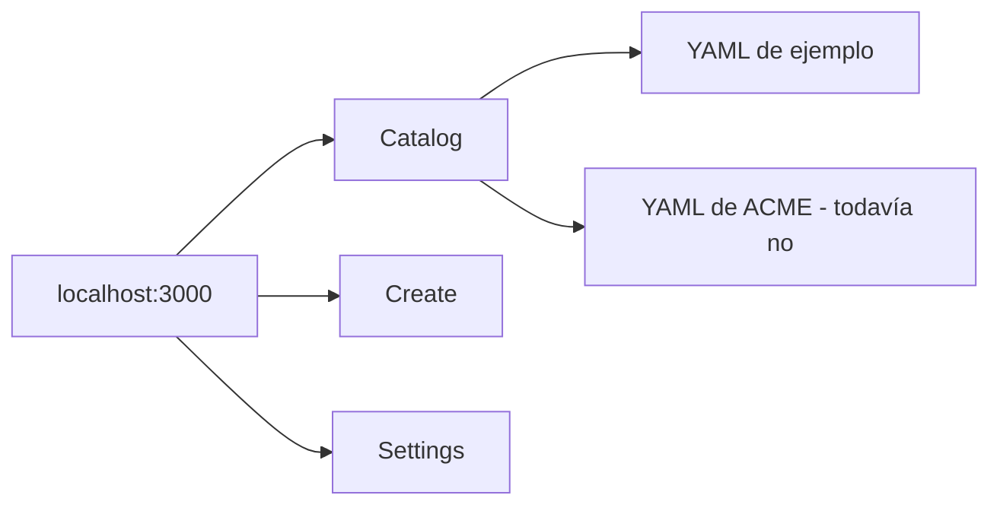

# El primer proyecto

Tiempo estimado: 20 min
Nivel: Básico
Importancia para entrevista: ALTO
Prioridad: ALTO

## 1. Objetivo

Recorrer la UI nueva y reconocer qué es demo y qué vas a reemplazar por ACME.

## 2. Prerrequisitos

Lab 01 en marcha.

## 3. Concepto

La app nueva trae un catálogo de ejemplo apuntando a ficheros del propio paquete, más la entidad de la propia app. También trae templates de ejemplo en Create. No son el golden path de ACME. Los vas a dejar de registrar cuando el catálogo ACME esté cargado, para no mezclar "artist-web" con `ms-orders`.

Guest entra sin password. Settings muestra el usuario. Catalog lista entidades. Create lista templates. Docs aparece dentro de una entidad que tenga TechDocs, no como un wiki global vacío.

## 4. ¿Por qué existe?

Si no distingues la demo, en la entrevista dirás que Backstage "ya trae microservicios". No. Trae ejemplos para que la UI no esté vacía.

## 5. Arquitectura

## 6. Ejemplo real

Dentro de un rato Catalog debe mostrar `ms-auth`, `ms-orders`, `ms-payments`, tres APIs, tres resources, dos systems, un domain y tres grupos. Si todavía ves solo la demo, el lab 02 no está hecho. Si ves las dos cosas, te falta quitar el `location` de ejemplo.

## 7. Laboratorio

Objetivo: inventario de la UI.

Dónde: el navegador, con `yarn start` corriendo.

1. Abre http://localhost:3000
2. Entra a **Catalog**. Cuenta cuántas entidades hay. Anota un `kind` que veas (Component, API, etc.).
3. Abre una entidad. Busca el campo Owner.
4. Entra a **Create**. Anota el nombre de un template de ejemplo. No lo ejecutes contra GitHub: no tienes token y no es el template de ACME.
5. Abre **Settings** y anota la identidad. Tiene que parecerse a `guest`.

Escribe esas cuatro notas en `notas-lab-00.md`.

## 8. Validación

Puedes decir, sin mirar: dónde está el catálogo, dónde se crea un componente y con qué usuario entraste.

## 9. Troubleshooting

### La página queda en blanco

¿Por qué ocurre? El frontend compiló con error o el backend no responde y la UI no maneja el fallo.
¿Cómo diagnosticarlo? Consola del navegador y la terminal de `yarn start`.
¿Cómo solucionarlo? El primer error de la terminal manda. No recargues diez veces.

### Create está vacío

¿Por qué ocurre? El backend de scaffolder no arrancó o los templates de ejemplo no se registraron.
¿Cómo diagnosticarlo? Busca `scaffolder` en el log de arranque.
¿Cómo solucionarlo? Reinicia `yarn start`. Si el log muestra un error de config, léelo antes de cambiar YAML.

### No veo Docs en el menú principal

¿Por qué ocurre? TechDocs se abre desde la entidad, no siempre como un sitio suelto.
¿Cómo diagnosticarlo? Abre un component de la demo y busca la pestaña Docs.
¿Cómo solucionarlo? No es un fallo. En ACME las docs de `ms-orders` se abren igual: desde su ficha.

## 10. Ejercicio

Dibuja qué menús vas a usar en la entrevista en vivo si te piden "enséñame el servicio y su dueño".

## 11. Preguntas de entrevista

### ¿Qué trae `create-app`?

Respuesta corta: frontend, backend, config, catálogo de ejemplo, auth guest y plugins base.

Explicación: es un punto de partida, no el modelo de tu empresa.

Qué mencionar: el trabajo real es sustituir locations, auth y templates.

## 12. Conexión con arquitectura

- Microservicios: todavía no están modelados.
- Platform Engineering: la demo es el "hello world" del producto.
- DevOps: sin pipeline.
- CI/CD: sin pipeline.
- Cloud: local.
- Developer Experience: la navegación que vas a defender es Catalog → entidad → relaciones → docs.

## 13. Checklist

- [ ] Entré al Catalog
- [ ] Vi Create
- [ ] Sé que soy guest
- [ ] Sé que la demo se va a sustituir
