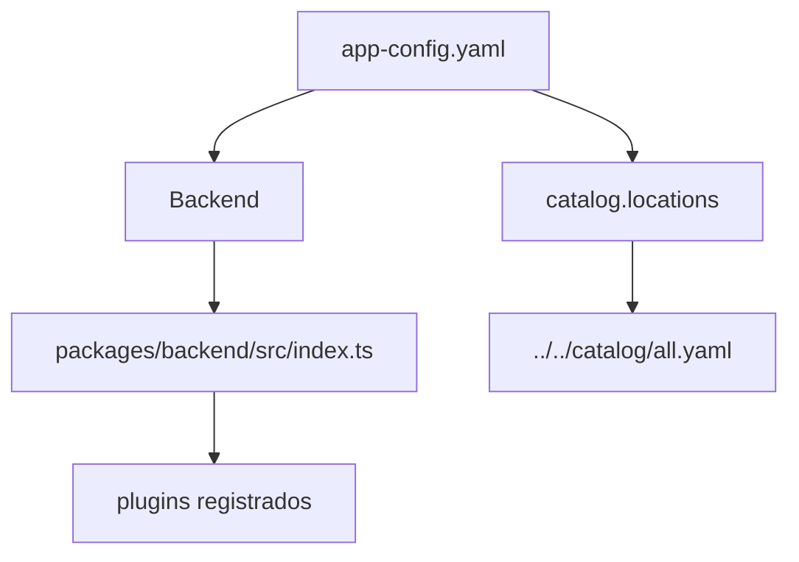

# Entender el proyecto

Tiempo estimado: 25 min
Nivel: Intermedio
Importancia para entrevista: CRÍTICO
Prioridad: CRÍTICO

## 1. Objetivo

Leer el árbol de `acme-developer-portal` y saber qué archivo tocar para cada cambio de los labs siguientes.

## 2. Prerrequisitos

Lab 01.

## 3. Concepto

Árbol que vas a usar:

```text
acme-developer-portal/
  app-config.yaml          # config commiteable, sin secretos
  app-config.local.yaml    # gitignored, secretos locales
  catalog-info.yaml        # la propia app como componente
  packages/app/            # frontend
  packages/backend/        # backend, incluido src/index.ts
  Dockerfile               # imagen de producción del portal
```

A partir del lab 02 también:

```text
acme-developer-portal/catalog/    # copia del catálogo ACME
```

Los paths de `catalog.locations` son relativos al directorio de trabajo del backend, que es `packages/backend`. Por eso un fichero en `acme-developer-portal/catalog/all.yaml` se apunta como `../../catalog/all.yaml`.

El backend nuevo se arma en `packages/backend/src/index.ts` con `createBackend()` y `backend.add(import('...'))`. Ahí registrarás el plugin del lab 14.

No añadas dependencias al `package.json` de la raíz. Yarn workspaces: cada paquete instala lo suyo.

## 4. ¿Por qué existe?

La mayoría de fallos de catalog del primer día son un path relativo mal contado, no un YAML inválido.

## 5. Arquitectura



## 6. Ejemplo real

Para ACME vas a tocar, en orden:

1. `app-config.yaml` → rules y location
2. `catalog/` → entidades
3. `packages/backend/src/index.ts` → plugin de salud
4. `app-config.local.yaml` → token de GitHub, cuando exista

No vas a tocar el código de React del catálogo. El catálogo ya sabe pintar un Component.

## 7. Laboratorio

Objetivo: comprobar el path y leer el arranque del backend.

Dónde: `acme-developer-portal/`.

```bash
cd acme-developer-portal
find . -maxdepth 3 -type d -not -path './node_modules*' -not -path './.yarn*' | sort
```

Qué hace: lista el árbol de primer y segundo nivel, sin `node_modules`.

Abre `packages/backend/src/index.ts`. Localiza `createBackend` y la lista de `backend.add`. Anota tres plugins que veas: tienen que incluir catalog y scaffolder.

Abre `app-config.yaml`. Busca `catalog:`. No lo edites todavía. Confirma que hay una clave `locations`.

Copia el catálogo del curso:

```bash
cd /mnt/c/Users/andre/Documents/Proyectos/backstage
cp -a docs/backstage-course/labs/catalog acme-developer-portal/catalog
test -f acme-developer-portal/catalog/all.yaml && echo "catalog listo"
```

Qué hace: copia YAML, template y docs de `ms-orders`. No registra nada todavía. El backend sigue sirviendo la demo hasta que cambies `app-config.yaml` en el capítulo siguiente.

Resultado esperado: la línea `catalog listo`.

## 8. Validación

Desde `packages/backend` el fichero existe:

```bash
cd acme-developer-portal/packages/backend
test -f ../../catalog/all.yaml && echo "path relativo correcto"
```

Ese `test` es la prueba del path que vas a poner en la config. Si falla, no edites `app-config.yaml` todavía: estás en otro directorio.

## 9. Troubleshooting

### `cp -a` desde Git Bash en Windows no está en `/mnt/c`

¿Por qué ocurre? Git Bash usa `/c/Users/...`, no `/mnt/c`.
¿Cómo diagnosticarlo? `pwd`.
¿Cómo solucionarlo? Usa la ruta que `pwd` imprime. El resto de comandos del curso asume bash. WSL y Git Bash sirven si el path es el de esa shell.

### Edité `app-config.yaml` y ahora no arranca

¿Por qué ocurre? YAML inválido, o una clave que ningún plugin declara.
¿Cómo diagnosticarlo? El log dice `schema` o `YAMLException`, con la línea.
¿Cómo solucionarlo? Revierte el archivo (`git checkout -- app-config.yaml` dentro de la app) y espera al capítulo de catálogo, que trae el bloque completo.

### Añadí una dependencia en el `package.json` raíz

¿Por qué ocurre? El reflejo de un repo Node normal.
¿Cómo diagnosticarlo? `create-app` te lo advierte en el README generado.
¿Cómo solucionarlo? Instala dentro del workspace: `yarn workspace backend add ...` o `yarn --cwd packages/backend add ...`.

## 10. Ejercicio

Sin abrir el fichero, di la ruta relativa desde `packages/backend` hasta `catalog/all.yaml`. Luego compruébala con `test -f`.

## 11. Preguntas de entrevista

### ¿Dónde se registra un plugin de backend?

Respuesta corta: en `packages/backend/src/index.ts`, con `backend.add(import('@internal/plugin-...'))`.

Explicación: el nuevo backend system no usa un `createRouter` central escrito a mano para cada plugin. Cada paquete exporta el plugin por defecto.

Qué mencionar: el pluginId acaba siendo el prefijo `/api/<pluginId>`.

### ¿Dónde se apunta el catálogo?

Respuesta corta: `catalog.locations` en `app-config.yaml`.

Explicación: un location `file` lee un YAML local. Ese YAML puede ser una entidad o un `Location` con `spec.targets`.

Qué mencionar: el path es relativo a `packages/backend`.

## 12. Conexión con arquitectura

- Microservicios: el catálogo es data, no código de negocio.
- Platform Engineering: la config es el contrato operativo del portal.
- DevOps: el Dockerfile de la raíz es el del portal.
- CI/CD: el portal tendrá su pipeline. Los servicios tendrán otro, generado por el template.
- Cloud: `app-config.production.yaml` será el que apunte a Postgres y al IdP.
- Developer Experience: un sitio predecible para "¿dónde registro esto?".

## 13. Checklist

- [ ] Vi `createBackend` en el index del backend
- [ ] Entiendo el path `../../catalog/all.yaml`
- [ ] Copié `catalog/` dentro de la app
- [ ] No metí secretos en `app-config.yaml`
