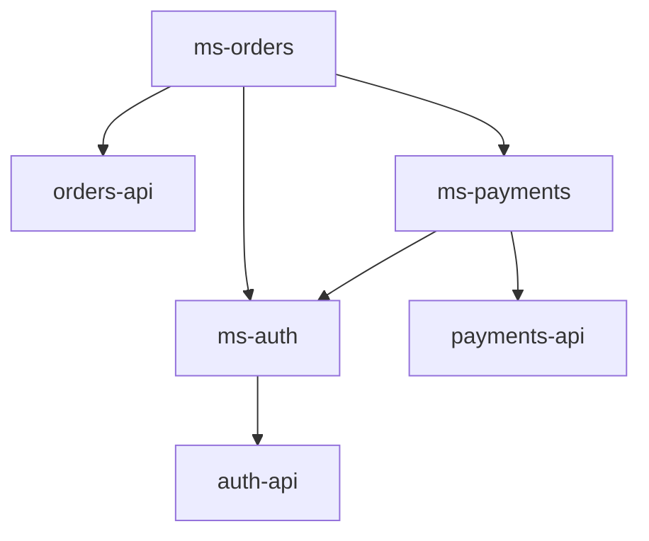

# Components — LAB 02 y LAB 03

Tiempo estimado: 45 min
Nivel: Básico
Importancia para entrevista: CRÍTICO
Prioridad: CRÍTICO

## 1. Objetivo

Registrar `ms-auth` y, después, los tres microservicios, y leer `catalog-info.yaml` línea por línea.

## 2. Prerrequisitos

`03-software-catalog/01-catalog.md` aplicado. `ms-auth` visible o el location listo para apuntarle.

## 3. Concepto

Un **Component** es una unidad de software que un desarrollador reconoce: un servicio, una web, una librería. En ACME los tres NestJS son `spec.type: service`.

Campos que siempre te preguntan:

| Campo | Rol |
| --- | --- |
| `apiVersion` | `backstage.io/v1alpha1`. No es `v1`. El formato sigue en alpha a propósito. |
| `kind` | `Component` |
| `metadata.name` | Identidad. Única por kind y namespace. `ms-auth` |
| `metadata.description` | Una frase para un humano que no es el autor |
| `spec.type` | Taxonomía. `service` para estos tres |
| `spec.lifecycle` | `experimental`, `production` o `deprecated`. ACME usa `production` en los tres actuales |
| `spec.owner` | El equipo responsable. Un solo dueño |
| `spec.system` | A qué sistema pertenece |
| `spec.providesApis` | APIs que este servicio implementa |
| `spec.consumesApis` | APIs que llama |
| `spec.dependsOn` | Resources u otros componentes que necesita |

`owner` no es seguridad. La documentación del catálogo lo dice: sirve para saber a quién llamar. No autoriza un deploy.

## 4. ¿Por qué existe?

Sin un kind Component, "servicio", "librería" y "la web" serían texto libre. Los plugins (Kubernetes, GitHub, TechDocs) se enganchan a anotaciones de un Component, no a un README.

## 5. Arquitectura



Esas flechas salen de `providesApis`, `consumesApis` y `dependsOn`. No las dibujas en la UI.

## 6. Ejemplo real

`ms-auth.yaml` completo está en `labs/catalog/components/ms-auth.yaml`. Lectura:

```yaml
apiVersion: backstage.io/v1alpha1   # formato de entidad Backstage
kind: Component                     # esto es software, no una base ni un equipo
metadata:
  name: ms-auth                     # id estable, minúsculas
  description: Emite y valida tokens de los clientes ACME
  annotations:
    github.com/project-slug: acme/ms-auth
    # el plugin de GitHub usa esto para abrir el repo correcto
    backstage.io/kubernetes-id: ms-auth
    # tiene que coincidir con el label del Deployment
    backstage.io/kubernetes-namespace: acme
spec:
  type: service
  lifecycle: production
  owner: platform-team              # Group, namespace default
  system: identity-platform
  providesApis:
    - auth-api                      # kind API por defecto en este campo
  dependsOn:
    - resource:default/acme-postgres
    - resource:default/acme-redis
```

`ms-orders` además consume `auth-api` y `payments-api`, y depende de `ms-auth` y `ms-payments`. El grafo de la ficha es el de arriba.

La anotación `github.com/project-slug` no crea el repo. Dice cuál es. Si el repo no existe, el plugin de GitHub mostrará un error en esa ficha y el resto del catálogo sigue bien.

## 7. Laboratorio

### LAB 02 — solo ms-auth

Objetivo: una entidad, leída línea a línea, visible en la UI.

Preparación: el `app-config.yaml` del capítulo anterior ya apunta a `../../catalog/components/ms-auth.yaml`. Si no, pon esa location ahora.

Dónde: navegador.

1. Abre http://localhost:3000/catalog
2. Abre `ms-auth`
3. Contrasta cada campo de la pantalla con el YAML. Owner, lifecycle, type, description.

Resultado esperado: la ficha de `ms-auth`.

### LAB 03 — los tres servicios

Objetivo: ver relaciones entre componentes.

Dónde: `acme-developer-portal/app-config.yaml`.

Cambia el target:

```yaml
catalog:
  locations:
    - type: file
      target: ../../catalog/components/services.yaml
```

`services.yaml` es un Location que incluye `ms-auth.yaml`, `ms-orders/catalog-info.yaml` y `ms-payments.yaml`.

Reinicia si hace falta:

```bash
cd acme-developer-portal
yarn start
```

En la UI abre `ms-orders` → pestaña de relaciones (Depends on / Dependency of, el nombre exacto depende del tema). Tienes que ver `ms-auth` y `ms-payments`.

Las APIs y los resources todavía no están ingeridos. Verás referencias a `orders-api` o a `acme-kafka` sin ficha destino. El capítulo de APIs y el de resources las cargan. No las "arregles" borrando el `dependsOn`.

## 8. Validación

Catalog filtrado por tipo service: tres filas, `ms-auth`, `ms-orders`, `ms-payments`.

En `ms-orders`, la relación hacia `ms-payments` existe.

## 9. Troubleshooting

### Duplicated entity `ms-auth`

¿Por qué ocurre? La demo y tu location, o dos locations, registran el mismo name.
¿Cómo diagnosticarlo? El log dice `duplicate`.
¿Cómo solucionarlo? Una sola location. Quita la demo.

### `ms-orders` no aparece y `ms-auth` sí

¿Por qué ocurre? Sigues apuntando a `ms-auth.yaml` y no a `services.yaml`.
¿Cómo diagnosticarlo? Lee el `target` en `app-config.yaml`.
¿Cómo solucionarlo? El cambio del lab 03. El path de `services.yaml` es `components/services.yaml`, y sus targets son relativos a ese fichero.

### El nombre `MS-Auth` no entra

¿Por qué ocurre? El validador acepta mayúsculas, pero mezclar `MS-Auth` y `ms-auth` choca: la unicidad es case insensitive.
¿Cómo diagnosticarlo? Error de conflicto de entidad.
¿Cómo solucionarlo? Un solo nombre canónico en minúsculas: `ms-auth`.

### Relaciones vacías

¿Por qué ocurre? Abriste Overview y no la vista de grafo, o el procesador aún no terminó.
¿Cómo diagnosticarlo? Refresca a los pocos segundos. Busca la sección Relations.
¿Cómo solucionarlo? Espera el refresh. Si a los 30 segundos no está, mira errores en la ficha.

## 10. Ejercicio

Sin mirar el YAML, di qué `spec` pondrías en un `ms-inventory` que llama a `orders-api` y lo posee `commerce-team`. Escríbelo en un fichero aparte y no lo registres todavía.

## 11. Preguntas de entrevista

### ¿Qué es un Component?

Respuesta corta: la unidad de software del catálogo. En ACME, un microservicio NestJS.

Explicación: `type: service`, un owner, un lifecycle, y opcionalmente system, APIs y dependencias.

Qué mencionar: no es un pod ni un repo. Puede corresponder a un repo gracias a una anotación.

### ¿Cómo registrarías un microservicio?

Respuesta corta: un `catalog-info.yaml` en el repo y un location que lo ingiera.

Explicación: `kind: Component`, `spec.type: service`, `spec.owner` apuntando a un Group.

Qué mencionar: el YAML viaja en el mismo PR que el código.

### ¿Qué diferencia hay entre `dependsOn` y `consumesApis`?

Respuesta corta: `consumesApis` es un contrato. `dependsOn` es una dependencia de runtime o de otro componente.

Explicación: `ms-orders` consume `payments-api` y depende del componente `ms-payments` y del resource Kafka.

Qué mencionar: no uses uno como cajón de sastre.

## 12. Conexión con arquitectura

- Microservicios: el Component es el mapa del servicio, no el proceso.
- Platform Engineering: `type` y `lifecycle` son taxonomía de plataforma. No dejes que cada equipo invente `microservice`, `svc`, `backend`.
- DevOps: el lifecycle dice si algo se opera en serio.
- CI/CD: el slug de GitHub conecta el component con el pipeline, en un capítulo posterior.
- Cloud: el servicio puede correr en EKS. El Component no cambia por eso.
- Developer Experience: la ficha es la puerta de entrada al servicio.

## 13. Checklist

- [ ] Leí `ms-auth.yaml` línea por línea
- [ ] Los tres servicios están en el Catalog
- [ ] `ms-orders` muestra dependencia con `ms-payments`
- [ ] Puedo explicar owner, lifecycle y type
