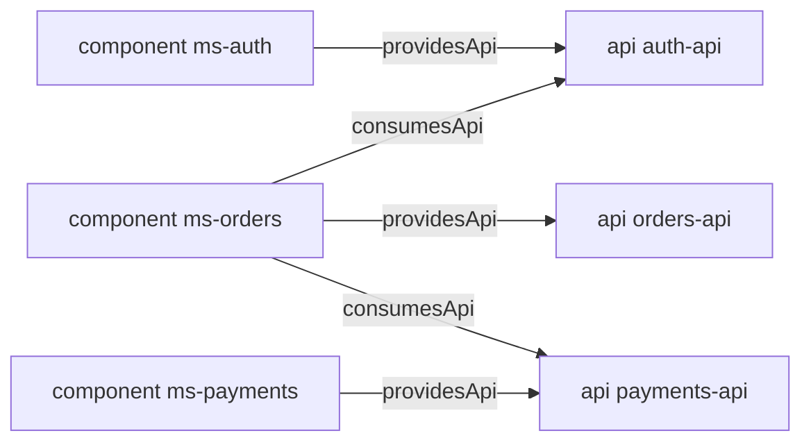

# APIs — LAB 04

Tiempo estimado: 30 min
Nivel: Básico
Importancia para entrevista: CRÍTICO
Prioridad: CRÍTICO

## 1. Objetivo

Registrar Auth API, Orders API y Payments API como entidades `API` con OpenAPI, y verlas conectadas a los servicios.

## 2. Prerrequisitos

Lab 03. Los tres Components existen.

## 3. Concepto

Una **API** en Backstage es el contrato, no el proceso que lo sirve. El proceso es el Component. El contrato es otro kind para que pueda tener dueño, lifecycle y visor propios.

`spec.type: openapi` le dice a la UI que pinte un visor OpenAPI. También existen `asyncapi`, `graphql` y `grpc`. Kafka en ACME no está modelado como AsyncAPI en este curso: está modelado como Resource. Si en una entrevista quieres ser fino, di que el topic podría ser además una API `asyncapi`. Aquí no hace falta para demostrar el concepto, y duplicarlo confunde el lab.

`spec.definition` lleva el contrato en texto. Tiene que incluir el server (`servers` en OpenAPI 3). Si no, algunos visores usan la URL de Backstage como base y el "Try it out" pega contra el portal.

La relación se cierra por los dos lados, pero basta con uno:

- el Component dice `providesApis: [orders-api]`
- la API no necesita repetir "me implementa ms-orders"

El procesador crea `providesApi` y `apiProvidedBy`.

## 4. ¿Por qué existe?

El README se desactualiza. El `catalog-info` del servicio no es un buen sitio para 400 líneas de OpenAPI, aunque puedes colgarlas ahí. Separar la entidad API deja que pagos sea dueño de `payments-api` aunque mañana haya dos implementaciones.

## 5. Arquitectura



## 6. Ejemplo real

`catalog/apis/orders-api.yaml` declara `POST /v1/orders` con respuesta `202`. Eso documenta la decisión de dominio: aceptar el pedido no es lo mismo que cobrarlo. El visor de Backstage muestra el contrato. La página de TechDocs, más adelante, explica el `202`.

## 7. Laboratorio

Objetivo: tres APIs visibles y enganchadas.

A partir de aquí el location pasa a ser el índice completo. Incluye servicios, APIs, resources, org, systems y el template. Los capítulos siguientes explican cada bloque. No borres entidades "porque todavía no toca": ya están bien formadas.

Dónde: `acme-developer-portal/app-config.yaml`.

```yaml
catalog:
  locations:
    - type: file
      target: ../../catalog/all.yaml
```

Reinicia `yarn start` si el location no recarga.

En la UI:

1. Catalog → filtra kind API, o busca `orders-api`.
2. Abre `orders-api`. Tiene que renderizar el OpenAPI (paths `/v1/orders`).
3. Busca la relación hacia `ms-orders` (provided by).
4. Abre `ms-orders` y confirma Provides y Consumes.

Repite el vistazo rápido a `auth-api` y `payments-api`.

## 8. Validación

Tres APIs. `orders-api` muestra `GET /v1/orders` y `POST /v1/orders`. `ms-orders` consume dos APIs y provee una.

## 9. Troubleshooting

### La API aparece como texto y no como visor

¿Por qué ocurre? `spec.type` no es `openapi`, o el `definition` no es OpenAPI válido.
¿Cómo diagnosticarlo? Abre el YAML y valida la indentación dentro del bloque `|`.
¿Cómo solucionarlo: usa los ficheros del curso. Un espacio de menos en `paths` rompe el parser del visor. La entidad puede existir igual y la pestaña Definition muestra el error.

### `providesApis` no enlaza

¿Por qué ocurre? El `metadata.name` de la API y el string del Component no coinciden, o la API no se ingerió.
¿Cómo diagnosticarlo? Compara `orders-api` en los dos ficheros. Mayúsculas importan en el sentido de que deben ser idénticos; el catálogo trata el conflicto de unicidad como case insensitive, así que no crees `Orders-API` y `orders-api`.
¿Cómo solucionarlo: un solo nombre, el del fichero del curso.

### El catálogo entero falla al cambiar a `all.yaml`

¿Por qué ocurre? Un fichero del índice tiene un error, o rules sin `Template` / `Group` / `User`.
¿Cómo diagnosticarlo? El log dice el path.
¿Cómo solucionarlo: rules del capítulo 01 de este módulo. Si un target no existe, copiaste `catalog/` a medias: repite el `cp -a`.

## 10. Ejercicio

¿Modelarías el topic `order.created` como API AsyncAPI o como Resource? Argumenta una opción y di qué perderías con la otra. No hace falta implementar las dos.

## 11. Preguntas de entrevista

### ¿Qué es una API en Backstage?

Respuesta corta: una entidad con el contrato, separada del servicio que lo implementa.

Explicación: `spec.type` elige el visor. `spec.definition` guarda el documento.

Qué mencionar: `providesApis` y `consumesApis` en el Component.

### ¿Dónde pongo el OpenAPI?

Respuesta corta: en `spec.definition`, o vía sustitución `$text` / `$yaml` si el fichero vive aparte.

Explicación: `$text: ./openapi.yaml` incrusta el fichero. En este curso va inline para que el lab sea un solo archivo.

Qué mencionar: si el origen es una URL externa, hay que permitir el host en `backend.reading.allow`.

## 12. Conexión con arquitectura

- Microservicios: el contrato es un artefacto de primer nivel, como lo tratarías en un diseño honesto.
- Platform Engineering: la taxonomía `openapi | asyncapi | grpc | graphql` la define plataforma.
- DevOps: el visor no sustituye un contract test. Lo enseña.
- CI/CD: el pipeline puede publicar el OpenAPI; el catálogo lo muestra.
- Cloud: el `servers.url` debería ser el host interno, no `localhost`, cuando hables de producción.
- Developer Experience: leer el contrato sin clonar el repo.

## 13. Checklist

- [ ] Registré las tres APIs vía `all.yaml`
- [ ] Vi el OpenAPI de `orders-api` en la UI
- [ ] `ms-orders` provee una API y consume dos
- [ ] Distingo Component y API
