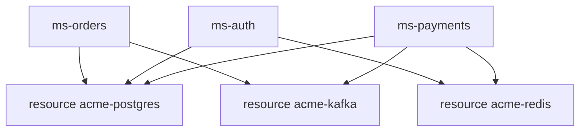

# Resources — LAB 05

Tiempo estimado: 25 min
Nivel: Básico
Importancia para entrevista: CRÍTICO
Prioridad: CRÍTICO

## 1. Objetivo

Registrar PostgreSQL, Redis y Kafka, y explicar qué es un Resource frente a un Component.

## 2. Prerrequisitos

Lab 04. `all.yaml` es el location activo.

## 3. Concepto

Un **Resource** es infraestructura de la que depende el software: base de datos, caché, broker, bucket, cluster. No es un repo de aplicación. No tiene Dockerfile en este modelo.

`spec.type` es texto. Este curso usa `database`, `cache` y `message-broker`. No son enums cerrados. En una empresa se acuerda la lista y se respeta. Si mañana un equipo escribe `postgres` y otro `database`, el filtro se rompe.

La relación nace en el Component:

```yaml
dependsOn:
  - resource:default/acme-postgres
```

El Resource no necesita declarar "de mí dependen estos servicios". Puedes hacerlo con `dependencyOf`, pero una sola dirección basta.

Kafka no está levantado en este laboratorio. El catálogo describe la dependencia. Levantar Kafka no enseña nada nuevo de Backstage. Por eso no hay un compose de Kafka en el curso.

## 4. ¿Por qué existe?

Si Postgres fuera un Component, parecería un servicio con repo y lifecycle de aplicación. El día que preguntes "¿qué software poseemos?" mezclas el broker con `ms-orders`. El kind existe para esa separación.

## 5. Arquitectura



## 6. Ejemplo real

`acme-postgres` es un motor compartido con un dueño de plataforma. Auth, orders y payments dependen de él. En la realidad cada uno tendría su base y su usuario. El catálogo de este curso no modela tres instancias porque no cambia la idea: el Resource es la infraestructura, el Component es el servicio. Si te preguntan cómo lo harías en serio, di: un Resource por base lógica, o un Resource cluster más anotaciones, y el owner del cluster es platform-team.

## 7. Laboratorio

Objetivo: ver los tres resources y la relación desde `ms-orders`.

No hay ficheros nuevos. `all.yaml` ya los incluye. Si tu location sigue en `services.yaml`, cámbialo a `../../catalog/all.yaml` como en el lab 04.

1. Catalog → busca `acme-kafka`. Kind Resource, type message-broker, owner platform-team.
2. Abre `ms-orders` → relaciones → `acme-postgres` y `acme-kafka`.
3. Abre `ms-auth` → `acme-postgres` y `acme-redis`. No debe depender de Kafka.

Resultado esperado: el grafo coincide con el diagrama.

## 8. Validación

Tres resources. `ms-payments` depende de los tres. `ms-auth` no depende de Kafka.

## 9. Troubleshooting

### El dependsOn no navega

¿Por qué ocurre? Escribiste `acme-postgres` sin kind y el default del campo no es Resource. En `dependsOn` el kind **no** tiene un único default: hay que poner `resource:` o `component:`.
¿Cómo diagnosticarlo? Compara con el YAML del curso: `resource:default/acme-postgres`.
¿Cómo solucionarlo: no uses el atajo que sí vale en `owner` o en `providesApis`.

### Quise levantar Postgres "para que la ficha se ponga verde"

¿Por qué ocurre? Confundes catálogo con health check.
¿Cómo diagnosticarlo? La ficha no tiene un ping a la base.
¿Cómo solucionarlo: el estado de runtime es el lab de observabilidad y el plugin de salud, no el kind Resource.

### Dos entities `acme-postgres`

¿Por qué ocurre? Copiaste el YAML y también lo pegaste dentro de `all.yaml` como documento, además del target.
¿Cómo diagnosticarlo? Error de duplicado.
¿Cómo solucionarlo: `all.yaml` solo tiene `targets`. No repitas la entidad.

## 10. Ejercicio

Clasifica: repositorio Git, cluster de Kubernetes, cola, servicio NestJS, esquema OpenAPI. ¿Component, API o Resource?

## 11. Preguntas de entrevista

### ¿Qué es un Resource?

Respuesta corta: infraestructura de la que el software depende.

Explicación: Postgres, Redis y Kafka en ACME. Type libre, owner obligatorio.

Qué mencionar: se enlaza con `dependsOn: resource:default/...`.

### ¿Diferencia entre Component y Resource?

Respuesta corta: Component es software que un equipo desarrolla. Resource es infraestructura que ese software usa.

Explicación: `ms-orders` se despliega desde un repo. `acme-kafka` no es ese repo.

Qué mencionar: un cluster de Kubernetes también puede ser un Resource (`type: kubernetes-cluster`) cuando el plugin lo usa como locator. Lo verás en el lab de Kubernetes.

## 12. Conexión con arquitectura

- Microservicios: las dependencias de datos y mensajería quedan explícitas.
- Platform Engineering: la taxonomía de `spec.type` es una decisión de plataforma.
- DevOps: el Resource no sustituye Terraform. Lo referencia.
- CI/CD: crear un Resource en el catálogo no provisiona la base.
- Cloud: RDS, ElastiCache y MSK serían los resources reales, con el mismo kind.
- Developer Experience: "¿orders toca Kafka?" se responde en la ficha.

## 13. Checklist

- [ ] Vi Postgres, Redis y Kafka en el Catalog
- [ ] Puedo decir por qué no son Components
- [ ] `ms-orders` depende de Postgres y Kafka
- [ ] Sé que el catálogo no hace health check de la base
