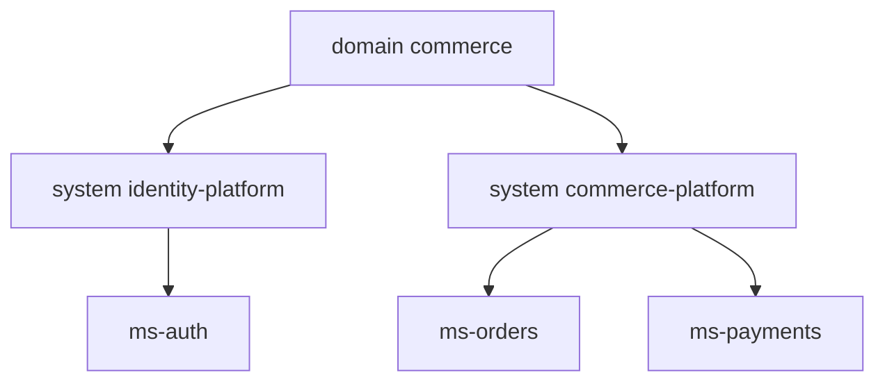

# Systems — LAB 06

Tiempo estimado: 20 min
Nivel: Intermedio
Importancia para entrevista: ALTO
Prioridad: CRÍTICO

## 1. Objetivo

Agrupar orders y payments en el system `commerce-platform`, y auth en `identity-platform`.

## 2. Prerrequisitos

Labs 03 a 05. `all.yaml` cargado.

## 3. Concepto

Un **System** es un conjunto de entidades que colaboran para una capacidad. No es un dominio de negocio completo y no es un equipo.

`commerce-platform` agrupa lo que hace falta para comprar: pedidos, pagos, el broker, la base. `identity-platform` agrupa la autenticación. Los dos declaran `spec.domain: commerce` porque, en esta empresa pequeña, identidad existe para el comercio. En una empresa grande, identidad sería otro domain. El modelo lo permite; ACME elige esta forma para que el lab quepa en una pantalla.

`spec.owner` del System es quien responde por el conjunto. Aquí es `platform-team`, aunque `ms-orders` lo posea `commerce-team`. No es una contradicción: el dueño del servicio y el dueño del sistema pueden ser distintos. El primero corrige bugs. El segundo responde por la capacidad.

## 4. ¿Por qué existe?

Con 3 servicios no impresiona. Con 500, "enséñame todo lo de pagos" no puede ser un filtro por prefijo `ms-`. El system es esa frontera.

## 5. Arquitectura

## 6. Ejemplo real

Ana abre el system `commerce-platform` y ve las partes: orders, payments, APIs, resources que declararon `spec.system: commerce-platform`. `ms-auth` no sale ahí. Sale en `identity-platform`. Si commerce necesita auth, la relación es `consumesApis: auth-api`, no "meter auth dentro de commerce-platform para verlo junto".

## 7. Laboratorio

Objetivo: ver los dos systems y sus partes.

1. Catalog → `commerce-platform`. Kind System.
2. Abre la ficha. Tiene que listar partes. Busca `ms-orders` y `ms-payments`.
3. Abre `identity-platform`. Tiene que aparecer `ms-auth`, no `ms-orders`.
4. Entra en `ms-orders` y confirma `spec.system` en la overview: commerce-platform.

No edites YAML salvo que falte una entidad. El fichero es `catalog/systems.yaml`.

## 8. Validación

Dos systems. Orders y payments cuelgan del de commerce. Auth cuelga del de identity.

## 9. Troubleshooting

### El system existe y no tiene partes

¿Por qué ocurre? Los components no tienen `spec.system`, o el nombre no coincide (`commerce` vs `commerce-platform`).
¿Cómo diagnosticarlo? Abre el YAML del component.
¿Cómo solucionarlo: el valor es `commerce-platform`, igual que `metadata.name` del System.

### Metí `ms-auth` dentro de commerce "porque orders lo llama"

¿Por qué ocurre? Confundes dependencia con pertenencia.
¿Cómo diagnosticarlo? ¿Auth se desplegaría y versionaría con el checkout?
¿Cómo solucionarlo: pertenencia es `spec.system`. Uso es `consumesApis` o `dependsOn`.

### El owner del system y el del servicio te parecen un bug

¿Por qué ocurre? Esperas un solo owner en toda la cadena.
¿Cómo diagnosticarlo? Lee los dos YAML.
¿Cómo solucionarlo: explícalo así en la entrevista. Es el modelo.

## 10. Ejercicio

Inventa un system `inventory-platform` de una frase. Di qué components meterías y cuál dejarías fuera aunque lo llamen por HTTP.

## 11. Preguntas de entrevista

### ¿Qué es un System?

Respuesta corta: un conjunto de componentes, APIs y resources que entregan una capacidad.

Explicación: `commerce-platform` junta orders y payments. Auth vive en otro system y se consume por API.

Qué mencionar: `spec.domain` opcional, `spec.owner` obligatorio, relación `partOf` / `hasPart`.

### ¿Cómo evitarías un catálogo inmanejable?

Respuesta corta: systems, domains, ownership y una taxonomía corta de types.

Explicación: el árbol domain → system → component escala mejor que una lista plana de 500 filas.

Qué mencionar: también locations por dominio y descubrimiento desde Git, no un YAML gigante editado a mano en el portal.

## 12. Conexión con arquitectura

- Microservicios: el system es la frontera de capacidad, parecida a un bounded context grande, no idéntica a un aggregate.
- Platform Engineering: plataforma define cuántos systems hay. No nacen solos por cada repo.
- DevOps: el system no es un namespace, aunque a menudo se alinean.
- CI/CD: cada component conserva su pipeline.
- Cloud: un system puede cruzar cuentas. El catálogo no lo impide.
- Developer Experience: una página para "todo lo de commerce".

## 13. Checklist

- [ ] Abrí `commerce-platform` y vi orders y payments
- [ ] Auth está en otro system
- [ ] Puedo explicar dos owners distintos en system y component
- [ ] No confundí dependencia con pertenencia
