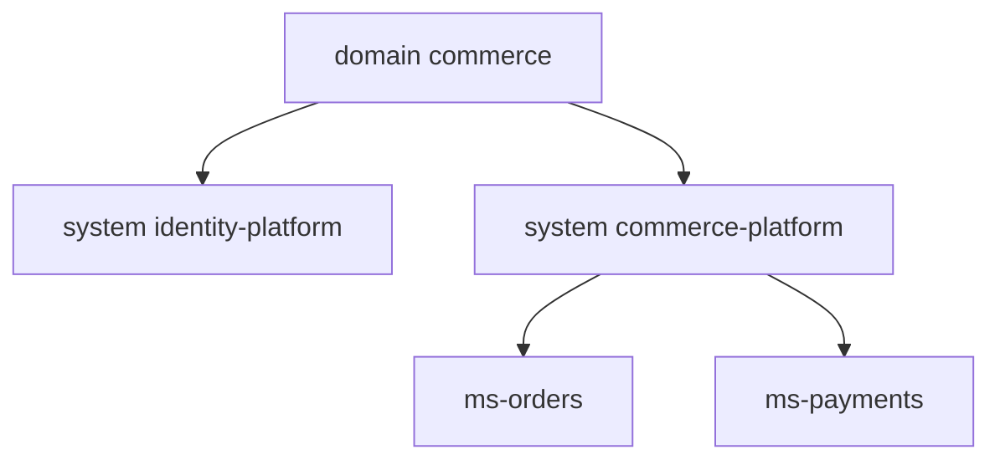

# Domains — LAB 06

Tiempo estimado: 15 min
Nivel: Intermedio
Importancia para entrevista: ALTO
Prioridad: ALTO

## 1. Objetivo

Entender el Domain `commerce` como el nivel de arriba del system, y cuándo no hace falta.

## 2. Prerrequisitos

Capítulo de systems.

## 3. Concepto

Un **Domain** agrupa systems. Responde a "¿de qué parte del negocio es esto?". `spec.owner` es obligatorio. En ACME el owner es `platform-team` porque la empresa ficticia es pequeña y plataforma custodia el mapa. En una empresa real el owner del domain commerce sería el directorio de ese negocio, no necesariamente el equipo que opera el portal.

ACME tiene un solo domain a propósito. Crear `domain: payments` además de `system: commerce-platform` sería jerarquía decorativa.

## 4. ¿Por qué existe?

Systems sueltos no dicen si `identity-platform` existe para el comercio, para el backoffice o para un producto distinto. El domain es esa etiqueta de negocio.

Con 500 microservicios y 40 systems, el domain es lo que un director pregunta. El component es lo que un desarrollador abre.

## 5. Arquitectura



## 6. Ejemplo real

`catalog/domains.yaml`:

```yaml
apiVersion: backstage.io/v1alpha1
kind: Domain
metadata:
  name: commerce
spec:
  owner: platform-team
```

Los systems apuntan `domain: commerce`. Esa cadena es la que la UI muestra como Has systems / Has parts.

## 7. Laboratorio

Objetivo: abrir el domain y bajar hasta un servicio sin usar el buscador.

1. Catalog → `commerce` → confirma kind Domain.
2. Entra a `commerce-platform` desde esa ficha.
3. Entra a `ms-orders` desde el system.
4. Vuelve atrás y entra a `identity-platform`. Baja a `ms-auth`.

Si no puedes bajar, el `spec.domain` del system no coincide con `metadata.name` del domain.

## 8. Validación

Un domain, dos systems debajo, y desde cada system llegas a su servicio.

## 9. Troubleshooting

### El domain no lista systems

¿Por qué ocurre? `spec.domain` ausente o con otro nombre.
¿Cómo diagnosticarlo? `catalog/systems.yaml`.
¿Cómo solucionarlo: `domain: commerce`.

### Quiero un domain por equipo

¿Por qué ocurre? Mezclas org chart y negocio.
¿Cómo diagnosticarlo? ¿Payments-team es una capacidad de negocio o un grupo de personas?
¿Cómo solucionarlo: el equipo es un Group. El domain es negocio. Se relacionan porque los components del domain tienen owners que son groups.

### Creé domains de más "para que se vea enterprise"

¿Por qué ocurre? El diagrama de la entrevista tienta a inflar.
¿Cómo diagnosticarlo? ¿Puedes explicar una decisión que cambie si ese domain no existiera?
¿Cómo solucionarlo: un domain. Dilo como trade-off, no como limitación del producto.

## 10. Ejercicio

¿En qué momento de ACME crearías el domain `corporate` para facturación interna? Escribe el criterio, no el YAML.

## 11. Preguntas de entrevista

### ¿Qué es un Domain?

Respuesta corta: el agrupador de systems según el negocio.

Explicación: commerce contiene identity-platform y commerce-platform.

Qué mencionar: owner obligatorio. No es un equipo.

### ¿Domain o System?

Respuesta corta: system es la capacidad técnica. Domain es el área de negocio que la contiene.

Explicación: orders no es un domain. Es un component dentro de commerce-platform, dentro de commerce.

Qué mencionar: con pocos sistemas, un domain puede bastar. No copies una jerarquía de consultora.

## 12. Conexión con arquitectura

- Microservicios: el domain no parte el despliegue.
- Platform Engineering: evita que cada equipo cree su propio portal.
- DevOps: no cambia pipelines.
- CI/CD: no cambia pipelines.
- Cloud: un domain puede cruzar varias cuentas.
- Developer Experience: dos clics desde el negocio hasta el servicio.

## 13. Checklist

- [ ] Abrí el domain commerce
- [ ] Bajé hasta `ms-orders` y hasta `ms-auth`
- [ ] Distingo domain, system y group
- [ ] Puedo justificar un solo domain en ACME
