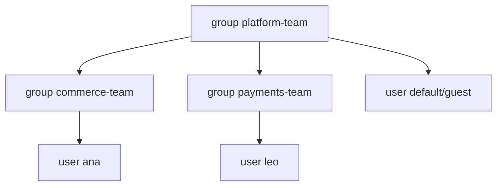

# Users y Groups — LAB 07

Tiempo estimado: 25 min
Nivel: Intermedio
Importancia para entrevista: CRÍTICO
Prioridad: CRÍTICO

## 1. Objetivo

Cargar `platform-team`, `commerce-team` y `payments-team`, con personas dentro, y entender que esto no es el login de producción.

## 2. Prerrequisitos

`all.yaml` activo. Rules que permiten `User` y `Group`.

## 3. Concepto

Un **Group** es un equipo. Un **User** es una persona. El org chart del catálogo responde "¿quién es el dueño?", no "¿quién puede entrar a Backstage?".

El login lo resuelve el plugin de auth (guest, GitHub, Okta, Entra ID). El catálogo puede ingerir los mismos usuarios desde el IdP para que el owner apunte a una entidad real. En este lab los usuarios están escritos a mano en `org.yaml`. Es válido para aprender. En una empresa de 500 personas no se mantiene a mano: se sincroniza.

Campos que el procesador exige en un Group:

- `spec.type`: en ACME, `team`
- `spec.children`: lista de subgrupos. Puede ser `[]`. Si falta, la entidad no pasa la validación
- `spec.members`: usuarios, opcional pero aquí lo usamos
- `spec.parent`: opcional. Commerce y payments cuelgan de platform

Un User tiene `spec.memberOf` y `spec.profile`.

El usuario con el que entras (`user:development/guest`) **no** es automáticamente `user:default/guest`. El namespace `development` es el del proveedor guest. El YAML crea `user:default/guest` para que el equipo de plataforma tenga un miembro visible. No son la misma entidad. Dilo en la entrevista si te preguntan por qué "guest" aparece dos veces.

## 4. ¿Por qué existe?

`spec.owner: commerce-team` es un string hasta que existe el Group. Con el Group, la UI enseña el nombre del equipo, los miembros y la lista de lo que poseen.

## 5. Arquitectura

## 6. Ejemplo real

Ana posee, vía su equipo, `ms-orders` y `orders-api`. Leo posee `ms-payments` y `payments-api`. Platform posee el portal como producto, los resources, `ms-auth` y los systems. Esa asignación está en el `spec.owner` de cada entidad, no dentro del Group. El Group no lista "mis servicios". El procesador los junta con la relación `ownerOf`.

## 7. Laboratorio

Objetivo: ver los tres equipos y sus miembros.

1. Catalog → kind Group. Tienen que salir `platform-team`, `commerce-team`, `payments-team`.
2. Abre `commerce-team`. Miembro: Ana Rivas. Parent: platform-team.
3. Abre `payments-team`. Miembro: Leo Martins.
4. Abre el User `ana` y mira `memberOf`.

Si el kind Group no aparece en el filtro, la entidad fue rechazada. Ve al troubleshooting.

## 8. Validación

Tres groups, tres users de `org.yaml` (`guest`, `ana`, `leo`). Commerce tiene parent.

## 9. Troubleshooting

### `children is required` o entity policy failure

¿Por qué ocurre? Un Group sin `spec.children`.
¿Cómo diagnosticarlo? El mensaje nombra la entidad.
¿Cómo solucionarlo: `children: []` cuando no hay subgrupos. No borres la clave.

### Group rechazado por rules

¿Por qué ocurre? `catalog.rules` no incluye Group o User.
¿Cómo diagnosticarlo? Log: kind is not allowed.
¿Cómo solucionarlo: el bloque del capítulo `01-catalog.md`.

### El owner sigue sin ser un link

¿Por qué ocurre? El `spec.owner` no coincide con `metadata.name` del Group, o apunta a un User con sintaxis de Group.
¿Cómo diagnosticarlo? `owner: commerce-team` busca un Group en el mismo namespace.
¿Cómo solucionarlo: no escribas `group:default/commerce-team` mal escrito. El atajo `commerce-team` basta si el namespace es `default`.

### Quiero que el login de Ana sea este User

¿Por qué ocurre? Es el paso natural y no toca en este lab.
¿Cómo solucionarlo conceptual: el proveedor de auth emite una identidad y un sign-in resolver la asocia a `user:default/ana`. No lo automatiza el YAML. El módulo de seguridad lo explica. No hay laboratorio de Okta porque exigiría un tenant real; inventar client secrets sería peor.

## 10. Ejercicio

¿Por qué `spec.children` es obligatorio aunque esté vacío? Responde con una frase sobre el org chart.

## 11. Preguntas de entrevista

### ¿Cómo modelas equipos?

Respuesta corta: kind Group, type team, members y children.

Explicación: los servicios apuntan al group desde `spec.owner`.

Qué mencionar: en serio se ingieren desde el IdP. El YAML a mano es para el lab y para equipos que todavía no están en el directorio.

### ¿User del catálogo y usuario logueado son lo mismo?

Respuesta corta: no tienen por qué coincidir el primer día.

Explicación: guest de desarrollo vive en el namespace `development`. Los users de ACME están en `default`.

Qué mencionar: el resolver de sign-in une las dos cosas cuando hay un IdP.

## 12. Conexión con arquitectura

- Microservicios: cada servicio tiene un equipo, no una persona heroína. El owner es el group.
- Platform Engineering: platform-team posee el mapa y los resources compartidos.
- DevOps: el equipo dueño es quien recibe la alerta. El catálogo no pagina a nadie por sí solo.
- CI/CD: el CODEOWNERS del repo debería coincidir con el group. No está forzado por Backstage.
- Cloud: los grupos de IAM no se generan desde el Group. Se alinean a propósito.
- Developer Experience: "¿a quién pregunto?" tiene respuesta.

## 13. Checklist

- [ ] Vi los tres teams
- [ ] Ana está en commerce y Leo en payments
- [ ] Sé que `children: []` es obligatorio
- [ ] Distingo guest de desarrollo y user del catálogo
