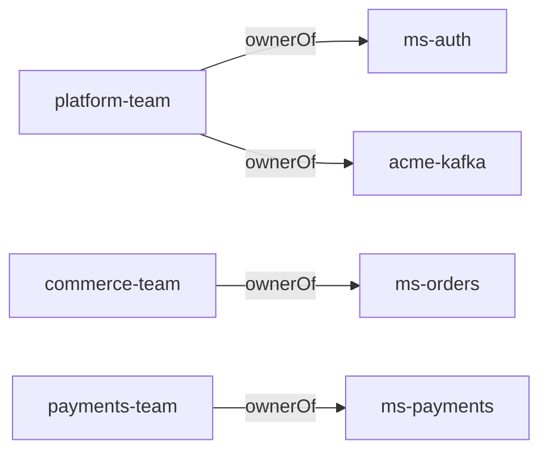

# Ownership — LAB 07

Tiempo estimado: 20 min
Nivel: Intermedio
Importancia para entrevista: CRÍTICO
Prioridad: CRÍTICO

## 1. Objetivo

Ver qué posee cada equipo y explicar por qué un servicio sin owner es un defecto de plataforma, no un detalle de YAML.

## 2. Prerrequisitos

Capítulo de users y groups. Los tres groups cargados.

## 3. Concepto

Ownership en Backstage es un campo obligatorio en Component, API, Resource, System, Domain y Template. El procesador crea:

- `ownedBy` desde la entidad hacia el Group o User
- `ownerOf` en sentido contrario

Un solo owner. Si dos equipos "comparten" el servicio, elige al que tiene la última palabra y pon al otro en la descripción o como consumidor. Dos owners en el modelo no existen, y en la práctica significan que nadie responde.

Esto no es RBAC. Que `commerce-team` posea `ms-orders` no le da permiso de borrar el catálogo ni de leer secretos. Los permisos son el módulo de seguridad.

## 4. ¿Por qué existe?

En platform engineering el fallo caro no es un YAML feo. Es un servicio en producción cuyo dueño se fue y nadie lo sabe. El catálogo hace esa pregunta imposible de posponer: sin owner la entidad no valida.

## 5. Arquitectura

## 6. Ejemplo real

| Entidad | Owner | Por qué |
| --- | --- | --- |
| ms-auth | platform-team | Identidad la opera plataforma en esta ACME |
| ms-orders | commerce-team | El dominio de pedidos es de commerce |
| ms-payments | payments-team | El cobro tiene otro ciclo de cambio y otro riesgo |
| acme-kafka | platform-team | El bus es compartido |
| commerce-platform | platform-team | La capacidad completa la custodia plataforma; los servicios tienen dueño de negocio |
| orders-api | commerce-team | Quien cambia el contrato es quien posee el servicio |

## 7. Laboratorio

Objetivo: comprobar `ownerOf` en la UI.

1. Abre `commerce-team`. Busca la relación Owner of. Tienen que aparecer `ms-orders` y `orders-api`.
2. Abre `payments-team`. Tienen que aparecer `ms-payments` y `payments-api`.
3. Abre `platform-team`. Tienen que aparecer `ms-auth`, los tres resources y los systems.
4. Abre `ms-orders`. El owner es un enlace a `commerce-team`, no un texto plano.

Si el owner es texto plano, el Group no está cargado o el nombre no coincide.

Error intencional, para ver el síntoma y deshacerlo:

En una **copia** mental, no hace falta guardar: si `spec.owner` fuera `commerce` en lugar de `commerce-team`, la ficha mostraría un owner que no navega. Diagnóstico: el string no es el `metadata.name` de ningún Group. Solución: volver a `commerce-team`. No dejes el fichero mal. Si lo guardaste, reviértelo.

## 8. Validación

Desde cada team llegas a sus entidades. Desde `ms-orders` el owner es un link.

## 9. Troubleshooting

### Owner of está vacío

¿Por qué ocurre? Ninguna entidad apunta a ese group, o el refresh no terminó.
¿Cómo diagnosticarlo? `grep -n "owner: commerce-team" catalog -r` dentro de la app.
¿Cómo solucionarlo: los YAML del curso ya apuntan bien. Si grep no encuentra nada, la copia de `catalog/` es vieja.

### Puse un User como owner del servicio

¿Por qué ocurre? Parece más concreto.
¿Cómo diagnosticarlo? `owner: user:default/ana` es válido en el modelo.
¿Cómo solucionarlo de criterio, no de sintaxis: en ACME el owner es el team. Ana se va de vacaciones. El team no.

### Creo que ownership bloquea el deploy

¿Por qué ocurre? Mezclas gobierno y autorización.
¿Cómo diagnosticarlo? ¿Hay alguna policy en este lab que lea `spec.owner`?
¿Cómo solucionarlo: no. Puedes construir una policy que lo haga. El campo por sí solo no bloquea nada.

## 10. Ejercicio

`ms-orders` hoy también depende de `ms-payments`. ¿Eso convierte a payments-team en co-owner de orders? Responde sí o no y por qué.

## 11. Preguntas de entrevista

### ¿Cómo implementarías ownership?

Respuesta corta: `spec.owner` hacia un Group, groups ingeridos desde el IdP, y un acuerdo de que no hay servicios sin dueño.

Explicación: la relación `ownedBy` la calcula el catálogo. La UI de "lo que yo poseo" sale de ahí.

Qué mencionar: un owner, el team, no una persona. No es RBAC.

### ¿Por qué es importante en platform engineering?

Respuesta corta: sin dueño no hay a quién avisar ni a quién pedir un cambio de contrato.

Explicación: el portal hace visible el hueco. No lo rellena solo.

Qué mencionar: el golden path pregunta el owner en el formulario para que un servicio nuevo no nazca huérfano.

## 12. Conexión con arquitectura

- Microservicios: cada servicio tiene un equipo con autoridad para cambiarlo.
- Platform Engineering: plataforma define la regla "owner obligatorio y de tipo team".
- DevOps: la alerta debería rutear al owner. El catálogo guarda el dato, no el pager.
- CI/CD: el template pide el owner antes de crear el repo.
- Cloud: la cuenta o el namespace se alinean al equipo, aparte del campo.
- Developer Experience: la pregunta "¿de quién es?" dura un clic.

## 13. Checklist

- [ ] commerce-team posee orders
- [ ] payments-team posee payments
- [ ] platform-team posee auth y Kafka
- [ ] Puedo explicar que esto no es un permiso
