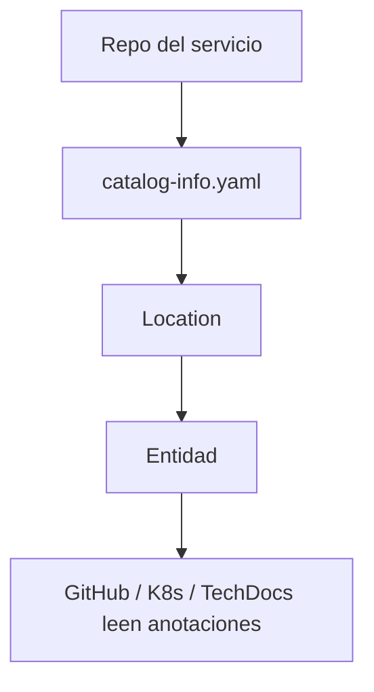

# catalog-info.yaml

Tiempo estimado: 20 min
Nivel: Básico
Importancia para entrevista: CRÍTICO
Prioridad: CRÍTICO

## 1. Objetivo

Quedarte con una plantilla mental del descriptor y con las reglas que hacen que el catálogo acepte o rechace un fichero.

## 2. Prerrequisitos

Labs 02 a 07. Ya viste el fichero funcionando. Este capítulo lo cierra.

## 3. Concepto

El descriptor es YAML con la misma forma que el JSON del API. Recomendación oficial: llámalo `catalog-info.yaml` y ponlo en la raíz del repo del servicio. En el curso, `ms-auth.yaml` y `ms-payments.yaml` rompen esa convención para poder convivir en una carpeta `components/`. `ms-orders` sí usa `catalog-info.yaml` porque TechDocs exige el `mkdocs.yml` al lado del descriptor (`dir:.`).

Reglas del `metadata.name`:

- 1 a 63 caracteres
- secuencias `[A-Za-z0-9]` separadas por `-`, `_` o `.`
- único por kind y namespace, sin distinguir mayúsculas

Si no pones `metadata.namespace`, es `default`.

No escribas `uid`, `etag` ni `status`. Son salida del catálogo.

Sustituciones, por si te las preguntan:

- `$text: ./openapi.yaml` incrusta texto
- `$json` y `$yaml` incrustan estructura

Anotaciones que ya usas:

| Anotación | Para qué |
| --- | --- |
| `github.com/project-slug` | repo `org/nombre` |
| `backstage.io/techdocs-ref` | dónde está el `mkdocs.yml` |
| `backstage.io/kubernetes-id` | label que el plugin busca en el cluster |
| `backstage.io/source-template` | qué template generó el componente |

## 4. ¿Por qué existe?

Hace falta un contrato estable entre equipos y el portal. Si cada equipo inventa un JSON distinto, los plugins no pueden asumir `spec.owner`.

## 5. Arquitectura



## 6. Ejemplo real

Plantilla mínima de un servicio ACME, la que el golden path genera:

```yaml
apiVersion: backstage.io/v1alpha1
kind: Component
metadata:
  name: ms-inventory
  description: Reserva stock
  annotations:
    backstage.io/techdocs-ref: dir:.
    backstage.io/kubernetes-id: ms-inventory
spec:
  type: service
  lifecycle: experimental
  owner: commerce-team
  system: commerce-platform
```

Compara con `labs/catalog/templates/nestjs-service/skeleton/catalog-info.yaml`. Ahí el nombre no está fijo: es `${{ values.name }}` porque lo rellena el Scaffolder, no el catálogo. Si registras ese skeleton sin pasar por el template, el catálogo rechazará el name.

## 7. Laboratorio

Objetivo: romper el name a propósito y leer el error. Después dejarlo bien.

Dónde: `acme-developer-portal/catalog/components/ms-auth.yaml`.

1. Cambia `name: ms-auth` por `name: ms auth` (con espacio). Guarda.
2. Mira el log de `yarn start` o el refresh del catálogo.

Resultado esperado del error: la entidad deja de ser válida. El mensaje habla de nombre o de policy. `ms-auth` puede desaparecer de la UI en el siguiente refresh.

3. Devuelve `name: ms-auth`. Guarda.
4. Confirma que la ficha volvió.

Ese es el error intencional del capítulo. No sigas con el espacio puesto.

## 8. Validación

`ms-auth` está otra vez en el Catalog y el YAML no contiene espacio en el name.

## 9. Troubleshooting

### Name con espacio, mayúsculas raras o más de 63 caracteres

¿Por qué ocurre? La policy por defecto del catálogo.
¿Cómo diagnosticarlo? El log cita `metadata.name`.
¿Cómo solucionarlo: minúsculas y guiones. `ms-auth`.

### Registré el skeleton del template y el name es literal `${{ values.name }}`

¿Por qué ocurre? Ese fichero es entrada del Scaffolder, no del catálogo.
¿Cómo diagnosticarlo? Ves `${{` en el YAML ingerido.
¿Cómo solucionarlo: no apuntes un location al skeleton. Apúntalo a `template.yaml`, que es `kind: Template`. `all.yaml` ya lo hace bien.

### Dos ficheros, mismo name, mismo kind

¿Por qué ocurre? Copiaste el componente a otra carpeta y los dos locations lo leen.
¿Cómo diagnosticarlo? Error de entidad duplicada.
¿Cómo solucionarlo: una fuente. Borra la copia.

## 10. Ejercicio

Escribe de memoria el mínimo de un Component: cuatro claves de primer nivel y las tres de `spec` que son obligatorias.

## 11. Preguntas de entrevista

### ¿Qué es catalog-info.yaml?

Respuesta corta: el descriptor de una entidad, normalmente en la raíz del repo.

Explicación: `apiVersion`, `kind`, `metadata`, `spec`. El catálogo lo ingiere desde un location.

Qué mencionar: el nombre del fichero es convención. El location también puede llamarse de otra forma, como en `ms-auth.yaml`.

### ¿Qué pasa si el YAML y el código no coinciden?

Respuesta corta: el portal enseña una mentira útil hasta que alguien la corrige.

Explicación: no hay comprobación mágica de que el Deployment exista. Por eso el golden path genera el YAML el mismo día que el repo, y el PR que cambia el servicio debería tocar el descriptor si cambia owner, API o dependencias.

Qué mencionar: se puede añadir un check de CI que valide el YAML contra el schema. Backstage no lo trae como puerta obligatoria.

## 12. Conexión con arquitectura

- Microservicios: un descriptor por servicio, al lado del código.
- Platform Engineering: la plantilla del descriptor es parte del golden path.
- DevOps: anotaciones conectan la ficha con el runtime.
- CI/CD: el mismo PR lleva código y metadata.
- Cloud: el descriptor no contiene ARNs secretos.
- Developer Experience: un fichero pequeño, revisable en code review.

## 13. Checklist

- [ ] Puedo recitar apiVersion, kind, metadata, spec
- [ ] Sé las tres claves obligatorias de `spec` en un Component
- [ ] Provocé y revertí el error del name con espacio
- [ ] Sé que el skeleton del template no se ingiere crudo
