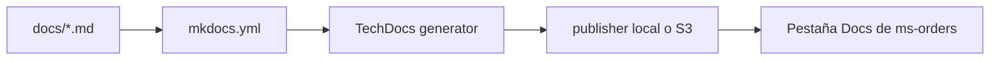

# TechDocs

Tiempo estimado: 15 min
Nivel: Básico
Importancia para entrevista: ALTO
Prioridad: ALTO

## 1. Objetivo

Explicar TechDocs como docs-like-code renderizadas dentro de la ficha del servicio.

## 2. Prerrequisitos

`ms-orders` está en el catálogo. Docker instalado si vas a generar en el lab siguiente. Sin Docker, el capítulo de creación te deja el camino con Python.

## 3. Concepto

TechDocs toma Markdown + `mkdocs.yml`, lo convierte en un sitio estático y lo muestra en la pestaña Docs de la entidad.

Tres piezas, y en local suelen ser el mismo proceso:

- **generator**: MkDocs. Corre en local (Python) o en un contenedor (`techdocs.generator.runIn: docker`).
- **builder**: en local, `local`. En producción seria, el CI genera los docs y el portal solo los lee (`builder: external`).
- **publisher**: dónde se guardan los HTML. En local, el disco. En producción, S3 u otro storage.

La entidad avisa dónde está la fuente con:

```yaml
backstage.io/techdocs-ref: dir:.
```

`dir:.` significa: el `mkdocs.yml` está en el mismo directorio que el descriptor. Por eso `ms-orders` usa `catalog-info.yaml` dentro de su carpeta, y no un YAML suelto en `components/`.

## 4. ¿Por qué existe?

La documentación en un wiki se separa del PR que cambia el comportamiento. TechDocs vive en el repo del servicio. El portal solo la enseña al lado del owner y del contrato.

## 5. Arquitectura



## 6. Ejemplo real

`ms-orders` documenta Overview, Architecture, API, Deployment y Troubleshooting. El diagrama Mermaid del servicio está en `docs/architecture.md`. El contrato sigue viviendo en la entidad `orders-api`. La doc explica lo que el OpenAPI no dice: el `202` no significa que el pago ya se autorizó.

## 7. Laboratorio

Objetivo: leer la fuente antes de generar.

Abre, en el repo del curso o en la copia dentro de la app:

- `catalog/components/ms-orders/mkdocs.yml`
- `catalog/components/ms-orders/docs/index.md`
- `catalog/components/ms-orders/catalog-info.yaml` y confirma la anotación `techdocs-ref`

No generes todavía. El capítulo siguiente enciende el generador.

Resultado esperado: sabes qué archivo alimenta cada página del nav.

## 8. Validación

El `nav` de `mkdocs.yml` lista cinco páginas y esos cinco Markdown existen bajo `docs/`.

## 9. Troubleshooting

### La pestaña Docs dice que no hay documentación

¿Por qué ocurre? Falta la anotación, o el generador no ha corrido, o `mkdocs.yml` no está junto al descriptor.
¿Cómo diagnosticarlo? La anotación y el directorio. Este capítulo solo lee ficheros. Si ya pulsaste Docs, sigue en el capítulo 02.
¿Cómo solucionarlo: `dir:.` y la estructura del curso.

### Confundo TechDocs con la entidad API

¿Por qué ocurre? Los dos "documentan".
¿Cómo diagnosticarlo? ¿Esto es un contrato ejecutable o una explicación?
¿Cómo solucionarlo: OpenAPI en kind API. Contexto y operación en TechDocs.

### Quiero un wiki de toda la empresa dentro de TechDocs

¿Por qué ocurre? TechDocs se parece a un sitio.
¿Cómo diagnosticarlo? ¿El documento pertenece a un component?
¿Cómo solucionarlo: un component de tipo `documentation` si de verdad es un sitio suelto. En ACME las docs cuelgan de `ms-orders`.

## 10. Ejercicio

Di qué información de `ms-orders` pondrías en TechDocs y cuál dejarías solo en la entidad API.

## 11. Preguntas de entrevista

### ¿Qué es TechDocs?

Respuesta corta: el sistema de docs-like-code de Backstage, basado en MkDocs, mostrado en la entidad.

Explicación: la fuente está en el repo. El portal genera o publica el HTML.

Qué mencionar: `backstage.io/techdocs-ref`. En producción, generar en CI y publicar en S3, no generar dentro del pod en cada visita.

## 12. Conexión con arquitectura

- Microservicios: cada servicio documenta su propio comportamiento.
- Platform Engineering: la estructura Overview / Architecture / API / Deployment / Troubleshooting puede ser el estándar.
- DevOps: el generador es un paso más, local o en CI.
- CI/CD: el modo `external` es el de verdad cuando el portal tiene más de un replica.
- Cloud: el publisher de producción es object storage.
- Developer Experience: la doc se abre sin salir de la ficha.

## 13. Checklist

- [ ] Sé qué es `techdocs-ref: dir:.`
- [ ] Vi el `mkdocs.yml` de `ms-orders`
- [ ] Distingo TechDocs y la entidad API
- [ ] Sé que generar en el pod no es el diseño de producción
