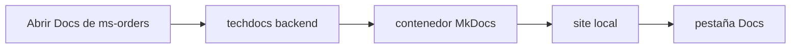

# Crear la documentación — LAB 08

Tiempo estimado: 35 min
Nivel: Intermedio
Importancia para entrevista: ALTO
Prioridad: ALTO

## 1. Objetivo

Ver las cinco páginas de `ms-orders` dentro de Backstage.

## 2. Prerrequisitos

Docker en marcha, o Python 3 con `mkdocs` y `mkdocs-techdocs-core`. El camino de este lab es Docker, porque no añade un entorno Python al curso.

## 3. Concepto

La app generada ya trae TechDocs. Hay que decirle que genere con la imagen de Docker en lugar de buscar MkDocs en el host.

La clave es:

```yaml
techdocs:
  builder: local
  generator:
    runIn: docker
  publisher:
    type: local
```

`builder: local` significa: cuando alguien abre la pestaña, el backend genera si hace falta. Vale en tu laptop. Con varios usuarios y varios pods, se generan docs en el request y es frágil. Producción: `builder: external` y el CI sube el sitio al bucket. No cambies a `external` en este lab: no tienes bucket y la pestaña se quedaría vacía.

La imagen la elige el propio plugin. No fijes un tag inventado. Si el pull falla, el log dice qué imagen pidió.

## 4. ¿Por qué existe?

Sin este paso la anotación está puesta y la pestaña dice que no puede construir. El concepto ya lo viste. Aquí lo enciendes.

## 5. Arquitectura



## 6. Ejemplo real

Las páginas ya están escritas en `catalog/components/ms-orders/docs/`. No las reescribas. El trabajo es configurar el generador y abrirlas. Si quieres cambiar una frase para ver el refresh, cambia `docs/index.md` y vuelve a abrir la pestaña.

## 7. Laboratorio

Objetivo: Docs renderizadas.

Dónde: `acme-developer-portal/app-config.yaml`. Añade o ajusta el bloque `techdocs` al nivel raíz, hermano de `catalog`, no dentro de `catalog`.

```yaml
techdocs:
  builder: local
  generator:
    runIn: docker
  publisher:
    type: local
```

Comprueba Docker:

```bash
docker info >/dev/null && echo "docker ok"
```

Reinicia Backstage:

```bash
cd acme-developer-portal
yarn start
```

UI:

1. http://localhost:3000
2. Abre `ms-orders`
3. Pestaña **Docs**
4. La primera generación tarda. Espera el build en el log (`techdocs`).
5. Navega Overview, Architecture, API, Deployment, Troubleshooting.
6. En Architecture tiene que verse el diagrama.

Resultado esperado: el sitio de MkDocs dentro de la ficha, no un 404.

## 8. Validación

Las cinco entradas del nav abren. El Mermaid de arquitectura se ve como diagrama, no como un bloque de código sin renderizar (el plugin `techdocs-core` se encarga; `mkdocs.yml` ya lo declara).

## 9. Troubleshooting

### `docker: command not found` o el daemon no arranca

¿Por qué ocurre? Docker Desktop apagado, o la shell de WSL no ve el socket.
¿Cómo diagnosticarlo? `docker info`.
¿Cómo solucionarlo: abre Docker Desktop y la integración WSL. Alternativa, si dominas Python: `pip install mkdocs mkdocs-techdocs-core` y `generator.runIn: local`. No uses las dos a la vez sin saber cuál está activa.

### `mkdocs.yml` not found

¿Por qué ocurre? El location lee otro fichero, o `dir:.` no cae en la carpeta que tiene el `mkdocs.yml`.
¿Cómo diagnosticarlo? El log de techdocs imprime el path que intentó leer.
¿Cómo solucionarlo: el descriptor de orders es `catalog/components/ms-orders/catalog-info.yaml` y el `mkdocs.yml` está en esa misma carpeta.

### La pestaña carga forever

¿Por qué ocurre? Está bajando la imagen, o el build falló y la UI no refresca el error.
¿Cómo diagnosticarlo? Terminal de `yarn start`, busca `techdocs`.
¿Cómo solucionarlo: el primer pull de la imagen es lento. Si hay un error de MkDocs, el nav del YAML no coincide con un fichero. Compara con el `mkdocs.yml` del curso.

### Cambié el Markdown y no se actualiza

¿Por qué ocurre? El publisher local cachea el sitio.
¿Cómo diagnosticarlo? La página vieja sigue igual tras recargar.
¿Cómo solucionarlo: en local, borra la caché de techdocs que indique el log (a menudo bajo `node_modules/.cache` o el directorio que imprima el publisher) y vuelve a abrir Docs. No hace falta recrear la app.

## 10. Ejercicio

Añade una línea al `docs/troubleshooting.md` de la copia que usa la app, regenera y comprueba que se ve. No cambies el contrato OpenAPI: eso es otra entidad.

## 11. Preguntas de entrevista

### ¿Cómo publicas TechDocs en producción?

Respuesta corta: el CI genera el sitio y lo sube a S3 (u otro publisher). El portal usa `builder: external` y solo lee.

Explicación: generar en el request no escala y acopla el pod a Docker.

Qué mencionar: la fuente sigue en el repo. Cambia el sitio de build, no el Markdown.

## 12. Conexión con arquitectura

- Microservicios: la doc operacional vive con el servicio.
- Platform Engineering: la estructura de páginas es un estándar, no una plantilla vacía.
- DevOps: Docker o CI ejecutan MkDocs. El portal presenta.
- CI/CD: el paso de docs es parte del pipeline del servicio o del portal, según el modo.
- Cloud: storage de objetos para el HTML.
- Developer Experience: Docs a un clic desde la ficha.

## 13. Checklist

- [ ] `techdocs.generator.runIn` está en `docker` o, si no hay Docker, en `local` con MkDocs instalado
- [ ] Abrí las cinco páginas de `ms-orders`
- [ ] Vi el diagrama de arquitectura
- [ ] Puedo decir por qué `builder: local` no es el diseño final
