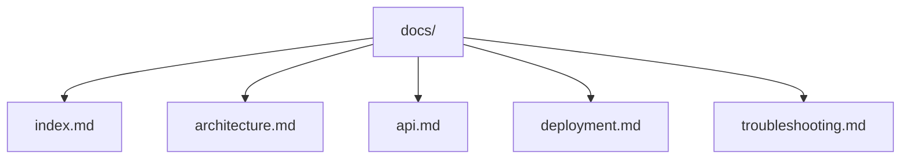

# Estructura de la documentación

Tiempo estimado: 15 min
Nivel: Básico
Importancia para entrevista: MEDIO
Prioridad: MEDIO

## 1. Objetivo

Fijar la estructura de páginas que ACME pide a un servicio, y saber qué va en cada una.

## 2. Prerrequisitos

Lab 08 visto, aunque el generador haya fallado por Docker: los Markdown existen igual.

## 3. Concepto

ACME no deja el `docs/` al gusto del autor. Un servicio nuevo, cuando el template crezca, debería traer estas páginas:

| Página | Contenido | No meter aquí |
| --- | --- | --- |
| Overview | Qué hace, qué no hace, dueño | El OpenAPI completo |
| Architecture | Flujo y módulos | Secretos, connection strings |
| API | Decisiones que el contrato no expresa | Una copia divergente del YAML |
| Deployment | Dónde corre y qué label usa Kubernetes | Tokens |
| Troubleshooting | Síntomas y dónde mirar en el portal | Un runbook de 40 páginas |

El template de este curso genera un README, no estas cinco páginas. Es una limitación consciente: el lab de template ya tiene bastante superficie. Extenderlo es el ejercicio.

## 4. ¿Por qué existe?

Sin estructura, TechDocs se llena de `untitled.md` y nadie compara dos servicios. La estructura es el producto de plataforma, igual que el Dockerfile único.

## 5. Arquitectura



## 6. Ejemplo real

`ms-orders` ya sigue la tabla. `ms-auth` y `ms-payments` no tienen TechDocs. Es el hueco que verías en una empresa a medio adoptar. En la entrevista puedes decir: el catálogo no exige docs; el estándar de plataforma sí, y se empuja con el template.

## 7. Laboratorio

Objetivo: rellenar la estructura para `ms-payments` sin copiar el negocio de orders.

Dónde: crea la carpeta dentro de la app, no solo en `docs/backstage-course`, si quieres verla en la UI.

```bash
cd acme-developer-portal
mkdir -p catalog/components/ms-payments/docs
```

Mueve el descriptor. Hoy es `catalog/components/ms-payments.yaml`. TechDocs con `dir:.` necesita el `mkdocs.yml` a su lado. El movimiento mínimo:

1. Crea `catalog/components/ms-payments/catalog-info.yaml` copiando el contenido actual.
2. Añade la anotación `backstage.io/techdocs-ref: dir:.`
3. Borra el YAML viejo.
4. En `catalog/all.yaml`, cambia el target `./components/ms-payments.yaml` por `./components/ms-payments/catalog-info.yaml`.
5. Crea `mkdocs.yml` con `site_name: ms-payments` y un nav de una sola página, Home → `index.md`.
6. Escribe `docs/index.md` con cuatro líneas: qué hace el servicio, quién es el owner, qué API provee, de qué resource depende.

Plantilla de `mkdocs.yml`:

```yaml
site_name: ms-payments
docs_dir: docs
plugins:
  - techdocs-core
nav:
  - Home: index.md
```

Abre la ficha de `ms-payments` → Docs.

## 8. Validación

`ms-payments` tiene pestaña Docs con tu párrafo. `ms-orders` sigue teniendo las cinco páginas. `all.yaml` no apunta al path viejo.

## 9. Troubleshooting

### `ms-payments` desaparece

¿Por qué ocurre? Borraste el YAML viejo y el nuevo no está en el Location, o el name cambió.
¿Cómo diagnosticarlo? `metadata.name` tiene que seguir siendo `ms-payments`.
¿Cómo solucionarlo: un solo fichero, el target actualizado, el mismo name.

### Docs de payments muestra el sitio de orders

¿Por qué ocurre? Copiaste `site_name` y el publisher mezcló, o abriste la ficha equivocada.
¿Cómo diagnosticarlo? El título de la página.
¿Cómo solucionarlo: `site_name: ms-payments` y recarga. Si la caché miente, aplica el truco del capítulo anterior.

### El Mermaid no era obligatorio aquí

Correcto. Este lab es estructura, no diagramas. El diagrama grande ya está en orders.

## 10. Ejercicio

Añade `architecture.md` a payments con un Mermaid de tres nodos: `ms-payments`, `acme-postgres`, `auth-api`. Actualiza el nav.

## 11. Preguntas de entrevista

### ¿Cómo estructuras la documentación?

Respuesta corta: una convención fija por servicio, generada el día uno, corta.

Explicación: Overview, Architecture, API, Deployment, Troubleshooting.

Qué mencionar: el contrato formal sigue en la entidad API.

## 12. Conexión con arquitectura

- Microservicios: la misma plantilla de docs en todos.
- Platform Engineering: la estructura se versiona con el template.
- DevOps: Deployment dice el label, no el procedimiento secreto de prod.
- CI/CD: el Markdown entra en el review del PR.
- Cloud: sin ARNs sensibles.
- Developer Experience: sabes dónde mirar en un servicio que no es el tuyo.

## 13. Checklist

- [ ] `ms-payments` tiene Docs propias
- [ ] No rompí el name ni el location
- [ ] Sé qué va en cada página del estándar
- [ ] El template todavía no genera estas páginas, y sé que es deuda consciente
