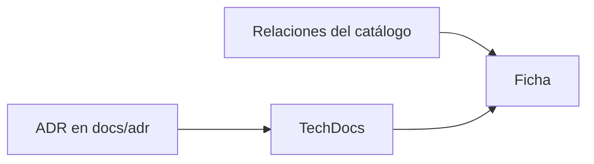

# Documentación de arquitectura

Tiempo estimado: 15 min
Nivel: Intermedio
Importancia para entrevista: ALTO
Prioridad: MEDIO

## 1. Objetivo

Decidir qué decisión de arquitectura vive en TechDocs y qué vive en un ADR, y dejar un ADR corto de ACME dentro de las docs de `ms-orders`.

## 2. Prerrequisitos

Lab 08. Sabes lo que es un ADR por tu experiencia. Aquí solo se engancha a Backstage.

## 3. Concepto

TechDocs explica cómo está hecho el servicio hoy. Un ADR explica por qué se eligió así y qué se descartó. Backstage no tiene un kind ADR. No lo inventes. Publica los ADR como páginas normales, o enlázalos con `metadata.links`.

En ACME el ADR relevante para una entrevista es: pedidos y pagos se separan, y el acoplamiento es un evento `order.created` más una llamada a `payments-api`. El catálogo muestra el acoplamiento (`consumesApis`, `dependsOn` Kafka). El ADR dice por qué no es una sola base de datos.

## 4. ¿Por qué existe?

El diagrama sin la decisión parece decoración. Quien entre en commerce dentro de seis meses preguntará por qué no hay un `JOIN` entre orders y payments.

## 5. Arquitectura



## 6. Ejemplo real

Decisión: `ms-payments` tiene su propia base. `ms-orders` no lee esa base. Se hablan por `payments-api` y por Kafka.

Eso ya está dibujado en `docs/architecture.md`. Falta el texto de "alternativas descartadas".

## 7. Laboratorio

Objetivo: añadir un ADR de una pantalla a `ms-orders`.

Dónde: `acme-developer-portal/catalog/components/ms-orders/docs/adr-001.md`.

```markdown
# ADR 001 — Orders no lee la base de payments

## Estado
Aceptado

## Decisión
ms-orders persiste pedidos en su esquema. El cobro lo hace ms-payments.
El contrato síncrono es payments-api. El hecho de que un pedido exista
se publica en Kafka como order.created.

## Descartado
Una sola base para orders y payments. Acopla los despliegues y los equipos.

## Cómo se ve en Backstage
spec.consumesApis incluye payments-api.
spec.dependsOn incluye resource:default/acme-kafka.
```

Añade la página al `nav` de `mkdocs.yml`:

```yaml
- ADR 001: adr-001.md
```

Abre Docs y entra al ADR.

## 8. Validación

La página renderiza dentro de `ms-orders`. El texto cita las mismas relaciones que la ficha.

## 9. Troubleshooting

### La página 404 dentro de Docs

¿Por qué ocurre? El nav apunta a un path distinto del fichero.
¿Cómo diagnosticarlo? El nav dice `adr-001.md` y el fichero está en `docs/`.
¿Cómo solucionarlo: mismo nombre. Regenera.

### Quise un kind ADR en el catálogo

¿Por qué ocurre? Tu experiencia con ADR pide una entidad.
¿Cómo diagnosticarlo? ¿Algún plugin del curso consume ese kind?
¿Cómo solucionarlo: no añadas kinds sin un consumidor. Una página basta. Si más adelante quieres buscar ADR, un Component `type: documentation` o un link en la entidad es suficiente.

### Metiste un connection string en el ADR

¿Por qué ocurre? El ADR "completo" de producción los trae.
¿Cómo solucionarlo: bórralo. TechDocs lo vería cualquiera que entre al portal.

## 10. Ejercicio

Escribe, en tres líneas y sin publicarlo, el ADR de por qué el owner de Kafka es platform y no commerce.

## 11. Preguntas de entrevista

### ¿Dónde guardas los ADR?

Respuesta corta: en el repo del servicio, publicados por TechDocs, alineados con las relaciones del catálogo.

Explicación: Backstage no trae un módulo ADR. No hace falta.

Qué mencionar: el catálogo muestra el qué. El ADR muestra el porqué.

## 12. Conexión con arquitectura

- Microservicios: el ADR justifica la frontera entre orders y payments.
- Platform Engineering: los ADR de plataforma (cómo se crea un servicio) pueden vivir en el repo del template.
- DevOps: el ADR no sustituye el runbook.
- CI/CD: el ADR entra en el PR.
- Cloud: sin secretos.
- Developer Experience: la decisión se lee al lado del diagrama.

## 13. Checklist

- [ ] Publiqué el ADR 001 en Docs de `ms-orders`
- [ ] El ADR cita relaciones reales del catálogo
- [ ] No inventé un kind nuevo
- [ ] No hay secretos en el Markdown
