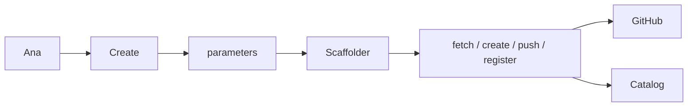

# Software Templates

Tiempo estimado: 15 min
Nivel: Intermedio
Importancia para entrevista: CRÍTICO
Prioridad: CRÍTICO

## 1. Objetivo

Explicar un Software Template como el formulario que dispara el golden path, distinto del catálogo que solo describe lo que ya existe.

## 2. Prerrequisitos

Catálogo ACME cargado con `all.yaml`, que ya incluye el template.

## 3. Concepto

Un Software Template es una entidad `kind: Template` con otro `apiVersion`: `scaffolder.backstage.io/v1beta3`.

Tiene tres zonas:

- `spec.parameters`: el formulario. Es JSON Schema más `ui:field` para widgets de Backstage (`OwnerPicker`, `RepoUrlPicker`).
- `spec.steps`: acciones que el backend ejecuta en orden.
- `spec.output`: links que ve el usuario al terminar (repo, entidad).

El catálogo **registra** el template para que salga en Create. El Scaffolder **ejecuta** los steps. Son plugins distintos.

El descriptor del catálogo, en una página antigua, todavía muestra `backstage.io/v1beta2` y `{{ parameters.name }}`. La guía vigente de escritura de templates, la que sigue este curso, es `scaffolder.backstage.io/v1beta3` y `${{ parameters.name }}`. Si mezclas las dos sintaxis, el formulario no sustituye nada.

## 4. ¿Por qué existe?

Registrar `ms-orders` a mano enseña el modelo. No escala cuando cada equipo crea servicios cada mes y cada uno trae un Dockerfile distinto. El template fija el esqueleto.

## 5. Arquitectura

## 6. Ejemplo real

El template `nestjs-microservice` pregunta nombre, descripción, owner y repositorio. Genera un NestJS mínimo, lo empuja a GitHub y lo registra. El fichero es `catalog/templates/nestjs-service/template.yaml`.

Sin token de GitHub los steps `github:repo:create` y `github:repo:push` no pueden terminar. El capítulo del template te hace ejecutar un **dry run** para ver el esqueleto sin publicar. El capítulo de GitHub completa la publicación.

## 7. Laboratorio

Objetivo: ver el template en Create, sin ejecutarlo todavía.

1. http://localhost:3000 → **Create**
2. Busca **NestJS Microservice**
3. Ábrelo. Tienen que aparecer dos pasos de formulario: Servicio y Repositorio.
4. No pulses Create al final. Cancela.

Si no está en la lista, `all.yaml` no es tu location o las rules no permiten `Template`.

## 8. Validación

El formulario muestra Name, Descripción, Owner y Repository Location. El owner es un picker, no un input libre, porque el campo usa `OwnerPicker`.

## 9. Troubleshooting

### Create no lista el template

¿Por qué ocurre? El kind Template no está en rules, o el location no incluye `template.yaml`.
¿Cómo diagnosticarlo? Log de catalog al ingerir `templates/nestjs-service/template.yaml`.
¿Cómo solucionarlo: rules del módulo 03 y location `../../catalog/all.yaml`.

### El formulario sale vacío o el YAML "no es un template"

¿Por qué ocurre? `apiVersion` viejo o `parameters` mal indentado.
¿Cómo diagnosticarlo? Compara con el fichero del curso. La primera línea es `scaffolder.backstage.io/v1beta3`.
¿Cómo solucionarlo: no reescribas el template a mano si el del curso ya carga.

### Pulsé Create y falló en GitHub

Esperado si no hay token. Sigue en `04-create-template.md`. No es un template roto.

## 10. Ejercicio

Di qué paso del template es catálogo y qué paso es scaffolder. Una frase cada uno.

## 11. Preguntas de entrevista

### ¿Qué es un Software Template?

Respuesta corta: una entidad que define un formulario y una secuencia de acciones para generar un software nuevo.

Explicación: en ACME genera un NestJS, publica el repo y lo registra.

Qué mencionar: `parameters`, `steps`, `output`. ApiVersion `scaffolder.backstage.io/v1beta3`.

## 12. Conexión con arquitectura

- Microservicios: el template es la puerta de un servicio nuevo, no el runtime.
- Platform Engineering: platform-team posee el template (`spec.owner: platform-team`).
- DevOps: el esqueleto incluye Dockerfile y workflow.
- CI/CD: el workflow nace con el repo.
- Cloud: el template podría crear recursos cloud. Este no lo hace. Dílo como límite.
- Developer Experience: un formulario en lugar de un wiki "cómo crear un servicio".

## 13. Checklist

- [ ] Vi el template en Create
- [ ] Distingo catálogo y scaffolder
- [ ] Sé el apiVersion v1beta3
- [ ] No publiqué un repo a medias sin token
