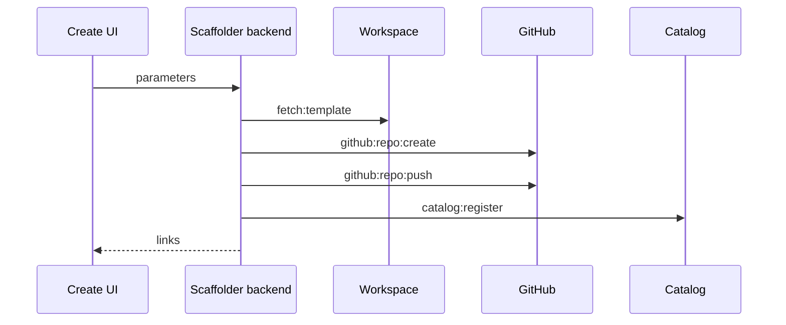

# Scaffolder

Tiempo estimado: 20 min
Nivel: Intermedio
Importancia para entrevista: CRÍTICO
Prioridad: CRÍTICO

## 1. Objetivo

Entender el Scaffolder como el motor que ejecuta acciones sobre un workspace temporal.

## 2. Prerrequisitos

Capítulo anterior. El template se ve en Create.

## 3. Concepto

El Scaffolder es el backend que:

1. Crea un directorio de trabajo efímero.
2. Ejecuta cada `step.action`.
3. Pasa outputs de un step al siguiente con `${{ steps.<id>.output.<nombre> }}`.
4. Tira el workspace al terminar.

Acciones de este template:

| Acción | Qué hace | Qué necesita |
| --- | --- | --- |
| `fetch:template` | Copia `./skeleton` y sustituye `${{ values.* }}` | Nada externo |
| `github:repo:create` | Crea el repo vacío | Token de GitHub e integración |
| `github:repo:push` | Hace el commit inicial y empuja | El repo ya creado |
| `catalog:register` | Ingiera el `catalog-info.yaml` publicado | URL del repo |

`publish:github` sigue existiendo como acción de alto nivel. Desde 1.55, `github:repo:create` ya no acepta un montón de inputs que ignoraba (protección de rama, autor del commit, etc.). Esos inputs viven en `github:repo:push`. El template del curso usa las dos acciones separadas a propósito.

En 1.55 también existe recuperación de tasks (`scaffolder.taskRecovery`). No la actives en el lab. Si te la preguntan: reanuda una task caída desde el último step completado, y las acciones tienen que ser idempotentes. El workspace de recuperación en base de datos es para desarrollo (`@backstage/plugin-scaffolder-backend-module-workspace-database`, límite 50 MB). En producción el workspace va a storage externo.

La sintaxis de plantilla es `${{ parameters.x }}` y `${{ values.x }}` dentro del skeleton. Para que un workflow de GitHub conserve su propio `${{ github.sha }}`, el skeleton lo escribe como `${{ '${{ github.sha }}' }}`. Si no escapas, el Scaffolder se come la expresión o falla porque `github` no es un parámetro.

## 4. ¿Por qué existe?

Alguien tiene que ejecutar esos pasos con credenciales de servidor, no en el browser. El token de GitHub no baja al React.

## 5. Arquitectura



## 6. Ejemplo real

Si Ana pide `ms-inventory`, el workspace acaba con `src/main.ts`, `Dockerfile`, `catalog-info.yaml` y `.github/workflows/ci.yml`, y el `name` dentro de esos ficheros ya es `ms-inventory`, no la cadena `${{ values.name }}`.

## 7. Laboratorio

Objetivo: inspeccionar el skeleton y localizar el escape de GitHub Actions.

Dónde: tu editor, carpeta `acme-developer-portal/catalog/templates/nestjs-service/`.

1. Abre `template.yaml`. Sigue los cuatro `id` de steps.
2. Abre `skeleton/catalog-info.yaml`. Confirma `${{ values.name }}` y `${{ values.owner }}`.
3. Abre `skeleton/.github/workflows/ci.yml`. Confirma que `github.sha` está escapado.
4. Abre `skeleton/src/main.ts`. El health devuelve el nombre del servicio.

No hace falta compilar el skeleton ahora. El `${{ }}` no es TypeScript válido hasta que el Scaffolder lo renderiza. Compilarlo en seco tiene que fallar. Ese fallo es la prueba de que entendiste.

Prueba intencional:

```bash
cd acme-developer-portal/catalog/templates/nestjs-service/skeleton
npx --yes tsc -p tsconfig.json --noEmit
```

Resultado esperado: error de sintaxis alrededor de `${{ values.name }}`. No lo "arregles". El fichero fuente del template debe conservar los placeholders.

## 8. Validación

Puedes señalar el step que no necesita GitHub (`fetch`) y los tres que sí. El `tsc` del skeleton falla por los placeholders.

## 9. Troubleshooting

### `tsc` pasa

¿Por qué ocurre? Estás en un directorio ya renderizado, no en el skeleton.
¿Cómo diagnosticarlo? Busca la cadena `${{ values.name }}` en `src/main.ts`.
¿Cómo solucionarlo: vuelve al skeleton del curso.

### Crees que `fetch:template` publica el repo

¿Por qué ocurre? "Fetch" suena a descargar y terminar.
¿Cómo diagnosticarlo? ¿Hay un `repoUrl` en ese step?
¿Cómo solucionarlo: fetch solo rellena el workspace. Publicar es `github:repo:push`.

### Un step usa `${{ steps.publish.output.repoContentsUrl }}` y el id del step es `push`

¿Por qué ocurre? Copiaste un ejemplo viejo que llamaba al step `publish`.
¿Cómo diagnosticarlo? El id de este curso es `push`. El output se lee `steps.push.output.repoContentsUrl`.
¿Cómo solucionarlo: no renombres el id sin cambiar las referencias.

## 10. Ejercicio

Ordena estas acciones y di cuál puede reejecutarse sin crear un segundo repo: `catalog:register`, `fetch:template`, `github:repo:push`, `github:repo:create`.

## 11. Preguntas de entrevista

### ¿Qué es el Scaffolder?

Respuesta corta: el backend que ejecuta los steps de un template sobre un workspace temporal.

Explicación: sustituye parámetros, llama acciones y puede registrar la entidad resultante.

Qué mencionar: el token no viaja al browser. Las acciones de GitHub viven en el módulo `@backstage/plugin-scaffolder-backend-module-github`.

### ¿Por qué separar create y push?

Respuesta corta: crear el repo y publicar el contenido son efectos distintos.

Explicación: en 1.55 los inputs de protección de rama y de autor del commit están en `github:repo:push`, no en `github:repo:create`.

Qué mencionar: `publish:github` sigue siendo el atajo. Este curso enseña los dos pasos porque el release 1.55 los separó de verdad.

## 12. Conexión con arquitectura

- Microservicios: el scaffolder no es uno de los microservicios de negocio. Es plataforma.
- Platform Engineering: las acciones son el producto.
- DevOps: el workspace es un build efímero.
- CI/CD: el scaffolder termina cuando el repo existe. El pipeline del servicio empieza después, en GitHub Actions.
- Cloud: una acción podría llamar a AWS. No hay una en este template.
- Developer Experience: el usuario ve pasos con nombre, no un script opaco.

## 13. Checklist

- [ ] Puedo nombrar los cuatro steps
- [ ] Sé qué es el workspace
- [ ] Vi el escape de `${{ github.sha }}`
- [ ] Entiendo por qué el skeleton no compila en seco
