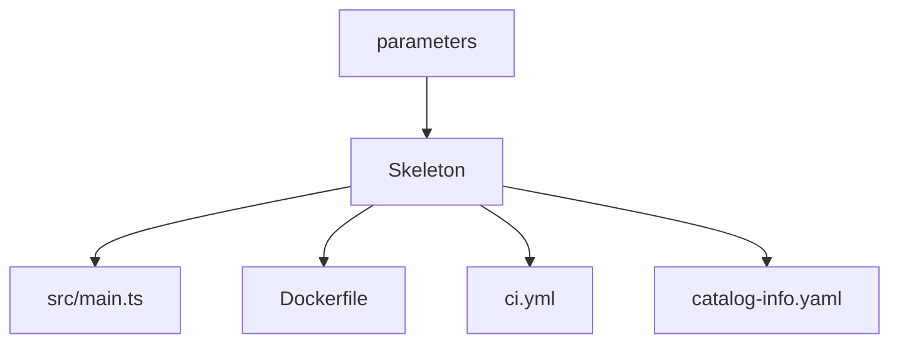

# Estructura del template

Tiempo estimado: 20 min
Nivel: Intermedio
Importancia para entrevista: ALTO
Prioridad: ALTO

## 1. Objetivo

Recorrer cada fichero del skeleton y decir qué problema de un servicio NestJS resuelve.

## 2. Prerrequisitos

Capítulo del Scaffolder.

## 3. Concepto

```text
nestjs-service/
  template.yaml          # formulario + steps
  skeleton/
    catalog-info.yaml    # la ficha futura
    README.md
    package.json
    tsconfig.json
    Dockerfile
    src/main.ts
    test/health.test.ts
    .github/workflows/ci.yml
```

`package.json` fija Nest 11 y Node en el Dockerfile con `node:22-alpine`. El servicio escucha `PORT` o 3000. Choca con el puerto de Backstage si lo arrancas en la misma máquina: por eso el README del skeleton lo advierte. No es un bug del template. Es el default de Nest.

El test usa `node:test`. No añade Jest. El golden path no necesita un runner nuevo para demostrar CI.

El usuario del contenedor es `node`. No corre como root. Eso sí es deliberado.

## 4. ¿Por qué existe?

Si el template solo crea el repo vacío, cada equipo vuelve a discutir el Dockerfile. El skeleton es la decisión ya tomada.

## 5. Arquitectura



## 6. Ejemplo real

`src/main.ts` no tiene dominio de pedidos. Tiene un `GET /health`. La arquitectura hexagonal iría en `domain/`, `application/` e `infrastructure/` cuando el equipo escriba negocio. El template no la genera. Meter carpetas vacías "para que parezca hexagonal" es ceremonia. En una entrevista di: el path estandariza el arranque y el contrato con la plataforma (catálogo, CI, imagen). El estilo interno lo puede imponer un segundo incremento del template cuando más de un equipo lo pida.

## 7. Laboratorio

Objetivo: marcar cada fichero con su consumidor.

Crea una tabla en tus notas:

| Fichero | Quién lo consume |
| --- | --- |
| catalog-info.yaml | Backstage catalog, después del register |
| Dockerfile | el CI, `docker build` |
| ci.yml | GitHub Actions |
| src/main.ts | el runtime del servicio |
| README.md | la persona que clona |

Rellénala sin mirar este capítulo y luego contrasta.

No ejecutes `npm install` dentro del skeleton: los placeholders rompen el nombre y no es el servicio generado.

## 8. Validación

Tu tabla no dice que Backstage ejecuta `src/main.ts`. El runtime del servicio es otro proceso, en otro repo, cuando exista.

## 9. Troubleshooting

### El health del skeleton y el health de Backstage se confunden

¿Por qué ocurre? Los dos son HTTP y los dos pueden usar el puerto 3000.
¿Cómo diagnosticarlo? ¿Qué `package.json` estás leyendo, el de la app o el del skeleton?
¿Cómo solucionarlo: el de ACME portal es Yarn en la raíz de `acme-developer-portal`. El del servicio generado será npm dentro de su repo.

### Quiero añadir Postgres al skeleton

¿Por qué ocurre? El diagrama de la empresa tiene Postgres.
¿Cómo diagnosticarlo? ¿Todos los servicios futuros usan Postgres el día uno?
¿Cómo solucionarlo: no. `ms-auth` podría no usarla en una variante. La dependencia se declara en el catálogo cuando es real. El ejercicio de abajo te deja extender el formulario si quieres practicar.

### `npm test` del skeleton referencia `dist/health.test.js`

¿Por qué ocurre? El script asume `tsc` previo. Es un esqueleto pequeño, no un monorepo Nest con `ts-jest`.
¿Cómo diagnosticarlo? Lee el script `test` del `package.json`.
¿Cómo solucionarlo: en el CI el orden es `npm run build` y luego `npm test`. No hace falta cambiarlo para el curso.

## 10. Ejercicio

Añade, solo en una copia local del `template.yaml`, un parámetro `system` con default `commerce-platform` y úsalo en el skeleton. No hace falta que el dry run pase todavía si no llegaste al capítulo siguiente. Si ya sabes lanzarlo, comprueba que el `catalog-info.yaml` renderizado trae tu system.

## 11. Preguntas de entrevista

### ¿Qué genera el template de ACME?

Respuesta corta: un NestJS que arranca, un test mínimo, un Dockerfile no root, un workflow y el `catalog-info.yaml`.

Explicación: no genera el dominio. Estandariza la plataforma.

Qué mencionar: placeholders `${{ values.* }}` y el escape de expresiones de GitHub.

## 12. Conexión con arquitectura

- Microservicios: cada repo generado es un servicio desplegable.
- Platform Engineering: el skeleton es una decisión de plataforma versionada.
- DevOps: usuario no root, multi-stage, Node 22.
- CI/CD: el workflow está dentro del skeleton, no en un wiki.
- Cloud: la imagen no se sube a ECR en este template. El CI solo hace `docker build` local al runner.
- Developer Experience: el README dice cómo arrancar y avisa del puerto.

## 13. Checklist

- [ ] Puedo listar los ficheros del skeleton
- [ ] Sé qué no genera (dominio, Kafka, Postgres)
- [ ] Sé por qué el contenedor no es root
- [ ] No instalé dependencias encima de los placeholders
