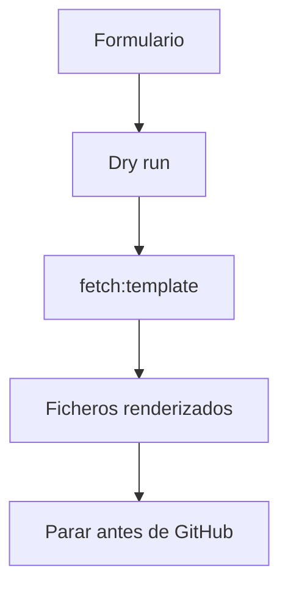

# Crear el template — LAB 09

Tiempo estimado: 30 min
Nivel: Intermedio
Importancia para entrevista: CRÍTICO
Prioridad: CRÍTICO

## 1. Objetivo

Ejecutar el template en dry run y leer el NestJS ya renderizado, sin token de GitHub.

## 2. Prerrequisitos

El template visible en Create. Capítulos anteriores de esta carpeta.

## 3. Concepto

El Scaffolder puede hacer un **dry run**: ejecuta los steps que no publican, o te deja inspeccionar el resultado antes de confirmar, según la UI de tu versión. En 1.55 el permiso `scaffolder.template.dry-run` protege esa acción. La policy por defecto de desarrollo lo permite. Si una policy custom niega lo desconocido, hay que permitir ese permiso. La app nueva no trae esa policy, así que el dry run tiene que funcionar.

Los steps de GitHub fallan sin integración. Por eso el dry run que nos importa es ver el resultado de `fetch:template`. Si la UI ejecuta todos los steps y se detiene en `github:repo:create`, el fallo **después** de fetch sigue siendo útil: abre el log del step `fetch` y, si la UI ofrece descargar el workspace, descárgalo.

Si tu versión no enseña el workspace, renderiza a mano solo para aprender. No es el camino del producto, y el capítulo lo marca como plan B. El plan A es la UI.

Sustitución que tienes que ver en el resultado:

- `${{ values.name }}` → el nombre que escribiste
- `${{ values.owner }}` → el group
- `${{ values.description }}` → la frase
- `${{ '${{ github.sha }}' }}` → el texto literal `${{ github.sha }}` dentro del YAML de Actions

## 4. ¿Por qué existe?

Publicar un repo de prueba en tu GitHub personal ensucia la cuenta y exige un token. El dry run demuestra que el template está bien antes de esa integración.

## 5. Arquitectura

## 6. Ejemplo real

Usa estos valores:

| Campo | Valor |
| --- | --- |
| name | `ms-inventory` |
| description | Reserva stock para un pedido |
| owner | `commerce-team` |
| repo | el que pida el picker; si exige `github.com?owner=acme&repo=ms-inventory`, pon eso. No se creará en el dry run |

`ms-inventory` cumple el `pattern` del formulario: minúsculas y guiones.

## 7. Laboratorio

Objetivo: ver `ms-inventory` escrito dentro de `catalog-info.yaml` y de `src/main.ts`.

Dónde: UI, http://localhost:3000 → Create → NestJS Microservice.

1. Rellena el formulario con la tabla.
2. Busca la acción de dry run / review. En la UI actual está en el flujo de Create, antes o en lugar de ejecutar contra GitHub. Si ves un botón **Dry Run**, úsalo.
3. Abre el fichero resultante `catalog-info.yaml`.
4. Confirma `name: ms-inventory`, `owner: commerce-team`, `lifecycle: experimental`.
5. Abre `src/main.ts`. El string del health es `ms-inventory`.
6. Abre `.github/workflows/ci.yml`. Tiene que contener `${{ github.sha }}` como texto, no vacío y no `ms-inventory` en el sitio del sha.

Plan B, si la UI no deja ver el workspace. Dónde: una carpeta temporal, **fuera** del skeleton.

No hay un CLI oficial de "renderiza este skeleton" que este curso quiera inventar. En ese caso el lab se valida leyendo el `template.yaml` y marcando en tus notas la sustitución esperada, y dejas la ejecución real para cuando tengas token en el capítulo de GitHub. Dilo así: no simules un render a mano editando copias, porque entonces no probaste el Scaffolder.

Resultado esperado del plan A: ficheros con `ms-inventory` y el workflow con la expresión de GitHub intacta.

## 8. Validación

Tres comprobaciones sobre el resultado del dry run:

- el name del Component es `ms-inventory`
- el owner es el group, no el string `${{ values.owner }}`
- el workflow todavía tiene `${{ github.sha }}`

## 9. Troubleshooting

### El patrón del name rechaza `ms_inventory` o `MS-Inventory`

¿Por qué ocurre? El JSON Schema tiene `pattern: '^[a-z0-9]+(-[a-z0-9]+)*$'`.
¿Cómo diagnosticarlo? El campo Name se pone rojo.
¿Cómo solucionarlo: `ms-inventory`.

### Dry run falla en `github:repo:create` con 401 o integration not found

¿Por qué ocurre? No hay token. En algunas versiones el dry run igual intenta las acciones.
¿Cómo diagnosticarlo? El step `fetch` está en verde y `create` en rojo.
¿Cómo solucionarlo: si puedes abrir el workspace del step fetch, el lab está cumplido. Si no, sigue al capítulo de GitHub y no bloquees el resto del día en el token.

### `OwnerPicker` no lista equipos

¿Por qué ocurre? Los Group no están en el catálogo.
¿Cómo diagnosticarlo? Catalog → Groups.
¿Cómo solucionarlo: location `all.yaml` y el capítulo de users.

### El permiso de dry run niega la acción

¿Por qué ocurre? Policy custom. La app nueva no la trae.
¿Cómo diagnosticarlo? El error nombra `scaffolder.template.dry-run`.
¿Cómo solucionarlo: con la policy allow-all de desarrollo no debería pasar. Si la cambiaste en el módulo de seguridad antes de tiempo, vuelve a la policy por defecto para este lab.

## 10. Ejercicio

Cambia la description y vuelve a lanzar el dry run. La línea `description:` del catalog-info renderizado tiene que cambiar. Si no cambia, estás leyendo el skeleton y no el resultado.

## 11. Preguntas de entrevista

### ¿Cómo pruebas un template sin crear repos?

Respuesta corta: dry run del Scaffolder.

Explicación: renderiza el skeleton con los parámetros. La publicación a GitHub es otro step.

Qué mencionar: el permiso `scaffolder.template.dry-run` en 1.55 si la policy niega por defecto.

## 12. Conexión con arquitectura

- Microservicios: `ms-inventory` nacería como un servicio más del system commerce.
- Platform Engineering: se prueba el camino antes de ofrecerlo.
- DevOps: el Dockerfile renderizado es revisable.
- CI/CD: el workflow queda listo para el primer push.
- Cloud: sigue sin provisionar nada.
- Developer Experience: el formulario avisa el pattern del name antes de fallar a mitad de los steps.

## 13. Checklist

- [ ] Lancé el dry run o dejé escrito por qué la UI no mostró el workspace
- [ ] Vi `ms-inventory` sustituido
- [ ] Vi `${{ github.sha }}` escapado en el resultado
- [ ] No creé un repo por accidente
