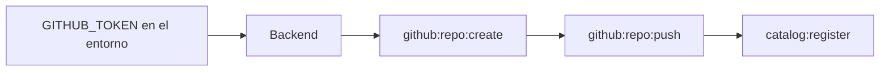

# Template con GitHub

Tiempo estimado: 25 min
Nivel: Intermedio
Importancia para entrevista: CRÍTICO
Prioridad: ALTO

## 1. Objetivo

Preparar el template para publicar en GitHub. Ejecutarlo de verdad solo si tienes un token y un owner real. Si no, el lab se queda en la configuración y en el dry run, y la publicación se explica con el flujo.

## 2. Prerrequisitos

Lab 09. Una cuenta de GitHub. El owner del `RepoUrlPicker` en el template es `acme`. Si no eres dueño de una org `acme`, el create fallará. Para un ensayo personal, cambia `allowedOwners` a tu usuario de GitHub en una copia local del template. No subas el token.

## 3. Concepto

La integración de GitHub del **backend** (leer ficheros, crear repos) no es el login de personas. Son cosas distintas:

```yaml
integrations:
  github:
    - host: github.com
      token: ${GITHUB_TOKEN}
```

Ese token lo usa el Scaffolder y el catalog cuando el location es una URL de GitHub. Permisos mínimos para este template: crear repo en el owner elegido y pushear. Un token fino (fine-grained) con acceso solo a esa cuenta. No un token clásico con `repo` sobre toda tu vida si puedes evitarlo.

El token va en el entorno o en `app-config.local.yaml`, que ya está gitignored en la app generada. Compruébalo antes de escribir nada.

`catalog:register` usa `steps.push.output.repoContentsUrl`. Ese output lo define `github:repo:push`. Si el step se llamara de otra forma, la referencia se rompe.

Desde 1.55, `github:repo:create` no recibe `protectDefaultBranch`, `gitAuthorName` ni `requiredApprovingReviewCount`. Esos valores, si los quieres, van en `github:repo:push`. El template del curso manda el autor del commit en el push.

## 4. ¿Por qué existe?

El dry run no deja un servicio registrado desde Git, que es como funciona una empresa. Este capítulo cierra esa distancia sin obligarte a tener org `acme`.

## 5. Arquitectura



## 6. Ejemplo real

Ana, con un token de la org `acme`, genera `ms-inventory`. El repo queda privado (`repoVisibility: private` en el step create). El catálogo pasa a leer el `catalog-info.yaml` de ese repo, no la copia de tu laptop. A partir de ahí, el location estático `all.yaml` y el registro dinámico conviven. El servicio nuevo no está en `all.yaml`. Lo añadió `catalog:register`. Si reinicias la base de desarrollo (SQLite en memoria), ese registro se pierde y el fichero del repo sigue siendo la fuente: vuelves a registrar la URL.

## 7. Laboratorio

Objetivo: token fuera del repo, integración escrita, y publicación solo si el owner existe.

Dónde: `acme-developer-portal`.

1. Confirma el ignore:

```bash
cd acme-developer-portal
grep app-config.local.yaml .gitignore
```

Resultado esperado: una línea que ignora ese fichero. Si no está, añádela y no sigas hasta que `git check-ignore -v app-config.local.yaml` lo reconozca. Si la app no es un repo git, créalo no es necesario: no pongas el token en `app-config.yaml`.

2. En la shell que va a ejecutar `yarn start`:

```bash
export GITHUB_TOKEN="pega-el-token-aqui"
```

No lo escribas en el Markdown del curso. No lo pegues en el chat. Si el token llegó a un fichero trackeado, revócalo en GitHub y genera otro.

3. En `app-config.local.yaml` (créalo si no existe):

```yaml
integrations:
  github:
    - host: github.com
      token: ${GITHUB_TOKEN}
```

4. Reinicia `yarn start` desde la misma shell donde exportaste la variable. Si arrancas desde un botón de IDE, el IDE no ve el `export`.

5. Si tienes un owner de GitHub donde puedas crear repos, edita `allowedOwners` del template para ese owner, abre Create y ejecuta el flujo completo con un repo nuevo `ms-inventory`.

6. Si no tienes owner, para aquí. El lab se valida con la config y con el dry run del capítulo anterior. Publicar contra `acme` fallará con 404 o 403. Es el diagnóstico correcto, no un YAML mal escrito.

## 8. Validación

Con token y owner real: el repo existe, contiene `catalog-info.yaml` con `ms-inventory`, y la entidad aparece en el Catalog.

Sin owner: `git check-ignore` cubre el fichero local, el YAML de integración usa `${GITHUB_TOKEN}`, y puedes explicar los cuatro steps.

## 9. Troubleshooting

### 401 Bad credentials

¿Por qué ocurre? Token vacío, expirado, o `yarn start` no heredó la variable.
¿Cómo diagnosticarlo? En la shell de Backstage, `test -n "$GITHUB_TOKEN" && echo set`. No imprimas el token.
¿Cómo solucionarlo: export de nuevo y reinicia el proceso.

### 403 o 404 al crear el repo

¿Por qué ocurre? El owner `acme` no es tuyo, o el token no tiene permiso de administración de repos.
¿Cómo diagnosticarlo? El mensaje de la action incluye el owner.
¿Cómo solucionarlo: `allowedOwners` con tu usuario, o acepta que el lab queda en configuración.

### El repo se creó y el push falló

¿Por qué ocurre? Repo creado por un intento anterior, o el token puede crear pero no escribir.
¿Cómo diagnosticarlo? El step `create` en verde, `push` en rojo.
¿Cómo solucionarlo: borra el repo vacío en GitHub y repite, o repara el permiso. No dejes repos basura.

### `catalog:register` no encuentra el fichero

¿Por qué ocurre? El push no dejó `catalog-info.yaml` en la raíz, o `repoContentsUrl` apunta a otra rama.
¿Cómo diagnosticarlo? Abre el repo en el navegador.
¿Cómo solucionarlo: `defaultBranch: main` en el push, y `catalogInfoPath: /catalog-info.yaml`.

## 10. Ejercicio

Explica la diferencia entre este token de integración y el login de una persona con GitHub OAuth. Dos frases.

## 11. Preguntas de entrevista

### ¿Cómo integra el template con GitHub?

Respuesta corta: `integrations.github` con un token de servidor, y las acciones `github:repo:create`, `github:repo:push` y `catalog:register`.

Explicación: el token no va al frontend. El picker solo construye `repoUrl`.

Qué mencionar: el breaking change de 1.55 sobre los inputs de `github:repo:create`.

## 12. Conexión con arquitectura

- Microservicios: el repo generado es el límite de despliegue.
- Platform Engineering: el token es de la plataforma, con el mínimo permiso.
- DevOps: el commit inicial ya trae CI.
- CI/CD: Actions arranca en el primer push a `main` si el workflow está en el default branch.
- Cloud: el token no es una key de AWS.
- Developer Experience: el usuario no clona un repo plantilla a mano.

## 13. Checklist

- [ ] El token no está en un fichero trackeado
- [ ] Sé qué step crea y qué step empuja
- [ ] Publiqué `ms-inventory` o documenté por qué me detuve en la config
- [ ] Distingo token de integración y login de usuario
