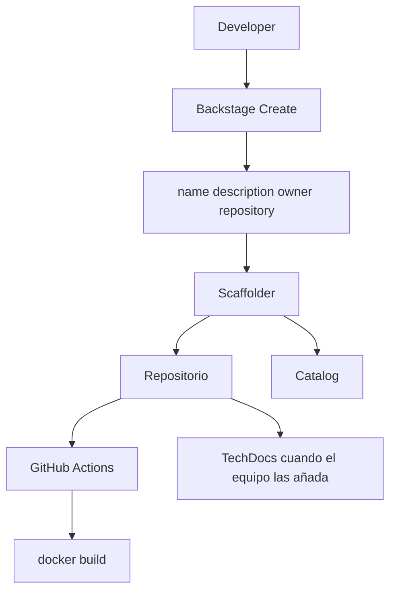

# Golden path — LAB 10

Tiempo estimado: 20 min
Nivel: Intermedio
Importancia para entrevista: CRÍTICO
Prioridad: CRÍTICO

## 1. Objetivo

Contar el template de NestJS como el golden path de ACME, de punta a punta, y saber qué lo convierte en platform engineering y no en un generador de carpetas.

## 2. Prerrequisitos

Labs 09 y el capítulo de GitHub del template. Da igual si el repo llegó a crearse.

## 3. Concepto

El camino soportado de ACME es:

```text
Developer
  → abre Backstage
  → Create / NestJS Microservice
  → rellena name, description, owner, repository
  → el Scaffolder genera el repo
  → el repo queda registrado en el Catalog
  → el repo nace con CI, Dockerfile, health y ficha
  → la documentación se añade con la convención de TechDocs
```

Lo que lo hace golden path, y no un script suelto:

- tiene dueño: `platform-team`
- es el que sale recomendado: tag `recommended` y título visible
- deja el servicio **dentro del catálogo**, con owner
- deja el pipeline dentro del repo
- declara de qué template salió: anotación `backstage.io/source-template`
- declara tiempo orientativo: `backstage.io/time-saved: PT4H`

Lo que no hace, y debes decirlo antes de que te lo pregunten:

- no crea el cluster
- no crea la base de datos
- no elige el bounded context
- no despliega a producción
- no escribe el dominio

El deploy sigue siendo GitHub Actions más el entorno que la empresa tenga. Backstage dejó el workflow. No pulsó producción.

## 4. ¿Por qué existe?

Porque el catálogo solo, sin este camino, describe el pasado. El golden path es cómo el sistema quiere que sea el próximo servicio. Platform engineering se juzga por cuántos servicios nuevos nacen así, no por cuántos plugins hay instalados.

## 5. Arquitectura



## 6. Ejemplo real

`ms-auth`, `ms-orders` y `ms-payments` están registrados a mano porque son el legado del curso. `ms-inventory` es el primero que nacería por el path. Esa diferencia es una buena respuesta de entrevista: lo existente se cataloga, lo nuevo se genera. No se reescribe el legado el primer día para que "todo salga del template".

## 7. Laboratorio

Objetivo: recorrer el flujo con el dedo sobre tu portal, y escribir la defensa en diez líneas.

1. Abre Create y el template. No hace falta ejecutarlo otra vez.
2. Abre `catalog/templates/nestjs-service/template.yaml` y señala owner, tags, time-saved y el step `register`.
3. Abre el skeleton y señala CI, Dockerfile y catalog-info.
4. Escribe en `docs/backstage-course/labs/golden-path-notas.md` (lo empezaste en el capítulo de platform engineering) esta secuencia real, corrigiendo lo que hubieras inventado entonces:

```text
1. Ana abre Create
2. Elige NestJS Microservice, dueño platform-team
3. Pone name, description, owner, repo
4. fetch:template rellena el skeleton
5. github:repo:create y github:repo:push publican
6. catalog:register crea la ficha
7. El workflow de Actions compila, testea y construye la imagen
8. TechDocs se añade en el repo; no las genera este template
```

Resultado esperado: tus notas coinciden con los steps del YAML. Si tu lista del día anterior pedía "desplegar a Kubernetes automáticamente", táchala y escribe que el manifiesto de Kubernetes es un lab aparte, no un step del template.

## 8. Validación

Lees las notas en voz alta en menos de un minuto y no dices que Backstage despliega a producción.

## 9. Troubleshooting

### El template no tiene tag recommended y se pierde entre los de ejemplo

¿Por qué ocurre? Volviste a activar los templates demo.
¿Cómo diagnosticarlo? Create muestra más de un template.
¿Cómo solucionarlo: el de ACME se titula NestJS Microservice. Los de ejemplo puedes dejar de ingerirlos si todavía están en `locations`.

### Quiero un step que haga `kubectl apply`

¿Por qué ocurre? El diagrama mental cierra el círculo.
¿Cómo diagnosticarlo? ¿Quién revisa el cambio antes de producción?
¿Cómo solucionarlo: no en la v1. El CI construye. El deploy es otro camino, con revisión. Añadirlo ahora mezcla plataforma con acceso al cluster dentro del scaffolder.

### `time-saved: PT4H` se toma como una métrica real

¿Por qué ocurre? El número está en el YAML.
¿Cómo diagnosticarlo? ¿Alguien lo midió?
¿Cómo solucionarlo: es una anotación para estimar. No la defiendas como un SLA.

## 10. Ejercicio

Di qué añadirías en una v2 del path y qué seguirías dejando fuera. Máximo tres ítems por columna. Pista: una página de TechDocs mínima puede entrar en v2. El alta en producción, no.

## 11. Preguntas de entrevista

### ¿Qué es un golden path?

Respuesta corta: el camino soportado para crear un tipo de software, con dueño, form, repo, catálogo y CI.

Explicación: en ACME es el template NestJS. Lo legado se registra. Lo nuevo se genera.

Qué mencionar: platform-team lo posee. No provisiona la base ni despliega solo.

### ¿Cómo implementarías un golden path para NestJS?

Respuesta corta: un Template v1beta3 que pregunte name, description, owner y repo, genere el esqueleto, publique en GitHub y registre el Component.

Explicación: el esqueleto lleva health, Dockerfile no root, test y workflow. El dominio lo escribe el equipo.

Qué mencionar: escapar las expresiones de Actions, token en el backend, `catalog:register` al final.

## 12. Conexión con arquitectura

- Microservicios: un repo, un servicio, un owner.
- Platform Engineering: este capítulo es la definición práctica.
- DevOps: el pipeline nace con el repo.
- CI/CD: Actions hace build y test. El deploy queda explícitamente fuera.
- Cloud: sin Terraform en la v1.
- Developer Experience: el desarrollador no busca el wiki de "cómo abrimos un servicio".

## 13. Checklist

- [ ] Puedo recorrer el flujo de ocho pasos
- [ ] Sé qué queda fuera a propósito
- [ ] Distingo legado catalogado y servicio generado
- [ ] Actualicé `golden-path-notas.md`
