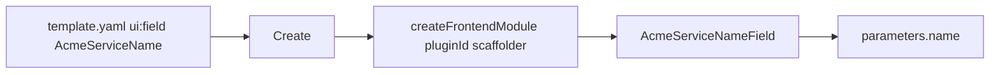

# Custom fields del Scaffolder

Tiempo estimado: 25 min
Nivel: Intermedio
Importancia para entrevista: CRÍTICO
Prioridad: CRÍTICO

Escrito contra el portal instalado: Backstage **1.56.0**, frontend nuevo (`createApp` de `@backstage/frontend-defaults`).

## 1. Objetivo

Registrar un campo de formulario propio, `AcmeServiceName`, que rechaza un nombre de servicio que no sea kebab-case.

## 2. Prerrequisitos

Portal en marcha (`yarn start` en `acme-developer-portal`). El capítulo 01 de templates ya explica `ui:field`.

## 3. Concepto

`spec.parameters` es JSON Schema. `ui:field` cambia el widget. `OwnerPicker` y `RepoUrlPicker` son campos que ya trae el plugin. Un campo propio es un componente React más una función de validación, con un nombre que el template cita en `ui:field`.

En el frontend nuevo el registro es un módulo:

- `createFormField` junta el nombre, el componente y la validación.
- `FormFieldBlueprint.make` lo convierte en extensión.
- `createFrontendModule({ pluginId: 'scaffolder' })` lo publica.
- `createApp({ features })` lo instala.

Los dos símbolos del campo salen de `@backstage/plugin-scaffolder-react/alpha`. El `name` de `createFormField` (`AcmeServiceName`) es el valor de `ui:field`. El `name` del blueprint (`acme-service-name`) es el id de la extensión, no el del formulario.

El frontend clásico (`scaffolderPlugin.provide` y `<ScaffolderFieldExtensions>`) no es el de esta app. Si tu `App.tsx` importa `createApp` desde `@backstage/app-defaults`, estás en el otro sistema.

Guía usada: [Writing Custom Field Extensions](https://backstage.io/docs/features/software-templates/writing-custom-field-extensions).

## 4. ¿Por qué existe?

JSON Schema ya puede poner `pattern`. No pinta el input de ACME ni el texto de ayuda. El campo propio existe cuando el formulario tiene que enseñar algo que el schema no dibuja. La regla del nombre sigue viviendo en la validación del campo, no en un comentario del template.

## 5. Arquitectura



## 6. Ejemplo real

ACME no acepta `MS-Inventory` ni `ms--orders`. El nombre de un servicio nuevo es `ms-inventory`. El campo lo comprueba antes de que el backend arranque ningún step.

## 7. Laboratorio

Objetivo: el formulario de Create usa el campo propio.

Los ficheros ya están en el portal de esta máquina. Si partes de un `create-app` limpio, cópialos desde `docs/backstage-course/labs/scaffolder/frontend/`:

| Origen | Destino en `acme-developer-portal` |
| --- | --- |
| `AcmeServiceNameField.tsx` | `packages/app/src/scaffolder/AcmeServiceNameField.tsx` |
| `AcmeServiceNameField.test.ts` | `packages/app/src/scaffolder/AcmeServiceNameField.test.ts` |
| `extensions.ts` | `packages/app/src/scaffolder/extensions.ts` |
| `scaffolderModule.ts` | `packages/app/src/scaffolder/scaffolderModule.ts` |

`packages/app/src/App.tsx` tiene que pasar el módulo en `features`:

```tsx
import { scaffolderCustomizations } from './scaffolder/scaffolderModule';

export default createApp({
  features: [catalogPlugin, navModule, homeModule, scaffolderCustomizations],
});
```

Comprueba la regla del nombre, desde `acme-developer-portal`:

```bash
yarn test --testPathPatterns AcmeServiceNameField --watchAll=false
```

El template que usa el campo está en el capítulo 09. Sin ese template, Create todavía no muestra el input.

## 8. Validación

El test acepta `ms-inventory` y rechaza `MS-Inventory`, `-inventory` y `ms--orders`.

## 9. Troubleshooting

### El template dice `ui:field: AcmeServiceName` y sale un input de texto normal

¿Por qué ocurre? El módulo no está en `features`, o el `name` de `createFormField` no coincide con `ui:field`.
¿Cómo diagnosticarlo? Mira `App.tsx` y el string `AcmeServiceName` en `extensions.ts`.
¿Cómo solucionarlo? Mismo nombre en los dos sitios. Reinicia `yarn start` si el frontend no recargó el módulo.

### El tipo `FormFieldBlueprint` no existe

¿Por qué ocurre? El import sale del paquete principal, no de `/alpha`, o la app sigue en el frontend clásico.
¿Cómo diagnosticarlo? El import válido es `@backstage/plugin-scaffolder-react/alpha`.
¿Cómo solucionarlo? No uses `scaffolderPlugin.provide` en esta app.

### La validación no pinta el error

¿Por qué ocurre? El componente mira `rawErrors` y el schema del template no marca el campo como `required`, así que un valor vacío ni siquiera llama al validador.
¿Cómo diagnosticarlo? En el template, `name` está dentro de `required`.
¿Cómo solucionarlo? Déjalo en `required` y escribe un nombre inválido, no lo dejes vacío.

## 10. Ejercicio

Cambia el helper text a una frase en español sin tocar `ui:field`. Recarga Create cuando el capítulo 09 ya esté cargado y confirma que el texto nuevo sale en el formulario.

## 11. Preguntas de entrevista

### ¿Dónde se registra un custom field?

Respuesta corta: en un frontend module del plugin `scaffolder`, instalado en `features` de `createApp`.

Explicación: `FormFieldBlueprint` más `createFormField`. El template solo pone `ui:field` con el `name` del field.

Qué mencionar: en el frontend clásico el registro es otro. Di cuál usa tu app.

### ¿Por qué no basta con `pattern` en el JSON Schema?

Respuesta corta: el pattern valida, el campo pinta.

Explicación: el widget, el texto de ayuda y una validación que puede llamar a una API viven en el field extension.

Qué mencionar: la validación puede ser async y leer un Utility API, por ejemplo el catálogo.

## 12. Conexión con arquitectura

- Microservicios: el nombre del servicio queda fijado antes de generar código.
- Platform Engineering: la convención `ms-*` la impone platform, no cada equipo.
- DevOps: un nombre inválido no llega al workspace.
- CI/CD: este campo no lanza el pipeline. Solo impide un mal input.
- Cloud: no crea recursos.
- Developer Experience: el error sale en el formulario, no en un log del backend cinco steps después.

## 13. Checklist

- [ ] Sé qué string va en `ui:field`
- [ ] El módulo está en `features`
- [ ] El test del nombre pasa
- [ ] No registré el campo con la API del frontend clásico
