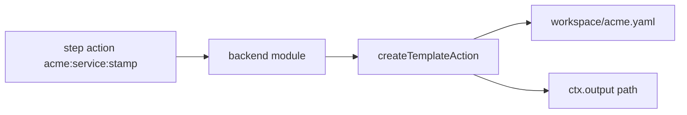

# Custom actions del Scaffolder

Tiempo estimado: 30 min
Nivel: Intermedio
Importancia para entrevista: CRÍTICO
Prioridad: CRÍTICO

Escrito contra el portal instalado: Backstage **1.56.0**, backend nuevo (`createBackend`).

## 1. Objetivo

Registrar la acción `acme:service:stamp`, que escribe `acme.yaml` en el workspace del template.

## 2. Prerrequisitos

Capítulo 07. `yarn start` parado o a punto de reiniciarse: el backend carga módulos al arrancar.

## 3. Concepto

Una acción es una función que el Scaffolder ejecuta dentro de un workspace temporal. `fetch:template`, `github:repo:create` y `debug:log` son acciones. La tuya se crea con `createTemplateAction` y se publica en `scaffolderActionsExtensionPoint`.

El id sigue `proveedor:entidad:verbo`. `acme:service:stamp` no choca con una acción que Backstage publique después.

El schema de input y output es Zod, en la forma `z => z.string(...)`. El handler recibe `ctx.input`, escribe con `ctx.workspacePath` y publica salidas con `ctx.output`. `resolveSafeChildPath` impide que el nombre del fichero salga del workspace.

`supportsDryRun: true` hace que la acción corra en un dry run. Sin eso, el ensayo no escribe el fichero y el laboratorio depende de GitHub.

El módulo es un `createBackendModule` con `pluginId: 'scaffolder'`. `packages/backend/src/index.ts` lo carga con `backend.add(import('./modules/acme/module'))`.

El generador oficial es `yarn new` y la opción `scaffolder-backend-module`. Este laboratorio deja el módulo dentro del backend, que es el mismo contrato con tres ficheros menos. Si la acción la va a consumir otra app, genera el paquete.

Guía usada: [Writing Custom Actions](https://backstage.io/docs/features/software-templates/writing-custom-actions).

## 4. ¿Por qué existe?

`debug:log` imprime. No deja un artefacto. `fetch:template` copia un skeleton. No decide el contenido a partir de una regla de ACME. La acción propia es el sitio de esa regla: aquí, estampar nombre y owner en un YAML que el resto del template podría commitear.

## 5. Arquitectura



## 6. Ejemplo real

Ana pide `ms-inventory` con owner `group:default/guests`. La acción escribe:

```yaml
service: ms-inventory
owner: group:default/guests
platform: acme
```

No llama a GitHub. El token no hace falta para demostrar la acción.

## 7. Laboratorio

Objetivo: el backend lista `acme:service:stamp` entre las acciones habilitadas.

Si partes de un `create-app` limpio, copia `docs/backstage-course/labs/scaffolder/backend/` a `packages/backend/src/modules/acme/` y declara las dos dependencias que el módulo importa. En el portal de esta máquina ya están.

`packages/backend/package.json` incluye `@backstage/backend-plugin-api` y `@backstage/plugin-scaffolder-node`. `packages/backend/src/index.ts` añade el módulo justo después del módulo de GitHub:

```ts
backend.add(import('@backstage/plugin-scaffolder-backend'));
backend.add(import('@backstage/plugin-scaffolder-backend-module-github'));
backend.add(import('./modules/acme/module'));
```

Desde `acme-developer-portal`:

```bash
yarn test --testPathPatterns stampAction --watchAll=false
```

Arranca el portal:

```bash
yarn start
```

En el log del backend tiene que aparecer `acme:service:stamp` en la línea "Starting scaffolder with the following actions enabled".

También puedes abrirlo en http://localhost:3000/create/actions y buscar `acme:service:stamp`.

## 8. Validación

El test contiene `service: ms-inventory`, `owner: group:default/guests` y `platform: acme`. El log de arranque nombra la acción.

## 9. Troubleshooting

### El log de acciones no incluye `acme:service:stamp`

¿Por qué ocurre? `backend.add` no está, el `pluginId` del módulo no es `scaffolder`, o el proceso es el de antes del cambio.
¿Cómo diagnosticarlo? Busca `acme-service-stamp` en el log de módulos instalados.
¿Cómo solucionarlo? Reinicia `yarn start`. El frontend recarga solo. Este módulo no.

### TypeScript no encuentra `createTemplateAction`

¿Por qué ocurre? `@backstage/plugin-scaffolder-node` no está en `dependencies` de `packages/backend`, solo transitivo.
¿Cómo diagnosticarlo? Mira `packages/backend/package.json`.
¿Cómo solucionarlo? Añade `@backstage/plugin-scaffolder-node` y `@backstage/backend-plugin-api` con la versión que ya resolvió el lockfile. No subas de major a mano.

### El dry run no muestra `acme.yaml`

¿Por qué ocurre? `supportsDryRun` no está en `true`. El dry run se salta la acción.
¿Cómo diagnosticarlo? El paso sale como skipped en la UI.
¿Cómo solucionarlo? `supportsDryRun: true` y vuelve a lanzar el dry run. El capítulo 09 es el que lo ejecuta.

## 10. Ejercicio

Añade la línea `kind: service` al documento, sin cambiar el id de la acción. El test tiene que fallar hasta que lo actualices. Vuelve a dejarlo en verde.

## 11. Preguntas de entrevista

### ¿Cómo publicas una custom action?

Respuesta corta: `createTemplateAction` dentro de un backend module, y `scaffolder.addActions` en el extension point.

Explicación: `backend.add` carga el módulo al arrancar. El template la nombra en `steps[].action`.

Qué mencionar: el id con namespace, Zod en el schema, `supportsDryRun` si quieres ensayarla sin Git.

### ¿Por qué `resolveSafeChildPath`?

Respuesta corta: el path del fichero no puede escapar del workspace.

Explicación: el input del template lo escribe un usuario. Un `../` no debe tocar el disco del portal.

Qué mencionar: el workspace es efímero. El fichero sobrevive si un step posterior lo empuja a Git.

## 12. Conexión con arquitectura

- Microservicios: la acción deja la ficha mínima del servicio, no el proceso de Nest.
- Platform Engineering: la regla "todo servicio lleva `acme.yaml`" vive en un solo módulo.
- DevOps: el workspace es el directorio de trabajo del pipeline de scaffolding.
- CI/CD: esta acción no dispara GitHub Actions.
- Cloud: no llama a AWS. Si mañana crea un bucket, el cliente va en el handler y el secreto en el backend, no en el template.
- Developer Experience: `/create/actions` documenta el id, el input y el output.

## 13. Checklist

- [ ] El test del documento pasa
- [ ] El log de arranque lista `acme:service:stamp`
- [ ] `supportsDryRun` está en true
- [ ] El módulo entra por `backend.add`
