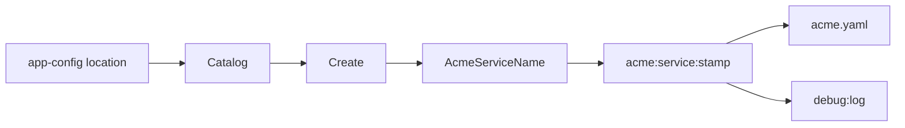

# Template que usa el campo y la acción

Tiempo estimado: 20 min
Nivel: Intermedio
Importancia para entrevista: CRÍTICO
Prioridad: CRÍTICO

## 1. Objetivo

Ejecutar un Software Template que pide el nombre con `AcmeServiceName` y escribe `acme.yaml` con `acme:service:stamp`.

## 2. Prerrequisitos

Capítulos 07 y 08. Portal arrancado. El catálogo de ejemplo trae el grupo `guests`, que es el owner que vas a elegir.

## 3. Concepto

El template es una entidad. El catálogo lo ingiere. El formulario llama al campo. Los steps llaman a la acción. Son tres piezas y este capítulo las junta.

`acme-service-stamp` no usa `github:repo:create`. El segundo step es `debug:log`, para ver en el log del task el path que devolvió la acción. Puedes lanzarlo de verdad o en dry run. Las dos cosas funcionan sin token.

El location está en `app-config.yaml`, con rule `Template`, apuntando a `catalog/templates/acme-service-stamp/template.yaml`. Sin esa rule el kind Template se rechaza.

## 4. ¿Por qué existe?

Un campo sin template no sale en Create. Una acción sin template solo sale en la lista de acciones. La revisión pide las tres cosas porque el formulario y el step tienen que verse juntos.

## 5. Arquitectura



## 6. Ejemplo real

El fichero es `catalog/templates/acme-service-stamp/template.yaml`. El parámetro `name` lleva `ui:field: AcmeServiceName`. El parámetro `owner` sigue siendo `OwnerPicker`, para que veas un campo built-in al lado del tuyo. El step `stamp` pasa `${{ parameters.name }}` y `${{ parameters.owner }}`.

`spec.owner` de la entidad es `user:guest`, el usuario del catálogo de ejemplo. No es el owner que elige Ana en el formulario.

## 7. Laboratorio

Objetivo: un dry run deja `acme.yaml` en el workspace.

Si partes de un `create-app` limpio, copia `docs/backstage-course/labs/scaffolder/template/template.yaml` a `catalog/templates/acme-service-stamp/template.yaml` y añade el location. En este portal ya está.

El bloque de `app-config.yaml`:

```yaml
- type: file
  target: ../../catalog/templates/acme-service-stamp/template.yaml
  rules:
    - allow: [Template]
```

La ruta es relativa a `packages/backend`, que es desde donde corre el proceso.

Reinicia `yarn start` si cambiaste `app-config.yaml` con el portal ya levantado.

1. http://localhost:3000/create
2. Abre **ACME Service Stamp**.
3. Name: `MS-Inventory`. No tiene que dejarte seguir.
4. Name: `ms-inventory`. Owner: `guests`.
5. Llega al review y pulsa el dry run, no Create, si solo quieres ver el fichero. Create también vale: no publica nada.
6. En el resultado del dry run abre `acme.yaml`.

## 8. Validación

`acme.yaml` contiene:

```yaml
service: ms-inventory
owner: group:default/guests
platform: acme
```

El log del task contiene la línea de `debug:log` con `acme.yaml`.

## 9. Troubleshooting

### Create no lista ACME Service Stamp

¿Por qué ocurre? El location no se leyó, o la rule no permite `Template`.
¿Cómo diagnosticarlo? Log del catálogo al procesar `acme-service-stamp/template.yaml`.
¿Cómo solucionarlo? El target y la rule de este capítulo. Reinicia el backend.

### El nombre inválido pasa el formulario

¿Por qué ocurre? El `ui:field` no está aplicado y estás viendo el input string por defecto.
¿Cómo diagnosticarlo? El helper "Lowercase letters, numbers and single hyphens" no aparece.
¿Cómo solucionarlo? Capítulo 07. El módulo tiene que estar en `features`.

### El step `stamp` falla con "action not found"

¿Por qué ocurre? El backend que atiende el task no cargó el módulo.
¿Cómo diagnosticarlo? `/create/actions` no lista `acme:service:stamp`.
¿Cómo solucionarlo? Capítulo 08. Reinicia `yarn start`.

### OwnerPicker sale vacío

¿Por qué ocurre? El catálogo no tiene grupos. El filtro del campo es `kind: Group`.
¿Cómo diagnosticarlo? http://localhost:3000/catalog?filters%5Bkind%5D=group
¿Cómo solucionarlo? `examples/org.yaml` tiene que seguir como location. El grupo se llama `guests`.

## 10. Ejercicio

Añade un parámetro `description` de tipo string, sin `ui:field` propio, y haz que `debug:log` lo imprima. No lo metas en `acme.yaml` todavía. Dry run otra vez.

## 11. Preguntas de entrevista

### ¿Qué tres piezas pide un template con extensión propia?

Respuesta corta: el field en el frontend, la action en el backend y el template que cita las dos.

Explicación: `ui:field` no ejecuta código. `action` no pinta el formulario. El YAML del template solo referencia ids.

Qué mencionar: el template es una entidad del catálogo. Sin location y sin rule `Template`, Create no lo muestra.

### ¿Por qué este template no usa GitHub?

Respuesta corta: para poder enseñar el campo y la acción sin un token.

Explicación: el golden path de NestJS sí publica. Este template es el laboratorio de extensiones. Un step posterior podría hacer `github:repo:push` del mismo workspace.

Qué mencionar: `supportsDryRun` en la acción. Si no, el ensayo no escribe `acme.yaml`.

## 12. Conexión con arquitectura

- Microservicios: el template es la puerta. El sello es el contrato mínimo que platform exige.
- Platform Engineering: platform posee el template (`spec.owner`) y la acción.
- DevOps: el workspace junta el YAML con lo que un step de Git publicaría.
- CI/CD: fuera de alcance. El golden path de NestJS sigue siendo el que lleva el workflow.
- Cloud: fuera de alcance.
- Developer Experience: un formulario, un error de nombre en el acto, un fichero al final.

## 13. Checklist

- [ ] Create lista ACME Service Stamp
- [ ] `MS-Inventory` no pasa
- [ ] `ms-inventory` pasa
- [ ] El dry run muestra `acme.yaml` con service, owner y platform
