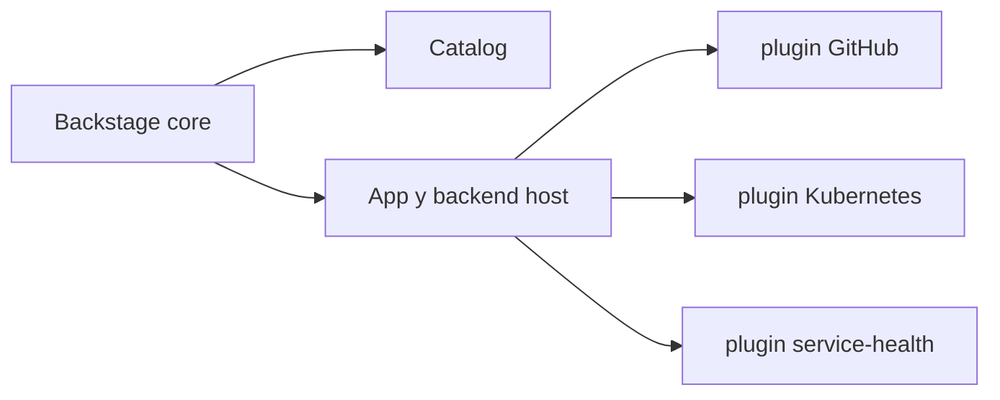

# Concepto de plugin

Tiempo estimado: 15 min
Nivel: Intermedio
Importancia para entrevista: CRÍTICO
Prioridad: CRÍTICO

## 1. Objetivo

Decidir cuándo un plugin existe y cuándo basta una anotación o un link.

## 2. Prerrequisitos

El portal arranca. Sabes qué es un Component.

## 3. Concepto

Un plugin es un paquete que añade capacidad al portal sin modificar el núcleo de Backstage. Puede ser:

- solo frontend: una página, una card en la ficha, una pestaña
- solo backend: una API bajo `/api/<pluginId>`
- los dos: la UI llama a tu backend, y el backend llama a sistemas externos

GitHub, Kubernetes, TechDocs y el Scaffolder son plugins. El catálogo también. Tu app los registra en `packages/backend/src/index.ts` y, en el frontend, en `App.tsx` o como feature del sistema nuevo.

No todo dato nuevo necesita un plugin. El link a Grafana de `ms-orders` es `metadata.links`. Un plugin de Grafana vale cuando quieres embeber paneles, no cuando quieres un enlace.

## 4. ¿Por qué existe?

El núcleo no puede conocer la API interna de cada empresa. ACME quiere ver estado, versión, entorno y último deploy. Eso no es un kind del catálogo. Es un plugin.

## 5. Arquitectura

## 6. Ejemplo real

`service-health` enseña una tabla de `ms-auth`, `ms-orders` y `ms-payments`. El frontend no llama al mock. Llama a `/api/service-health/services`. El backend lee `http://127.0.0.1:4010/services`.

## 7. Laboratorio

Objetivo: anotar tres necesidades de ACME y marcar cuáles son plugin.

| Necesidad | ¿Plugin? | Por qué |
| --- | --- | --- |
| Ver el owner de orders | No | Ya es el catálogo |
| Abrir Grafana | No en la v1 | `metadata.links` |
| Ver versión y último deploy desde una API interna | Sí | Hace falta backend y UI |

Escríbelo en tus notas. El resto del módulo construye la tercera fila.

## 8. Validación

Tu tabla no propone un plugin para el owner.

## 9. Troubleshooting

### Quiero un plugin por cada microservicio

¿Por qué ocurre? Confundes ficha y herramienta.
¿Cómo diagnosticarlo? ¿El comportamiento es el mismo para auth, orders y payments?
¿Cómo solucionarlo: un plugin de salud para todos. La ficha ya distingue el servicio.

### Instalé un plugin de la comunidad sin mirar la versión

¿Por qué ocurre? El marketplace tienta.
¿Cómo diagnosticarlo? El plugin no arranca y cita un peer dependency de Backstage.
¿Cómo solucionarlo: este curso no instala plugins de comunidad salvo que un capítulo lo diga. La versión tiene que coincidir con tu 1.55.x.

### Metí lógica de pedidos en un plugin

¿Por qué ocurre? Es Node y "ya que estamos".
¿Cómo solucionarlo: el plugin muestra plataforma. El negocio sigue en `ms-orders`.

## 10. Ejercicio

Di una feature que implementarías como anotación y otra como plugin, distintas de la tabla.

## 11. Preguntas de entrevista

### ¿Qué es un plugin?

Respuesta corta: una extensión empaquetada, de UI, de backend, o de las dos, que se registra en la app.

Explicación: no se fork ea Backstage para añadir una página.

Qué mencionar: `/api/<pluginId>` y el límite de "no pongas el secreto en el frontend".

### ¿Cuándo no crearías un plugin?

Respuesta corta: cuando el catálogo ya tiene el dato, o cuando un link basta.

Explicación: owner, system y API son modelo. Grafana, en la v1 de ACME, es un link.

Qué mencionar: un plugin se justifica si hay lógica, una credencial o una vista que el núcleo no tiene.

## 12. Conexión con arquitectura

- Microservicios: el plugin no es un microservicio de negocio. Es parte del portal.
- Platform Engineering: los plugins son el producto interno, con dueño de plataforma.
- DevOps: se versionan con la app.
- CI/CD: se construyen en el pipeline del portal.
- Cloud: el plugin de backend es el único con credenciales cloud.
- Developer Experience: una capacidad nueva aparece en el mismo host.

## 13. Checklist

- [ ] Distingo plugin, link y campo del catálogo
- [ ] Sé que service-health tendrá frontend y backend
- [ ] No voy a forkear el núcleo
- [ ] El negocio de pedidos no entra en el plugin
