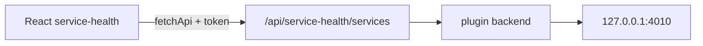

# Arquitectura de plugins

Tiempo estimado: 20 min
Nivel: Intermedio
Importancia para entrevista: CRÍTICO
Prioridad: CRÍTICO

## 1. Objetivo

Saber cómo se registra un plugin de backend y cómo detectar si tu frontend es el clásico o el nuevo.

## 2. Prerrequisitos

`packages/backend/src/index.ts` lo viste en la instalación.

## 3. Concepto

Backend, el que vas a usar. Es el sistema actual, no el legacy `createRouter` montado a mano en un `index` gigante:

```ts
backend.add(import('@internal/plugin-service-health-backend'));
```

El paquete exporta por defecto un `createBackendPlugin`. Dentro, `registerInit` declara dependencias: `coreServices.logger`, `coreServices.httpRouter`, `coreServices.rootConfig`. El router queda en `/api/service-health`.

Por defecto ese router exige el token de Backstage. El frontend manda el token con `fetchApi`. No abras el endpoint como público. El mock de salud no es público hacia el browser: es público solo en `127.0.0.1` y solo lo llama el backend.

Frontend. Hay dos sistemas:

| | Clásico | Nuevo |
| --- | --- | --- |
| Cómo se crea | `createPlugin` de `@backstage/core-plugin-api` | `createFrontendPlugin` de `@backstage/frontend-plugin-api` |
| Página | `createRoutableExtension` | `PageBlueprint` |
| Dónde se registra | `packages/app/src/App.tsx` | feature instalada en la app nueva |
| CLI | `yarn new` → `frontend-plugin` | el paquete exporta el plugin como default |

La página oficial "Create a Backstage Plugin" está marcada como legacy y describe `yarn new`. El sistema nuevo es el que debes nombrar en una entrevista de arquitectura. El lab te hace detectar cuál generó tu app.

Configuración propia. Una clave `acme.healthApi.baseUrl` sin schema tira el arranque: Backstage rechaza config desconocida. El paquete de backend lleva `config.d.ts` y en su `package.json` la entrada `"configSchema": "config.d.ts"`. La visibilidad es `backend`. El browser no recibe esa URL.

## 4. ¿Por qué existe?

Hace falta un sitio para credenciales, otro para la UI, y un contrato de config que no deje pasar typos. Si la URL del mock se cuela como string suelto en React, el día que sea una API interna con token habrás enseñado el patrón malo.

## 5. Arquitectura



## 6. Ejemplo real

El código de referencia está en `docs/backstage-course/labs/plugin/`. No lo copies todavía. Primero `yarn new` genera el `package.json` con las versiones de tu app. Luego sustituyes los fuentes. Si copias un `package.json` inventado, las versiones no coinciden con 1.55 y el workspace no enlaza.

## 7. Laboratorio

Objetivo: clasificar tu frontend.

Dónde: `acme-developer-portal`.

```bash
cd acme-developer-portal
grep -n "app-defaults\|frontend-defaults\|createApp" packages/app/src/App.tsx | head
```

Qué hace: enseña qué sistema usa la UI.

- Si aparece `@backstage/app-defaults`, vas por el lab clásico. Es lo habitual en `create-app` de esta línea.
- Si aparece `@backstage/frontend-defaults` y no hay un `App.tsx` clásico, vas por el sistema nuevo. El fichero `plugin-new-frontend.tsx` del curso es tu punto de partida.

Anota el resultado en tus notas. El capítulo de frontend plugin ramifica aquí.

Resultado esperado: una línea clara, no las dos a la vez. Si `grep` no encuentra `App.tsx`, lista `packages/app/src` y quédate con el fichero que construye la app. No inventes el sistema.

## 8. Validación

Puedes decir "mi app usa el frontend clásico" o "usa el nuevo", con el import como prueba.

## 9. Troubleshooting

### `grep` no encuentra nada

¿Por qué ocurre? La ruta del App cambió en tu versión.
¿Cómo diagnosticarlo? `find packages/app/src -name '*.tsx' | head`
¿Cómo solucionarlo: abre el fichero que importa plugins de catalog. El import de `app-defaults` o `frontend-defaults` es la respuesta.

### Añadí `acme:` al config antes de crear el plugin

¿Por qué ocurre? Adelantaste el capítulo de API.
¿Cómo diagnosticarlo? El arranque dice configuración desconocida o schema.
¿Cómo solucionarlo: quita el bloque `acme` hasta que el plugin con `config.d.ts` esté instalado.

### Confundo module y plugin

¿Por qué ocurre? El backend tiene los dos.
¿Cómo diagnosticarlo? ¿Estás añadiendo una feature nueva o extendiendo el catálogo?
¿Cómo solucionarlo: service-health es un plugin (`createBackendPlugin`). Un processor de entidades sería un module del plugin catalog (`createBackendModule`). No lo necesitas en este curso.

## 10. Ejercicio

Di qué se rompería si `baseUrl` viajara al frontend. Una frase sobre el token de la API interna del futuro.

## 11. Preguntas de entrevista

### ¿Cómo se estructura un plugin?

Respuesta corta: un paquete de backend con `createBackendPlugin` y, si hay UI, un paquete de frontend registrado en la app.

Explicación: el backend monta `/api/<id>`. La config propia va en `config.d.ts`.

Qué mencionar: los dos sistemas de frontend. Di cuál usaste y que conoces el otro.

### ¿Qué es un backend module?

Respuesta corta: una extensión de un plugin existente, por ejemplo un processor del catálogo.

Explicación: no es un plugin nuevo. Comparte el `pluginId` del plugin que extiende.

Qué mencionar: service-health no es un module. Es un plugin.

## 12. Conexión con arquitectura

- Microservicios: el plugin es un módulo dentro del proceso del portal, no un deploy aparte. Podrías extraerlo, y no hace falta.
- Platform Engineering: el schema de config evita que cada entorno invente claves.
- DevOps: el plugin se publica con la imagen del portal.
- CI/CD: se compila con `yarn tsc` de la app.
- Cloud: la URL y el futuro token se leen de config con visibilidad backend.
- Developer Experience: una página más en el mismo origen.

## 13. Checklist

- [ ] Sé cómo se hace `backend.add`
- [ ] Clasifiqué mi frontend
- [ ] Sé para qué es `config.d.ts`
- [ ] Distingo plugin y module
