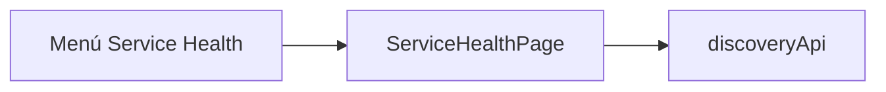

# Plugin de frontend — LAB 13

Tiempo estimado: 40 min
Nivel: Intermedio
Importancia para entrevista: CRÍTICO
Prioridad: CRÍTICO

## 1. Objetivo

Tener una página Service Health en el portal. En este capítulo la página puede fallar la llamada al API: el backend llega en el capítulo siguiente. Aquí tiene que existir la ruta y el código de la tabla.

## 2. Prerrequisitos

Sabes si tu app es frontend clásico o nuevo.

## 3. Concepto

La página pide `discoveryApi.getBaseUrl('service-health')` y llama a `/services` con `fetchApi`. `discoveryApi` resuelve el prefijo correcto (`http://localhost:7007/api/service-health` en local). No escribas el puerto 7007 en el componente.

El código de la página está en `docs/backstage-course/labs/plugin/service-health/src/ServiceHealthPage.tsx`. Usa `@backstage/core-plugin-api` y `@backstage/core-components`, que son los paquetes del frontend clásico y también sirven como componentes visuales si el sistema nuevo los trae en la app.

El fichero `plugin-new-frontend.tsx` es la variante con `PageBlueprint`. Úsalo solo si tu app es el sistema nuevo.

## 4. ¿Por qué existe?

Sin página no hay lab. El backend solo, en curl, no demuestra el portal.

## 5. Arquitectura



## 6. Ejemplo real

La tabla tendrá columnas Servicio, Estado, Versión, Entorno, Último deploy. Los datos son los tres microservicios de ACME. `ms-payments` vendrá `degraded` cuando el mock esté vivo. Es un dato de laboratorio, no un incidente real.

## 7. Laboratorio

Objetivo: ruta `/service-health` registrada.

Dónde: `acme-developer-portal`.

```bash
cd acme-developer-portal
yarn new
```

Elige `frontend-plugin`. ID: `service-health`. El CLI crea `plugins/service-health` y, en el sistema clásico, lo añade a `App.tsx`.

Cuando termine, sustituye la página de ejemplo por la del curso.

Camino clásico (`app-defaults`):

1. Copia `docs/backstage-course/labs/plugin/service-health/src/ServiceHealthPage.tsx` a `plugins/service-health/src/components/ServiceHealthPage/ServiceHealthPage.tsx` si el CLI creó esa carpeta, o reemplaza el componente de página que el plugin ya exporta.
2. Haz que el extension de la ruta renderice `ServiceHealthPage`. El plugin generado ya tiene un `createRoutableExtension`. Cambia el import lazy para que apunte a tu componente, sin borrar el `mountPoint` ni el `routeRef` que generó el CLI.
3. Confirma que `packages/app/src/App.tsx` tiene la ruta. `yarn new` suele insertarla. Si no, añade el `<Route>` que los otros plugins usan, con `path="/service-health"`.

No reescribo aquí el `App.tsx` completo de tu versión: el CLI ya lo tocó y un pegado ciego pisa el catálogo. Abre el diff de `yarn new` y no reviertas las rutas de catalog, scaffolder y api-docs.

Camino nuevo (`frontend-defaults`):

1. Copia `ServiceHealthPage.tsx` y `plugin-new-frontend.tsx` al `src/` del plugin.
2. El default export del paquete tiene que ser el `createFrontendPlugin`. Sigue el README que haya dejado tu versión para instalar la feature. Si esa instalación no está documentada en el árbol generado, no inventes un `createApp` paralelo: quédate con el camino clásico creando el plugin `frontend-plugin`, que es el que el CLI soporta de forma explícita.

Arranca:

```bash
cd acme-developer-portal
yarn start
```

Abre http://localhost:3000/service-health

Resultado esperado: la página con el título **Service Health**. La tabla puede decir que el backend respondió 404. Es correcto en este capítulo. El 404 desaparece cuando registres el backend.

## 8. Validación

La ruta carga dentro del portal, con el header de Backstage, no como un HTML suelto. El 404 del API, si aparece, nombra el status. No hay un crash de React en la consola por un import roto.

## 9. Troubleshooting

### `yarn new` no ofrece frontend-plugin

¿Por qué ocurre? El CLI de tu versión renombró las plantillas.
¿Cómo diagnosticarlo? Lee la lista que imprime. Busca la que diga frontend.
¿Cómo solucionarlo: elige esa. Si solo existe el sistema nuevo, usa `plugin-new-frontend.tsx` y el README del paquete generado.

### La página está en blanco

¿Por qué ocurre? El Route no está montado, o el import del componente falla.
¿Cómo diagnosticarlo? Consola del navegador y la terminal de Rspack.
¿Cómo solucionarlo: el path `/service-health` tiene que estar en `App.tsx` en el sistema clásico. No borres el `FlatRoutes` existente.

### `Cannot find module @backstage/core-components`

¿Por qué ocurre? El plugin nuevo no declara la dependencia.
¿Cómo diagnosticarlo? El error de TypeScript nombra el módulo.
¿Cómo solucionarlo: `yarn --cwd plugins/service-health add @backstage/core-components @backstage/core-plugin-api` usando los rangos que ya usa `packages/app`. Mira la versión en `packages/app/package.json` y alinea. No subas de major.

### La tabla llama a `localhost:4010` desde el browser

¿Por qué ocurre? Saltaste el diseño y pusiste el mock en el `fetch` del componente.
¿Cómo diagnosticarlo? La pestaña Network del browser.
¿Cómo solucionarlo: la URL tiene que ser la de `discoveryApi`, bajo `/api/service-health`.

## 10. Ejercicio

Añade una columna mental, sin implementarla todavía: "fuente". ¿Qué valor tendría y por qué no debe ser la URL del mock pintada en la tabla?

## 11. Preguntas de entrevista

### ¿Cómo crea un plugin de frontend?

Respuesta corta: `yarn new`, paquete en `plugins/`, ruta en la app, datos vía `discoveryApi` y `fetchApi`.

Explicación: el componente no conoce el puerto del backend.

Qué mencionar: sistema clásico y `PageBlueprint` del sistema nuevo.

## 12. Conexión con arquitectura

- Microservicios: la página agrega varios servicios. No es la UI de uno solo.
- Platform Engineering: la vista es de plataforma.
- DevOps: el "último deploy" es un dato que el backend obtendrá, no un `kubectl` en el browser.
- CI/CD: el plugin se versiona con el portal.
- Cloud: sin credenciales en el bundle.
- Developer Experience: una URL estable `/service-health`.

## 13. Checklist

- [ ] Existe `plugins/service-health`
- [ ] http://localhost:3000/service-health abre la página
- [ ] El fetch no apunta a `:4010`
- [ ] No pisé las rutas del catálogo al editar `App.tsx`
