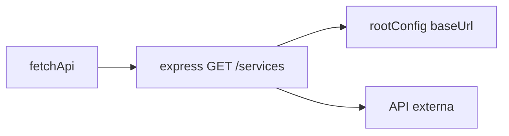

# Plugin de backend — LAB 13

Tiempo estimado: 35 min
Nivel: Intermedio
Importancia para entrevista: CRÍTICO
Prioridad: CRÍTICO

## 1. Objetivo

Exponer `GET /api/service-health/services` desde el backend de Backstage, todavía con datos fijos si el mock no está. El capítulo siguiente conecta el mock. Este deja el plugin registrado y el schema de config.

## 2. Prerrequisitos

Capítulo de arquitectura de plugins. La página de frontend existe.

## 3. Concepto

`yarn new` → `backend-plugin` crea `plugins/service-health-backend` con `createBackendPlugin`, un router Express y el export default.

El curso reemplaza tres ficheros:

- `src/index.ts`
- `src/plugin.ts`
- `src/router.ts`

Y añade `config.d.ts`. En el `package.json` generado tiene que estar:

```json
"configSchema": "config.d.ts"
```

Si el CLI ya generó un `config.d.ts` vacío, sustituye su contenido por el del curso.

El router hace `fetch` a `baseUrl`. Si el mock está caído, responde 502 con `{ "error": "health api unavailable" }`. No traga el error. Un 200 con lista vacía ocultaría la caída.

El `httpRouter` exige autenticación. La página, con `fetchApi`, envía el token de guest. No añadas `addAuthPolicy` de `unauthenticated` en este lab. Si lo haces, cualquiera que llegue al puerto 7007 lee el estado sin pasar por el portal.

## 4. ¿Por qué existe?

La página necesita un origen en el mismo backend, con el modelo de auth de Backstage, no un `json-server` publicado al navegador.

## 5. Arquitectura



## 6. Ejemplo real

`plugin.ts` lee `acme.healthApi.baseUrl`. Si no está, usa `http://127.0.0.1:4010`. El default existe para que el lab arranque antes de tocar config. En producción no dejes un default apuntando a localhost: pon la clave en la config del entorno y falla si falta. El `getOptionalString` es una simplificación de laboratorio. El techo está escrito en el código del curso con el comentario que vas a añadir en el ejercicio.

## 7. Laboratorio

Objetivo: el plugin carga en el arranque.

Dónde: `acme-developer-portal`.

```bash
cd acme-developer-portal
yarn new
```

Elige `backend-plugin`. ID: `service-health`.

Copia encima, desde el repo del curso:

```text
labs/plugin/service-health-backend/src/index.ts
labs/plugin/service-health-backend/src/plugin.ts
labs/plugin/service-health-backend/src/router.ts
labs/plugin/service-health-backend/config.d.ts
```

Si el CLI nombró el router `src/service/router.ts`, deja el fichero donde el `plugin.ts` generado lo importaba **o** adapta el import a `./router`. Una sola copia. No dejes dos routers.

En `package.json` del plugin:

```json
"configSchema": "config.d.ts"
```

`yarn new` suele añadir `backend.add(...)` en `packages/backend/src/index.ts`. Comprueba que existe:

```ts
backend.add(import('@internal/plugin-service-health-backend'));
```

El nombre del paquete es el del `package.json` generado. Si el CLI usó otro scope, usa ese string, no uno inventado.

Añade la config solo después de tener el schema. En `app-config.local.yaml`:

```yaml
acme:
  healthApi:
    baseUrl: http://127.0.0.1:4010
```

Arranca el mock, en otra terminal:

```bash
cd docs/backstage-course/labs/mock-health-api
node server.mjs
```

Dónde: la raíz del repo del curso, no dentro de `acme-developer-portal`.
Qué hace: escucha en `127.0.0.1:4010`.
Resultado esperado: `mock health api on http://127.0.0.1:4010/services`.

Comprueba el mock:

```bash
curl -s http://127.0.0.1:4010/services
```

Tiene que imprimir JSON con `ms-orders` y `ms-payments`.

Reinicia Backstage:

```bash
cd acme-developer-portal
yarn start
```

Resultado esperado en el log: `service-health reads http://127.0.0.1:4010` y el plugin en la lista de inicialización.

Abre http://localhost:3000/service-health

La tabla muestra tres filas. `ms-payments` está `degraded`.

## 8. Validación

La tabla tiene Servicio, Estado, Versión, Entorno y Último deploy. El network del browser llama a `/api/service-health/services`, no al puerto 4010.

## 9. Troubleshooting

### Unknown configuration key `acme`

¿Por qué ocurre? El schema no está enlazado o el paquete no se compiló.
¿Cómo diagnosticarlo? ¿`package.json` tiene `configSchema`? ¿El plugin está en `backend.add`?
¿Cómo solucionarlo: la clave `configSchema` y reiniciar. El backend descubre schemas de los paquetes instalados en el workspace.

### 401 en `/api/service-health/services`

¿Por qué ocurre? Llamaste con `curl` sin token, o la página usa `fetch` pelado.
¿Cómo diagnosticarlo? La página debe usar `fetchApi`.
¿Cómo solucionarlo: no abras el endpoint. Arregla el cliente. `curl` sin token tiene que seguir en 401. Esa es la prueba de que auth sigue puesta.

### 502 en la tabla

¿Por qué ocurre? El mock no está corriendo o el puerto no es 4010.
¿Cómo diagnosticarlo? `curl` al mock. El log del plugin dice `health api failed`.
¿Cómo solucionarlo: `node server.mjs` y refresca la página.

### El CLI no registró `backend.add`

¿Por qué ocurre? Plantilla distinta o el fichero ya estaba modificado.
¿Cómo diagnosticarlo? Busca `service-health` en `packages/backend/src/index.ts`.
¿Cómo solucionarlo: añade la línea al lado de los otros `backend.add`. El import es dinámico (`import('...')`), no un `require` estático.

## 10. Ejercicio

En `plugin.ts`, sustituye el default localhost por un fallo explícito si la config no está, solo en una rama mental para la entrevista. En el código del lab puedes dejar el default. Añade encima un comentario:

```ts
// ponytail: default localhost solo para el lab; en prod exigir acme.healthApi.baseUrl
```

## 11. Preguntas de entrevista

### ¿Cómo crea un plugin de backend?

Respuesta corta: `yarn new` backend-plugin, `createBackendPlugin`, router en el `httpRouter`, registro con `backend.add`.

Explicación: las dependencias se declaran en `deps` y se inyectan en `init`. La config se lee de `rootConfig` y se declara en `config.d.ts`.

Qué mencionar: auth por defecto, 502 si la dependencia externa cae, secreto fuera del frontend.

## 12. Conexión con arquitectura

- Microservicios: el plugin es un adapter hexagonal. El mock es el puerto de salida.
- Platform Engineering: una API interna de plataforma, no de negocio.
- DevOps: el 502 es operable. Un 200 vacío no.
- CI/CD: el paquete entra en el build del portal.
- Cloud: `baseUrl` por entorno.
- Developer Experience: la tabla vive en el portal, con la misma sesión.

## 13. Checklist

- [ ] El log dice `service-health reads`
- [ ] La tabla muestra tres servicios
- [ ] `curl` al API de Backstage sin token no devuelve los datos
- [ ] El schema de `acme` existe
