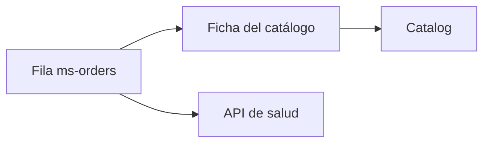

# Plugin a medida

Tiempo estimado: 15 min
Nivel: Avanzado
Importancia para entrevista: ALTO
Prioridad: MEDIO

## 1. Objetivo

Cerrar el módulo decidiendo qué más tendría service-health en una empresa, y qué no vas a construir hoy.

## 2. Prerrequisitos

Labs 13 y 14 funcionando.

## 3. Concepto

Un plugin a medida se queda pequeño si cumple una pregunta. Service-health cumple "¿en qué versión y entorno está cada servicio, y cuándo se desplegó?".

En una empresa, el siguiente incremento no es más columnas. Es enlazar la fila con la entidad del catálogo (`/catalog/default/component/ms-orders`) y no duplicar el owner, que ya está en el catálogo. Duplicar el owner en el mock sería una segunda fuente de verdad.

Tampoco hace falta un plugin por entorno. El campo `environment` ya viaja en el JSON. Si hubiera prod y dev, serían dos portales o dos configs `baseUrl`, no dos plugins.

## 4. ¿Por qué existe?

Las entrevistas se ganan diciendo qué no construirías. Este capítulo es esa respuesta, con un cambio pequeño y real: un link a la ficha.

## 5. Arquitectura



## 6. Ejemplo real

La fila `ms-orders` debería llevar a `http://localhost:3000/catalog/default/component/ms-orders`. El nombre del mock coincide con `metadata.name`. Esa convención es el contrato entre el equipo de la API de salud y el catálogo. Si alguien nombra el servicio distinto en cada sitio, el link miente.

## 7. Laboratorio

Objetivo: convertir el nombre en un enlace.

En `ServiceHealthPage.tsx`, la columna `name` puede renderizar un enlace. Si la `Table` de `@backstage/core-components` te deja un `render`, úsalo. Si la versión de la tabla no acepta `render` como esperas, un párrafo debajo de la tabla con tres links basta y es más honesto que pelearte con la API del componente:

```tsx
<a href="/catalog/default/component/ms-orders">ms-orders</a>
```

Usa rutas relativas del portal, no `localhost` fijo.

Validación manual: el click abre la ficha de `ms-orders` que ya conoces, con su owner `commerce-team`.

No añadas columnas nuevas.

## 8. Validación

Desde Service Health llegas a la ficha de orders y reconoces el owner del catálogo, que no está en el JSON del mock.

## 9. Troubleshooting

### El link abre fuera del router y recarga mal

¿Por qué ocurre? Un `<a href>` recarga la página. En el sistema clásico a veces quieres `Link` de `react-router-dom`.
¿Cómo diagnosticarlo? La página parpadea entera.
¿Cómo solucionarlo: si ya tienes `react-router` en la app, usa su `Link`. Si el `<a>` funciona y vuelve a pintar el portal, déjalo. No añadas un router nuevo.

### El link 404

¿Por qué ocurre? El name del mock y el del catálogo no coinciden, o falta el namespace `default`.
¿Cómo diagnosticarlo? Abre la ficha desde Catalog y copia la URL.
¿Cómo solucionarlo: `/catalog/default/component/ms-orders`.

### Añadiste el owner al mock

Deshazlo. El ejercicio era no duplicar.

## 10. Ejercicio

Escribe el contrato en una frase: "el campo `name` del API de salud es el `metadata.name` del Component". Dónde lo guardarías para que no se pierda: en el README del plugin, no en un ADR de orders.

## 11. Preguntas de entrevista

### ¿Cómo evolucionas un plugin custom?

Respuesta corta: una pregunta de usuario por incremento, sin copiar datos que el catálogo ya tiene.

Explicación: service-health enlaza a la ficha. No reimplementa ownership.

Qué mencionar: el name es el contrato entre sistemas.

## 12. Conexión con arquitectura

- Microservicios: el identificador estable es el del catálogo.
- Platform Engineering: el contrato del name se documenta donde vive el plugin.
- DevOps: el deploy que muestra la tabla tiene que ser el mismo identificador que Kubernetes (`backstage.io/kubernetes-id` alineado con `name`).
- CI/CD: el pipeline que despliega debería informar a la API de salud. El mock simula ese informe.
- Cloud: sin cambio.
- Developer Experience: de la tabla a la ficha en un clic.

## 13. Checklist

- [ ] Hay un camino desde la tabla hasta la ficha
- [ ] El owner se lee del catálogo, no del mock
- [ ] Puedo decir qué no añadí
- [ ] El contrato del `name` está escrito
