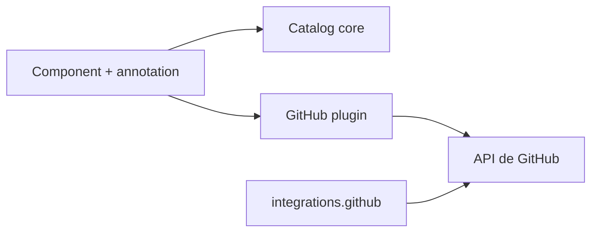

# GitHub — LAB 11

Tiempo estimado: 30 min
Nivel: Intermedio
Importancia para entrevista: CRÍTICO
Prioridad: CRÍTICO

## 1. Objetivo

Separar qué hace el plugin de GitHub y qué hace el núcleo, y ver repo, código y la ausencia honesta de PRs si el repo no es tuyo.

## 2. Prerrequisitos

Anotación `github.com/project-slug: acme/ms-auth` ya puesta. Token de integración solo si vas a leer GitHub de verdad. El capítulo de templates ya explicó dónde vive el token.

## 3. Concepto

El núcleo guarda la entidad y la anotación. No habla con GitHub.

El plugin `@backstage/plugin-catalog-backend-module-github` y la integración `integrations.github` hacen el trabajo de red: leer ficheros, y en la UI el plugin de GitHub muestra el slug. La app generada suele traer ya la pestaña de CI/GitHub en la entidad si el módulo de frontend está registrado. Si no ves PRs, el paquete de UI puede no estar montado: no es que el catálogo "incluya GitHub".

Qué enseña cada capa:

| Pregunta | Quién responde |
| --- | --- |
| ¿Cuál es el repo? | La anotación en el catálogo |
| ¿Puedo leer el YAML remoto? | Integración + token, en el backend |
| ¿Qué PRs hay abiertos? | Plugin de GitHub, si está instalado y el token puede leer la repo |
| ¿Quién es el owner? | El catálogo, no GitHub |
| ¿Quién puede mergear? | GitHub. Backstage no lo decide |

`acme/ms-auth` es un slug de ejemplo. Si esa org y ese repo no existen, la pestaña mostrará error. El catálogo sigue bien. Para un lab con datos reales, cambia el slug a un repo público que controles, por ejemplo el repo del curso si lo publicas, y el token solo si es privado.

Hay otra forma de integrar GitHub: descubrir repos e ingerir todos los `catalog-info.yaml` de una org. Es el provider de catalog, no la pestaña. Con 500 servicios esa es la vía. Con tres, el `file` location del curso es la vía de aprendizaje.

## 4. ¿Por qué existe?

El portal que no abre el código obliga a tener el repo en otro bookmark. El plugin cierra ese salto sin copiar el código a la base de Backstage.

## 5. Arquitectura

## 6. Ejemplo real

`ms-orders` declara `github.com/project-slug: acme/ms-orders`. El owner sigue siendo `commerce-team`, aunque el repo tenga otros colaboradores. Ownership no se importa solo de los admins de GitHub. Se puede construir esa sincronización. No es el default, y mezclarlas sin querer hace que un admin accidental de GitHub parezca dueño del servicio.

## 7. Laboratorio

Objetivo: ver la anotación en la UI y, si tienes un repo real, apuntar una entidad a él.

1. Abre `ms-orders` en el Catalog. En la overview tiene que aparecer el enlace de código o la anotación. El `metadata.links` del YAML también tiene un enlace "Repositorio" a `https://github.com/acme/ms-orders`. Ese link es núcleo del catálogo (`metadata.links`). Funciona aunque GitHub responda 404. Ábrelo y constata el 404. Esa es la diferencia: el link no consulta la API.
2. Si el plugin de GitHub está en la ficha, abre la pestaña. Con el slug falso verás un error de API. Léelo.
3. Opcional, con un repo real: duplica la anotación en una copia local de `ms-auth.yaml` hacia `tu-org/tu-repo`, reinicia, y mira si la pestaña lista el contenido. Revierte el slug a `acme/ms-auth` al terminar para que el resto del curso no dependa de tu cuenta.

No implementes el provider de org entera. Explícalo en la entrevista como el paso de 3 a 500 servicios.

## 8. Validación

Puedes señalar en la ficha qué parte es un link estático y qué parte fallaría sin token. El 404 del repo `acme/ms-orders` es un resultado válido del lab.

## 9. Troubleshooting

### Puse el token y sigue el 404

¿Por qué ocurre? El repo no existe. El token no crea la org `acme`.
¿Cómo diagnosticarlo? Abre la URL en el navegador, sin Backstage.
¿Cómo solucionarlo: usa un slug real o acepta el 404 como prueba del link estático.

### El token funciona para el Scaffolder y la pestaña no lista PRs

¿Por qué ocurre? Falta el frontend plugin de GitHub, o el token no tiene permiso de pull requests.
¿Cómo diagnosticarlo? ¿Hay pestaña en la entidad? ¿El log de backend habla de GitHub?
¿Cómo solucionarlo: no bloquees el día instalando un paquete de más si la versión no coincide. En la entrevista di: la anotación es el contrato; el plugin es el cliente. Si el paquete no está montado, el link de `metadata.links` sigue siendo el mínimo.

### Sincronicé owners desde GitHub y pisé `commerce-team`

¿Por qué ocurre? Un processor de CODEOWNERS demasiado agresivo.
¿Cómo diagnosticarlo? El owner cambió solo después de un refresh.
¿Cómo solucionarlo: en este curso no actives ese módulo. El owner lo decide el YAML.

## 10. Ejercicio

Escribe dos bullets: qué se pierde si borras la anotación y dejas el `metadata.links`, y qué se pierde al revés.

## 11. Preguntas de entrevista

### ¿Cómo integras GitHub?

Respuesta corta: anotación `github.com/project-slug`, integración con token en el backend, y el plugin de UI para PRs, issues y código.

Explicación: el catálogo no llama a GitHub. El plugin sí.

Qué mencionar: el token de integración no es el OAuth de login. Para muchos repos, discovery por org en lugar de locations a mano.

## 12. Conexión con arquitectura

- Microservicios: un repo por servicio en el path de ACME.
- Platform Engineering: el slug es convención. El template lo rellena cuando el repoUrl se parsea; el skeleton del curso deja el kubernetes-id y el techdocs-ref, y el slug lo añade el equipo o una evolución del template. Si te preguntas por qué el skeleton no trae `github.com/project-slug`, es porque el `repoUrl` del formulario no está partido en owner y repo dentro del skeleton. Es una mejora v2, no un olvido que debas tapar a mano durante el dry run.
- DevOps: PRs y checks viven en GitHub.
- CI/CD: Actions se ve desde el plugin o desde el link al workflow.
- Cloud: GitHub no sustituye el registry de imágenes.
- Developer Experience: de la ficha al código en un clic cuando el repo existe.

## 13. Checklist

- [ ] Vi el link estático de `ms-orders`
- [ ] Sé que el 404 no rompe el catálogo
- [ ] Distingo plugin, integración y anotación
- [ ] No pisé el owner con datos de GitHub
