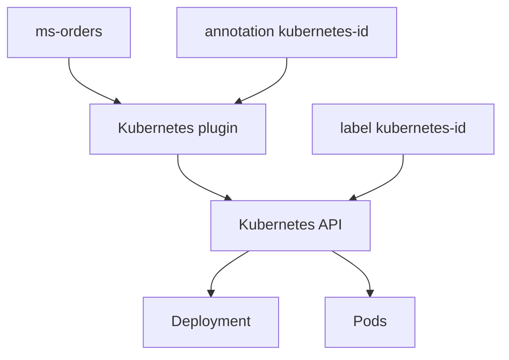

# Kubernetes — LAB 12

Tiempo estimado: 35 min
Nivel: Intermedio
Importancia para entrevista: CRÍTICO
Prioridad: ALTO

## 1. Objetivo

Explicar el camino Backstage → plugin de Kubernetes → API del cluster → Deployment y Pods, y encenderlo si ya tienes un cluster local.

## 2. Prerrequisitos

`ms-orders` tiene las anotaciones `backstage.io/kubernetes-id` y `backstage.io/kubernetes-namespace`. Docker si vas a usar kind o el Kubernetes de Docker Desktop.

## 3. Concepto

El plugin no adivina qué pods son de un servicio. Hace falta:

1. Un cluster en `kubernetes.clusterLocatorMethods`.
2. En el Component, `backstage.io/kubernetes-id: ms-orders`.
3. En los objetos del cluster, el label `backstage.io/kubernetes-id: ms-orders`.

El locator dice en qué clusters buscar. `multiTenant` mira todos los clusters configurados. `catalogRelation` solo mira clusters que el component declara en `dependsOn`.

Para un cluster de verdad en local, el locator más simple es `config` con la URL del API y un token de service account, o `localKubectlProxy` si levantas `kubectl proxy`. La guía oficial describe ambos. El token de service account no va en una anotación del catálogo: cualquiera que lea `/api/catalog` lo vería. Por eso el locator `catalog` no acepta `serviceAccount`. El token va en config o en el entorno.

El manifiesto del lab está en `docs/backstage-course/labs/k8s/ms-orders.yaml`. Usa `nginx` a propósito. No construye el NestJS. El objetivo es ver pods en la ficha, no servir pedidos.

Si no tienes cluster, el lab obligatorio es el diagrama y la lectura del manifiesto. Levantar kind puede llevar más tiempo del que te queda. No es obligatorio para defender la entrevista si puedes recorrer el flujo y nombrar el label.

## 4. ¿Por qué existe?

El Deployment vive en el cluster. El Component vive en el catálogo. Sin un identificador común, el plugin no puede unirlos.

## 5. Arquitectura



## 6. Ejemplo real

Namespace `acme`, label `backstage.io/kubernetes-id: ms-orders` en el Deployment, el Pod template y el Service. Si el label solo está en el Deployment y no en el pod template, la lista de pods sale vacía. Es el error clásico.

## 7. Laboratorio

### Camino A — sin cluster

1. Lee `labs/k8s/ms-orders.yaml` y subraya los tres sitios del label.
2. Lee las anotaciones de `catalog/components/ms-orders/catalog-info.yaml`.
3. Escribe el flujo de cinco cajas del diagrama sin mirarlo.

Eso valida el lab si `kubectl` no existe.

### Camino B — con cluster

Dónde: una terminal con `kubectl` ya apuntando a docker-desktop, minikube o kind.

```bash
kubectl create namespace acme --dry-run=client -o yaml | kubectl apply -f -
kubectl apply -f docs/backstage-course/labs/k8s/ms-orders.yaml
kubectl -n acme get pods -l backstage.io/kubernetes-id=ms-orders
```

Resultado esperado: un pod Running.

Configura el locator. Ejemplo con `kubectl proxy` en otra terminal (`kubectl proxy --port=8001`):

```yaml
kubernetes:
  serviceLocatorMethod:
    type: multiTenant
  clusterLocatorMethods:
    - type: localKubectlProxy
```

Si tu versión no acepta `localKubectlProxy` sin clusters (el log te lo dirá al arrancar), usa el método `config` de la documentación oficial con la URL que imprima `kubectl cluster-info` y un token de una service account de solo lectura. No pegues el token en el repo.

Reinicia Backstage. Abre `ms-orders`. La pestaña Kubernetes tiene que listar el deployment.

La app generada suele registrar el plugin de kubernetes en el backend. Si la pestaña no existe, el frontend no está montado. Míralo en `App.tsx` antes de dar el cluster por roto.

## 8. Validación

Camino A: explicas label, anotación y por qué el token no va en el YAML de catálogo.

Camino B: la pestaña muestra el pod de `ms-orders` en el namespace `acme`.

## 9. Troubleshooting

### La pestaña dice que no hay clusters

¿Por qué ocurre? No hay `clusterLocatorMethods`, o el proxy no está levantado.
¿Cómo diagnosticarlo? `kubectl cluster-info` y el log del plugin kubernetes.
¿Cómo solucionarlo: camino A si no hay tiempo. Si lo hay, el locator y el proxy en marcha antes de abrir la ficha.

### Hay cluster y cero pods

¿Por qué ocurre? El label no coincide con la anotación, o el namespace de la anotación es `acme` y aplicaste el manifiesto en `default`.
¿Cómo diagnosticarlo? `kubectl -n acme get deploy --show-labels`.
¿Cómo solucionarlo: el YAML del curso ya trae namespace y label. Aplícalo tal cual.

### Pegaste el service account token en una anotación

¿Por qué ocurre? Copiaste un ejemplo viejo.
¿Cómo diagnosticarlo? El token aparece en la respuesta de `/api/catalog`.
¿Cómo solucionarlo: bórralo, rota el token, ponlo solo en config de backend. El locator `catalog` ignora esa estrategia a propósito.

## 10. Ejercicio

¿Por qué `ms-auth` y `ms-orders` pueden compartir cluster y no compartir `kubernetes-id`? Una frase.

## 11. Preguntas de entrevista

### ¿Cómo integra Backstage con Kubernetes?

Respuesta corta: el plugin consulta la API del cluster y filtra por el label `backstage.io/kubernetes-id` declarado en la entidad.

Explicación: el cluster se configura en el backend. El token no vive en el catálogo.

Qué mencionar: namespace, locator multiTenant frente a catalogRelation, y que esto no despliega. Solo muestra.

## 12. Conexión con arquitectura

- Microservicios: cada uno tiene su id. El manifiesto del curso es el contrato visual.
- Platform Engineering: plataforma define el label obligatorio.
- DevOps: el plugin es observabilidad de runtime, no GitOps.
- CI/CD: el pipeline aplica el manifiesto. Backstage lo lee después.
- Cloud: EKS usaría `authProvider: aws` en el locator, no un token eterno.
- Developer Experience: la ficha muestra pods sin abrir la consola del cloud.

## 13. Checklist

- [ ] Puedo recorrer plugin → API → Deployment → Pods
- [ ] Sé dónde va el label
- [ ] Sé dónde no va el token
- [ ] Hice el camino A o el B, y sé cuál
