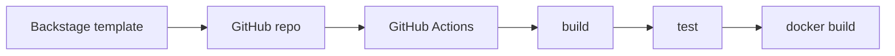

# CI/CD — LAB 16

Tiempo estimado: 20 min
Nivel: Intermedio
Importancia para entrevista: CRÍTICO
Prioridad: CRÍTICO

## 1. Objetivo

Explicar el sitio de Backstage en un pipeline y leer el workflow que el golden path deja en el repo.

## 2. Prerrequisitos

El skeleton del template. No hace falta un repo publicado.

## 3. Concepto

Backstage no es el motor de CI. GitHub Actions lo es, en este curso. El portal:

- genera el workflow el día cero
- guarda el slug para abrir el repo donde corren esos workflows
- no recibe el resultado del job salvo que un plugin de CI lo consulte

Flujo de ACME:

```text
Backstage (template)
  → GitHub (repo)
    → GitHub Actions
      → npm run build
      → npm test
      → docker build
```

No hay un paso de deploy. Añadirlo sería otro workflow, con un entorno protegido y revisión. Meter `kubectl apply` en el mismo job que el test enseña un anti-patrón: el primer PR desplegaría.

El fichero es `skeleton/.github/workflows/ci.yml`. El `${{ github.sha }}` que ves ahí, después del render, es sintaxis de Actions, no del Scaffolder. El capítulo del Scaffolder explicó el escape.

## 4. ¿Por qué existe?

Si el CI se documenta en un wiki, el servicio generado nace sin pipeline y cada equipo copia uno distinto. El golden path y el CI son la misma decisión.

## 5. Arquitectura



## 6. Ejemplo real

`ms-orders` ya existe como legado. Su CI no está generado por el template. Cuando hables del legado, di que el portal enlaza el repo y el pipeline vive en GitHub. Cuando hables de `ms-inventory`, di que el pipeline nació dentro del skeleton.

El portal también se construye. Ese es otro pipeline, el de `acme-developer-portal`, con su Dockerfile de la raíz de la app. No reutilices el workflow de NestJS para construir Backstage. Son productos distintos.

## 7. Laboratorio

Objetivo: leer el workflow y marcar qué no hace.

Abre `acme-developer-portal/catalog/templates/nestjs-service/skeleton/.github/workflows/ci.yml` (la copia) o el del curso.

Responde por escrito:

1. ¿En qué eventos corre?
2. ¿Qué versión de Node instala?
3. ¿En qué orden van install, build, test e image?
4. ¿Hay un step de deploy?
5. ¿El workflow llama a Backstage al terminar?

Resultados esperados: `push` a `main` y `pull_request`. Node 22. El orden es install, build, test, docker build. No hay deploy. No hay callback a Backstage.

Error intencional, solo de lectura: si quitaras el escape y el Scaffolder viera `${{ github.sha }}` como parámetro suyo, el render fallaría o dejaría el tag vacío. Ya está escapado. No lo quites. Señálalo con un comentario en tus notas.

## 8. Validación

Las cinco respuestas coinciden con el fichero. Puedes decir en voz alta que el estado del pipeline no vuelve solo al catálogo.

## 9. Troubleshooting

### El workflow no aparece en GitHub

¿Por qué ocurre? No publicaste el repo, o el fichero no quedó en `.github/workflows` de la rama por defecto.
¿Cómo diagnosticarlo? Árbol del repo remoto.
¿Cómo solucionarlo: lab de GitHub del template. Sin remoto, este lab se valida leyendo el fichero.

### Actions falla en `docker build` dentro del skeleton sin renderizar

¿Por qué ocurre? Estás intentando ejecutar el skeleton con placeholders.
¿Cómo diagnosticarlo? El YAML todavía tiene `${{ values.name }}`.
¿Cómo solucionarlo: no lances Actions sobre el skeleton. Lánzalo sobre un repo renderizado.

### Quiero que el catálogo se ponga en verde cuando el CI pasa

¿Por qué ocurre? Es una feature razonable.
¿Cómo diagnosticarlo? ¿Hay un plugin de GitHub Actions configurado contra el slug?
¿Cómo solucionarlo de alcance: no en este curso. El slug es el gancho. El plugin de CI es el cliente. Nombrarlo basta para la entrevista.

## 10. Ejercicio

¿Dónde pondrías el deploy a un entorno `dev`: en el mismo job, en otro workflow con environment, o en el Scaffolder? Elige uno y di qué acceso le das.

## 11. Preguntas de entrevista

### ¿Cómo se relaciona Backstage con CI/CD?

Respuesta corta: genera y enlaza el pipeline. No lo ejecuta.

Explicación: el template deja GitHub Actions. El plugin, si está, muestra el resultado. El deploy no forma parte del golden path v1.

Qué mencionar: el pipeline del portal es otro. Node 22, test antes de la imagen, sin secretos en el workflow de ejemplo.

## 12. Conexión con arquitectura

- Microservicios: cada servicio tiene su workflow porque cada uno es un repo.
- Platform Engineering: el workflow es parte del path, no un documento.
- DevOps: build y test como puerta mínima.
- CI/CD: Actions es el motor elegido para no meter Jenkins en el curso.
- Cloud: `docker build` no empuja a ECR. El push al registry sería el siguiente step, con un rol, no con una clave en el YAML.
- Developer Experience: el servicio nace con CI. Nadie copia un yml de otro equipo.

## 13. Checklist

- [ ] Leí `ci.yml` y respondí las cinco preguntas
- [ ] Sé que no hay deploy
- [ ] Distingo el pipeline del servicio y el del portal
- [ ] El escape de `github.sha` sigue en su sitio
