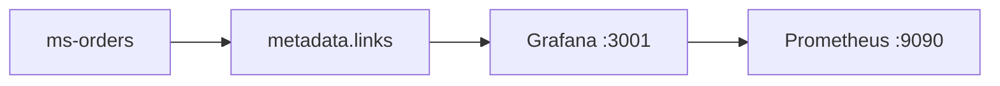

# Grafana — LAB 15

Tiempo estimado: 25 min
Nivel: Intermedio
Importancia para entrevista: ALTO
Prioridad: ALTO

## 1. Objetivo

Abrir el dashboard de `ms-orders` desde la ficha del catálogo. Grafana corre en local si tienes Docker. Si no, el link y el razonamiento cierran el lab.

## 2. Prerrequisitos

Docker, si vas a levantar el compose. El link ya está en el YAML de `ms-orders`.

## 3. Concepto

Backstage no guarda métricas. Prometheus las guarda. Grafana las dibuja. El portal lleva al dashboard del servicio para no buscarlo en una carpeta.

En la v1 de ACME el mecanismo es `metadata.links`. Es núcleo del catálogo. No hace falta el plugin de Grafana.

Un plugin de Grafana (hoy en la comunidad, no asumas el nombre del paquete antiguo de Spotify) embebe el panel y usa anotaciones propias. Vale cuando todo el mundo quiere el gráfico dentro de la ficha. Añade un paquete que tiene que coincidir con tu versión de Backstage. Este curso no lo instala. En la entrevista di el criterio: link primero, plugin si el embed es el producto.

El dashboard de laboratorio tiene uid `ms-orders`. La URL es `http://localhost:3001/d/ms-orders`. El puerto 3001 evita chocar con Backstage en 3000. El compose publica `3001:3000` del contenedor.

La contraseña de Grafana del lab es `acme-lab`, en el compose, porque es un laboratorio local. No la reutilices en ningún otro sitio. El usuario anónimo de ese compose puede ver dashboards para que el link no pida login durante la demo.

## 4. ¿Por qué existe?

El desarrollador que ve un `degraded` en service-health tiene que caer en el gráfico sin preguntar en Slack dónde está el dashboard de orders.

## 5. Arquitectura



## 6. Ejemplo real

`ms-payments` también tiene link, a `/d/ms-payments`. Ese dashboard no está provisionado. El de orders sí. La diferencia te sirve para explicar un catálogo que apunta a una URL todavía vacía: el link no comprueba que el dashboard exista. Igual que el link de GitHub a `acme/ms-orders`.

## 7. Laboratorio

Objetivo: desde la ficha, abrir Grafana.

Camino con Docker. Dónde: `docs/backstage-course/labs/observability`.

```bash
cd docs/backstage-course/labs/observability
docker compose up -d
docker compose ps
```

Resultado esperado: prometheus y grafana en estado running.

Abre http://localhost:3001/d/ms-orders

Tienes que ver el dashboard `ms-orders` con un panel "Prometheus up".

Después abre http://localhost:3000, ficha `ms-orders`, enlace **Grafana — ms-orders**. Tiene que ser la misma página.

Camino sin Docker: abre la ficha, enseña el link, abre `catalog-info.yaml` y lee la URL. Di en voz alta el diagrama. El lab queda cerrado. No simules capturas.

Para parar:

```bash
docker compose down
```

## 8. Validación

El click sale de Backstage y aterriza en el uid `ms-orders`. Prometheus responde en http://localhost:9090 si el compose está arriba. No hace falta una query sofisticada: el panel usa `up`.

## 9. Troubleshooting

### El puerto 3001 está ocupado

¿Por qué ocurre? Otro Grafana u otro proceso.
¿Cómo diagnosticarlo? `ss -ltnp | grep 3001` o `docker ps`.
¿Cómo solucionarlo: para el otro proceso. No muevas Backstage de 3000.

### Grafana abre y el dashboard no está

¿Por qué ocurre? El provisioning no montó el JSON, o el uid no coincide.
¿Cómo diagnosticarlo? `docker compose logs grafana` y el fichero `grafana/dashboard.json`.
¿Cómo solucionarlo: el uid del JSON es `ms-orders`. La URL usa ese uid. Reinicia el compose después de corregir un mount.

### El plugin de comunidad no instala

¿Por qué ocurre? Peer dependency distinta de 1.55.
¿Cómo diagnosticarlo? El error de Yarn nombra el paquete.
¿Cómo solucionarlo: no lo instales para el curso. El link cumple el objetivo. Di el trade-off.

## 10. Ejercicio

¿Qué dato de Grafana no copiarías a service-health? Elige uno (latencia, owner, versión) y justifica con "una sola fuente".

## 11. Preguntas de entrevista

### ¿Cómo das observabilidad desde Backstage?

Respuesta corta: la ficha enlaza el dashboard del servicio. Las métricas siguen en Prometheus y Grafana.

Explicación: `metadata.links` es el primer paso. Un plugin embebe si hace falta.

Qué mencionar: Backstage no es el TSDB. No scrapees desde el portal.

## 12. Conexión con arquitectura

- Microservicios: un dashboard por servicio, uid igual al `metadata.name`.
- Platform Engineering: la convención del uid es el estándar.
- DevOps: Grafana sigue siendo la herramienta de operación.
- CI/CD: el deploy no se ve aquí. Se ve en Actions y en la tabla de service-health.
- Cloud: el mismo link apuntaría a Grafana gestionado, con auth real, sin usuario anónimo.
- Developer Experience: un clic desde la ficha.

## 13. Checklist

- [ ] Vi el link en la ficha
- [ ] Levanté Grafana o justifiqué el camino sin Docker
- [ ] Sé que el link no valida que el dashboard exista
- [ ] No instalé un plugin a ciegas
