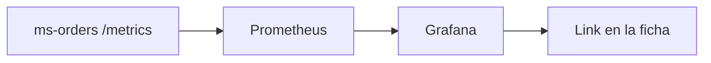

# Prometheus

Tiempo estimado: 15 min
Nivel: Intermedio
Importancia para entrevista: ALTO
Prioridad: MEDIO

## 1. Objetivo

Dejar claro que Prometheus no se configura dentro de Backstage, y qué tendría que exponer `ms-orders` para que el dashboard deje de ser un `up` de laboratorio.

## 2. Prerrequisitos

Capítulo de Grafana. Compose opcional.

## 3. Concepto

Prometheus scrapea targets. El `prometheus.yml` del lab solo scrapea al propio Prometheus (`localhost:9090` dentro de la red del contenedor). Por eso el panel se llama "Prometheus up". No hay métricas de pedidos.

Un `ms-orders` real expondría `/metrics` en el formato de Prometheus, con un nombre de job estable. Backstage no scrapea ese endpoint. Si quisieras ver la serie desde el portal, Grafana seguiría siendo el visor, o un plugin que embeba el panel que ya consulta PromQL.

No añadas un exporter "porque el diagrama de la empresa tiene Prometheus". El concepto ya está: la fuente de métricas es Prometheus, el portal enlaza.

## 4. ¿Por qué existe?

Porque en entrevistas de plataforma alguien pregunta si Backstage sustituye a Prometheus. La respuesta es no, y este capítulo te deja el fichero en la mano para demostrarlo.

## 5. Arquitectura



La flecha de orders a Prometheus **no está implementada** en el lab. El diagrama incluye el destino. El compose solo prueba Prometheus y Grafana.

## 6. Ejemplo real

El service-health del plugin muestra `version` y `lastDeployment` porque eso no es una métrica de serie temporal. Es el estado del último deploy. Meter esa tabla en Prometheus sería forzar un gauge de juguete. Las dos herramientas responden preguntas distintas.

## 7. Laboratorio

Objetivo: leer el scrape y hacer una query mínima, si el compose está arriba.

Abre `labs/observability/prometheus.yml`. Confirma que el único target es `localhost:9090`.

Si Grafana está levantada:

```bash
curl -s http://localhost:9090/api/v1/query?query=up
```

Resultado esperado: JSON con `"status":"success"` y al menos un resultado.

Si no está levantada, la lectura del YAML basta. No escribas un exporter de NestJS hoy.

## 8. Validación

Puedes decir qué target existe y cuál no existe (`ms-orders`).

## 9. Troubleshooting

### `curl` a 9090 falla

¿Por qué ocurre? El compose no está arriba o el puerto está publicado en otra interfaz.
¿Cómo diagnosticarlo? `docker compose ps` dentro de `labs/observability`.
¿Cómo solucionarlo: `docker compose up -d`. Si decidiste el camino sin Docker, no fuerces el curl.

### Quiero scrapear el mock del puerto 4010

¿Por qué ocurre? Está encendido y "ya que está".
¿Cómo diagnosticarlo? El mock no expone métricas Prometheus. Un scrape fallaría o devolvería JSON.
¿Cómo solucionarlo: no lo añadas al `prometheus.yml`.

### Confundes el `up` del lab con la salud de payments

¿Por qué ocurre? El panel vive en un dashboard llamado ms-orders.
¿Cómo diagnosticarlo? La query es `up`, del propio Prometheus.
¿Cómo solucionarlo: dilo en la entrevista como límite del lab. La salud de negocio está en el plugin, con datos del mock, no en esta serie.

## 10. Ejercicio

Nombra una métrica que sí pondrías en Prometheus para `ms-orders` (`http_server_requests`) y un dato que dejarías en el catálogo (owner).

## 11. Preguntas de entrevista

### ¿Backstage reemplaza a Prometheus?

Respuesta corta: no.

Explicación: Prometheus almacena series. Grafana las muestra. Backstage enlaza el dashboard con el servicio.

Qué mencionar: el lab solo scrapea Prometheus a sí mismo. No finjas métricas de orders.

## 12. Conexión con arquitectura

- Microservicios: cada servicio expone `/metrics` en su proceso, no en el portal.
- Platform Engineering: el nombre del job y las labels son estándar de plataforma.
- DevOps: la alerta vive en Alertmanager, no en el catálogo.
- CI/CD: un deploy malo se ve en la métrica y en `lastDeployment`. Son señales distintas.
- Cloud: AMP o Grafana Cloud serían el mismo diagrama con otra URL.
- Developer Experience: el desarrollador no necesita el endpoint de Prometheus si el dashboard está enlazado.

## 13. Checklist

- [ ] Leí `prometheus.yml`
- [ ] Sé que `ms-orders` no es un target
- [ ] Distingo métrica, dashboard y ficha
- [ ] No añadí un exporter innecesario
