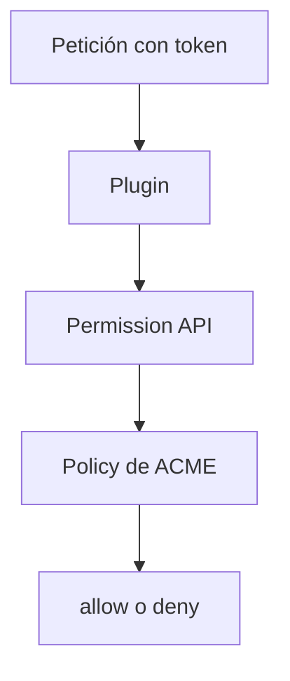

# Autorización

Tiempo estimado: 15 min
Nivel: Avanzado
Importancia para entrevista: ALTO
Prioridad: ALTO

## 1. Objetivo

Separar autenticación y autorización, y decir qué decide cada una en ACME.

## 2. Prerrequisitos

Capítulo de autenticación. Ownership entendido.

## 3. Concepto

Autorización responde "¿esta identidad puede hacer esta acción?". En Backstage eso es el **permission framework**. Una policy recibe la identidad y el permiso que el plugin está pidiendo (`catalog.entity.read`, `scaffolder.template.dry-run`, ...) y responde allow o deny.

La app de desarrollo trae una policy que permite. Por eso guest lee todo el catálogo y lanza dry runs. No es que el producto "no tenga permisos". Es que la policy de desarrollo no niega.

`spec.owner` no se consulta solo. Si quieres que solo `commerce-team` registre cambios sobre `ms-orders`, tienes que escribir una policy que mire la entidad y los groups del usuario. Es trabajo de producción, con tests. Este curso no pega una policy de ejemplo porque la API de `createBackendModule` del permission policy ha ido moviéndose de paquete, y una policy que no compila contra tu 1.55 enseña un import falso. La entrevista se gana describiendo el flujo y el sitio donde viviría: un backend module registrado en `index.ts`, al lado de los otros plugins.

## 4. ¿Por qué existe?

Guest con allow-all en producción significa que cualquiera ve y lanza templates. El owner del catálogo no lo impide.

## 5. Arquitectura

## 6. Ejemplo real

Decisión razonable para ACME, no implementada:

- leer el catálogo: cualquier persona autenticada
- ejecutar el template NestJS: miembros de un group de desarrolladores
- borrar entidades: platform-team
- leer service-health: cualquier autenticado, porque el endpoint ya exige token

Guest no entra en esa lista. Ni siquiera llega, porque el provider se apaga.

## 7. Laboratorio

Objetivo: demostrar que hoy la policy deja pasar, sin escribir una policy rota.

1. Con guest, abre `ms-payments`, que es de otro equipo. Puedes verlo. Anótalo: "leer no está restringido por owner".
2. Abre Create. Puedes ver el template. Anótalo: "scaffolder no está restringido".
3. Escribe en tus notas la policy de cuatro bullets de la sección 6, marcada como diseño, no como código desplegado.

No añadas un `permission.policy` copiado de un blog.

## 8. Validación

Tus notas distinguen el comportamiento actual (allow) y el diseño (leer amplio, escribir acotado).

## 9. Troubleshooting

### Instalé una policy de un ejemplo y el backend no arranca

¿Por qué ocurre? El import no existe en tu versión.
¿Cómo diagnosticarlo? El primer error de `yarn start` nombra el módulo.
¿Cómo solucionarlo: quita ese module del `index.ts`. Vuelve al backend que arrancaba. Estudia la policy contra la documentación de **tu** versión el día que la implementes.

### Crees que ocultar el botón en React es autorización

¿Por qué ocurre? La UI deja de mostrar Create y parece seguro.
¿Cómo diagnosticarlo? ¿El API de scaffolder sigue aceptando el POST?
¿Cómo solucionarlo: la decisión es de backend. El botón es conveniencia.

### Quieres que el owner del YAML bloquee el `kubectl`

¿Por qué ocurre? Mezclas portal y cluster.
¿Cómo diagnosticarlo? ¿El plugin de Kubernetes aplica RBAC del cluster o el del catálogo?
¿Cómo solucionarlo: el cluster tiene su RBAC. El portal tiene su policy. Se alinean. No son el mismo sistema.

## 10. Ejercicio

¿Debería Leo, de payments, ejecutar el template y crear un servicio con owner `commerce-team`? Decide y di qué permiso lo impediría.

## 11. Preguntas de entrevista

### ¿Cómo autorizas en Backstage?

Respuesta corta: permission framework en el backend. La policy mira identidad y permiso. El owner del catálogo es un dato, no la policy.

Explicación: desarrollo va en allow. Producción apaga guest y niega lo que no sea explícito, con cuidado de permitir los permisos nuevos de cada release (en 1.55 hay permisos nuevos de dry run y de ingesta).

Qué mencionar: no autorizar solo en el frontend.

## 12. Conexión con arquitectura

- Microservicios: cada API de negocio tiene su propia auth. Esta es la del portal.
- Platform Engineering: la policy es producto de plataforma, con tests.
- DevOps: un cambio de policy se despliega con el portal.
- CI/CD: el pipeline no usa la policy de la UI.
- Cloud: IAM de AWS sigue aparte.
- Developer Experience: la gente ve lo que necesita. No ve un portal vacío por una policy demasiado cerrada el primer día.

## 13. Checklist

- [ ] Distingo login y permiso
- [ ] Sé que hoy guest puede leer payments
- [ ] Tengo el diseño de policy en notas, no un import inventado
- [ ] Sé que ocultar un botón no basta
