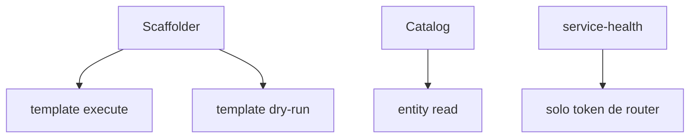

# Permisos

Tiempo estimado: 15 min
Nivel: Avanzado
Importancia para entrevista: ALTO
Prioridad: MEDIO

## 1. Objetivo

Nombrar permisos que ya tocaste sin verlos, y saber que un release puede añadir permisos nuevos.

## 2. Prerrequisitos

Capítulo de autorización.

## 3. Concepto

Los plugins declaran permisos. El scaffolder pide permiso para ejecutar un template y, desde 1.55, para el dry run (`scaffolder.template.dry-run`). El catálogo pide permisos de lectura y, en módulos de ingesta, de administración. Si tu policy es "niega todo lo que no conozco", un upgrade a 1.55 te apaga el dry run hasta que añadas el permiso nuevo. Es un punto fino de entrevista y un incidente real de upgrade.

El plugin service-health de este curso **no declara un permiso propio**. Se apoya en la auth del `httpRouter`: hay token o no hay token. Es suficiente para el lab. En producción, si solo platform debe ver la tabla, declararías un permiso y lo consultarías en el router antes de llamar al upstream. No está hecho. El techo es ese.

## 4. ¿Por qué existe?

Sin permisos con nombre, la policy solo podría decir "este usuario sí o no" para todo el portal. Los permisos parten el sí.

## 5. Arquitectura



## 6. Ejemplo real

En el lab 09 el dry run funcionó porque la policy de desarrollo permite `scaffolder.template.dry-run` aunque no la hayas escrito. Si alguien te dice que "el dry run no pide permiso", corrígelo: lo pide desde 1.55. La policy allow no te lo hizo visible.

## 7. Laboratorio

Objetivo: encontrar en el release el permiso, no implementarlo.

Abre las notas del release 1.55 que enlaza el roadmap, o la frase del capítulo de templates: `scaffolder.template.dry-run`.

Escribe en tus notas:

```text
Permiso: scaffolder.template.dry-run
Desde: 1.55
Efecto si la policy niega desconocidos: el dry run deja de funcionar
service-health: no tiene permiso propio; exige token
```

No hay comando. El laboratorio es de lectura porque pegar una policy incompatible rompe el portal el día antes de la entrevista.

## 8. Validación

Tus notas nombran el permiso de dry run y el límite de service-health.

## 9. Troubleshooting

### Después de un upgrade el Create falla con permission denied

¿Por qué ocurre? Policy deny-by-default y un permiso nuevo.
¿Cómo diagnosticarlo? El mensaje trae el nombre del permiso.
¿Cómo solucionarlo: añade una decisión explícita. No pongas allow-all en producción para "arreglarlo rápido" sin una fecha para quitarlo.

### Quiero un permiso por cada fila de la tabla

¿Por qué ocurre? Granularidad máxima.
¿Cómo diagnosticarlo? ¿La pregunta de negocio es por fila o por herramienta?
¿Cómo solucionarlo: un permiso para ver service-health. Filtrar filas por owner es un incremento, no el primer diseño.

### Confundes el 401 del router con un deny de policy

¿Por qué ocurre? Los dos impiden ver datos.
¿Cómo diagnosticarlo? 401 es "no sé quién eres" o "no mandaste token". 403 es "sé quién eres y la policy dijo no".
¿Cómo solucionarlo: en el lab, curl sin token es 401. No lo llames problema de policy.

## 10. Ejercicio

Inventa el nombre de un permiso para ver service-health, al estilo `acme.service-health.read`. No lo registres. Solo el nombre y quién tendría allow.

## 11. Preguntas de entrevista

### ¿Qué cambia en los permisos al subir de versión?

Respuesta corta: los plugins pueden exigir permisos nuevos. Una policy que niega lo desconocido hay que actualizarla en el mismo cambio.

Explicación: 1.55 añadió el dry run del scaffolder y permisos de ingesta.

Qué mencionar: lees el release notes antes de subir producción. No es un detalle de changelog.

## 12. Conexión con arquitectura

- Microservicios: cada plugin declara sus permisos, como cada servicio declara su API.
- Platform Engineering: la policy es un artefacto revisado.
- DevOps: el fallo de un upgrade de permisos es un incidente de plataforma.
- CI/CD: el portal se despliega con la policy que corresponde a esa versión.
- Cloud: no sustituye IAM.
- Developer Experience: un deny tiene que decir qué permiso faltó, no un 500.

## 13. Checklist

- [ ] Puedo nombrar `scaffolder.template.dry-run`
- [ ] Distingo 401 y 403
- [ ] Sé que service-health aún no tiene permiso propio
- [ ] No pegué una policy de internet
