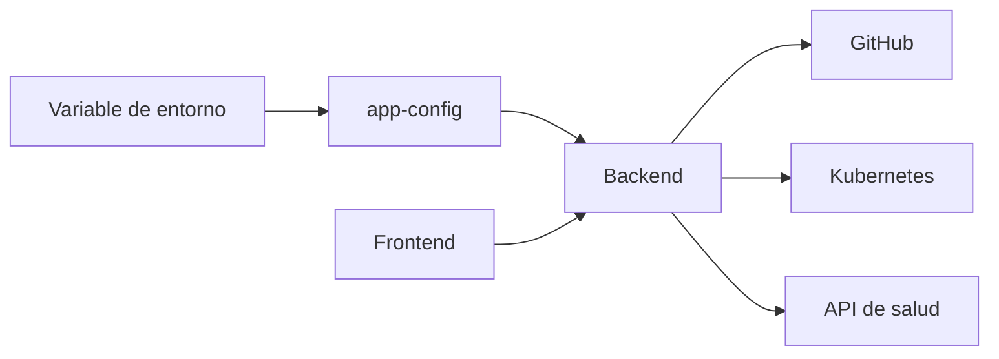

# Secretos

Tiempo estimado: 20 min
Nivel: Intermedio
Importancia para entrevista: CRÍTICO
Prioridad: CRÍTICO

## 1. Objetivo

Dejar los secretos fuera del repo y saber cómo los lee el backend.

## 2. Prerrequisitos

`app-config.local.yaml` gitignored. Plugin de salud con schema.

## 3. Concepto

Backstage sustituye `${NOMBRE}` en el YAML con la variable de entorno al arrancar. El fichero puede commitearse si el valor es la referencia, no el secreto.

```yaml
integrations:
  github:
    - host: github.com
      token: ${GITHUB_TOKEN}
```

`app-config.local.yaml` es para tu laptop y está fuera de git. `app-config.production.yaml` en el repo solo tiene `${...}`. El valor lo inyecta el runtime: en Kubernetes, un Secret montado como env. En AWS, el secreto vive en Secrets Manager o SSM y el task lo recibe como variable. No hace falta un SDK dentro de cada plugin si la variable ya está en el proceso.

Visibilidad en `config.d.ts`:

- `backend`: el frontend no recibe la clave
- `secret`: además se enmascara en logs de config

Un token con `@visibility secret` que imprimas tú con `logger.info(token)` se salta esa protección. No loguees el valor. El lab de salud loguea la URL, que no es secreta. No loguees un token el día que lo añadas.

`npmMinimalAgeGate` de Yarn 4.13 no es un secreto, pero es el control de supply chain de las apps nuevas. Mencionalo si te preguntan cómo reduces el riesgo de un paquete malicioso en el portal.

## 4. ¿Por qué existe?

El portal concentra tokens: GitHub, Kubernetes, la API de salud. Un YAML commiteado con un token es una filtración de plataforma, no de un solo servicio.

## 5. Arquitectura



El frontend no está unido a Env.

## 6. Ejemplo real

| Secreto | Dónde vive en el lab | Dónde viviría en serio |
| --- | --- | --- |
| GITHUB_TOKEN | env de la shell | Secret de Kubernetes / Secrets Manager |
| token del cluster | no lo guardamos | env, nunca una anotación |
| password de Grafana `acme-lab` | compose del lab | no se reutiliza |
| baseUrl de health | app-config.local.yaml | config por entorno, no es secreto |
| token futuro de health | no existe | `${ACME_HEALTH_TOKEN}` con visibility secret |

## 7. Laboratorio

Objetivo: demostrar que un fichero local no está trackeado y que un secreto en el YAML equivocado sí lo estaría.

Dónde: `acme-developer-portal`.

```bash
cd acme-developer-portal
git check-ignore -v app-config.local.yaml || echo "NO IGNORADO"
```

Si la app no es un repo git, `git init` solo para esta prueba está bien. No hagas commit.

Escribe un fichero `app-config.yaml` **no**. En su lugar, añade una línea falsa en un fichero nuevo `secret-lab.txt` con el texto `token: no-es-un-secreto-real`.

```bash
echo 'token: no-es-un-secreto-real' > secret-lab.txt
git status --short secret-lab.txt app-config.local.yaml
rm secret-lab.txt
```

Resultado esperado: `secret-lab.txt` aparece como untracked (git lo commitearía si lo añades). `app-config.local.yaml` no aparece, o `check-ignore` lo nombra. Borras `secret-lab.txt`. No era un secreto, y tampoco se queda en el árbol.

Si `git status` lista `app-config.local.yaml`, arréglalo en `.gitignore` antes de seguir. No continues con un token dentro.

## 8. Validación

El fichero local está ignorado. No queda `secret-lab.txt`. Sabes recitar `${GITHUB_TOKEN}` como la forma commiteable.

## 9. Troubleshooting

### El frontend de config muestra el token

¿Por qué ocurre? El schema no lo marcó secret o backend, y alguna página de config lo imprime.
¿Cómo diagnosticarlo? Busca el valor en el bundle no. Busca la clave en el schema.
¿Cómo solucionarlo: `@visibility secret` y no lo pongas en una clave que el frontend necesite.

### Sustituiste `${GITHUB_TOKEN}` y en el proceso está vacío

¿Por qué ocurre? La shell que arranca Backstage no tiene la variable. Un IDE lanzado desde el menú no hereda el `export` de otra terminal.
¿Cómo diagnosticarlo? El step de GitHub dice bad credentials y `test -n "$GITHUB_TOKEN"` en **esa** shell falla.
¿Cómo solucionarlo: arranca `yarn start` desde la shell donde exportaste.

### Metiste el token del cluster en `catalog-info.yaml`

Revierte, rota, y vuelve al capítulo de Kubernetes. El catálogo es legible por quien tenga `catalog.entity.read`.

## 10. Ejercicio

¿La `baseUrl` de health es un secreto? Responde y di qué visibilidad le diste en `config.d.ts`.

## 11. Preguntas de entrevista

### ¿Cómo manejas secretos en Backstage?

Respuesta corta: referencias `${ENV}` en config, valores inyectados por el runtime, schema con visibilidad secret, nunca en el catálogo ni en el frontend.

Explicación: `app-config.local.yaml` solo en local y gitignored. Producción usa el gestor de secretos de la plataforma.

Qué mencionar: no loguear el valor. No usar anotaciones para tokens. Yarn `npmMinimalAgeGate` como control de dependencias en apps nuevas.

## 12. Conexión con arquitectura

- Microservicios: el mismo criterio que ya usas en NestJS. El portal no es una excepción.
- Platform Engineering: plataforma custodia los tokens de integración, con alcance mínimo.
- DevOps: rotación incluida. Un token en git se rota, no se "borra en el siguiente commit" y ya.
- CI/CD: el workflow del servicio de ejemplo no lleva secretos. El de deploy, cuando exista, usará secrets del CI, no del catálogo.
- Cloud: Secrets Manager o SSM, env en la task. Sin SDK repetido en cada plugin si el env basta.
- Developer Experience: el desarrollador del template no ve el token. Solo el picker del repo.

## 13. Checklist

- [ ] `app-config.local.yaml` está ignorado
- [ ] Sé escribir una referencia `${ENV}`
- [ ] No dejé `secret-lab.txt`
- [ ] Puedo decir dónde no va un token de cluster
