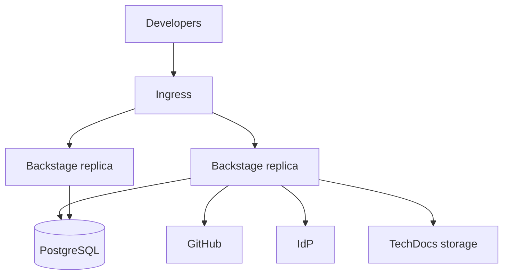

# Arquitectura de producción

Tiempo estimado: 20 min
Nivel: Avanzado
Importancia para entrevista: CRÍTICO
Prioridad: ALTO

## 1. Objetivo

Dibujar el portal de ACME como un desplegable más, con base, IdP, storage de docs y sin guest.

## 2. Prerrequisitos

Módulos de instalación, catálogo, TechDocs y seguridad.

## 3. Concepto

En producción `acme-developer-portal` es un Deployment (o un servicio equivalente) con más de un replica. Eso prohíbe SQLite en un disco local: las réplicas no comparten el fichero y un reinicio puede perder ingestas hechas solo en memoria.

Piezas:

| Pieza | Local (este curso) | Producción |
| --- | --- | --- |
| Base | SQLite | PostgreSQL |
| Auth | guest | IdP, sin guest |
| Catálogo | ficheros en el repo de la app | locations URL a GitHub, o discovery |
| TechDocs | builder local, Docker | builder external, HTML en S3 o equivalente |
| Secretos | env de la shell | Secret de la plataforma |
| Imagen | `yarn start` | la imagen del Dockerfile de la app |

El portal no está en el camino de una compra. Si cae, la tienda sigue. Cae la discoverability. Eso define el SLO: importante para desarrolladores, no es el checkout. No lo operes como si un error de catálogo debiera tumbar `ms-orders`.

Tampoco metas el portal dentro de `ms-orders`. Es un producto de platform-team, con su pipeline.

## 4. ¿Por qué existe?

El `yarn start` de la entrevista no es una respuesta de producción. Si solo sabes el lab, te van a preguntar qué cambia el lunes.

## 5. Arquitectura

## 6. Ejemplo real

ACME tendría un hostname interno `portal.acme.example`. El catalog location de `ms-orders` sería la URL del `catalog-info.yaml` en el repo, no `../../catalog/...`. El `all.yaml` de este curso es el anda mio de aprendizaje. En serio, cada repo es su fuente. Un índice por dominio sigue valiendo si no quieres discovery automático.

`pluginDivisionMode: schema` en Postgres separa schemas por plugin y evita mezclar tablas. Hay un `schemaPrefix` desde los arreglos de 1.55 si chocas con schemas ya existentes. No lo actives en el lab de SQLite.

## 7. Laboratorio

Objetivo: escribir el diagrama de producción de ACME en tus notas y marcar qué pieza del curso ya existe.

Copia el diagrama de la sección 5. Al lado de cada caja pon "hecho en el lab" o "solo diseñado":

- replicas: diseñado
- Postgres: capítulo de base, opcional levantarlo
- GitHub: diseñado, hecho si publicaste el template
- IdP: diseñado
- S3 de TechDocs: diseñado
- guest: hecho, y debe desaparecer

## 8. Validación

Ninguna caja dice que SQLite sirve para dos replicas. Ninguna caja mete a Backstage en el request path de la tienda.

## 9. Troubleshooting

### Quiero un Backstage por equipo

¿Por qué ocurre? Miedo a un catálogo grande.
¿Cómo diagnosticarlo? ¿Ana puede ver el contrato de payments?
¿Cómo solucionarlo: un portal, domains y permisos. Varios portales duplican el problema que Backstage vino a quitar. Un segundo portal solo se justifica con un aislamiento duro (otra empresa, otro cumplimiento), no con 500 servicios.

### El portal en el mismo cluster que producción de pagos, con el mismo nivel de acceso

¿Por qué ocurre? "Todo va a Kubernetes".
¿Cómo diagnosticarlo? ¿El service account del portal puede borrar deployments?
¿Cómo solucionarlo: el plugin de Kubernetes usa un token de lectura. El deploy lo hace el CI con otro rol.

### Generar TechDocs en cada replica

¿Por qué ocurre? Dejaste `builder: local`.
¿Cómo diagnosticarlo? Cada pod construye MkDocs y la doc parpadea o se duplica el trabajo.
¿Cómo solucionarlo: `external` + storage. El capítulo de TechDocs ya lo dijo.

## 10. Ejercicio

¿Cuántos portales desplegarías para 500 microservicios de una sola empresa? Responde con un número y una frase.

## 11. Preguntas de entrevista

### ¿Cómo diseñas Backstage para 500 microservicios?

Respuesta corta: un portal, Postgres, discovery desde Git, domains y systems, owners obligatorios, TechDocs generados en CI, IdP real, permisos deny-by-default actualizados en cada upgrade.

Explicación: el catálogo no se edita a mano en un YAML gigante. Cada repo trae su descriptor. El template impide que los nuevos nazcan sin owner ni CI.

Qué mencionar: el portal fuera del camino de runtime del negocio. Token de Kubernetes de solo lectura.

## 12. Conexión con arquitectura

- Microservicios: el portal es uno más, de plataforma.
- Platform Engineering: este diagrama es el sistema que operas.
- DevOps: réplicas, health del propio portal, base gestionada.
- CI/CD: pipeline distinto del de `ms-orders`.
- Cloud: Postgres gestionado, storage de objetos, secretos gestionados.
- Developer Experience: un hostname interno, no un `localhost` compartido por SSH.

## 13. Checklist

- [ ] Dibujé réplicas y Postgres
- [ ] Saqué al portal del camino de la compra
- [ ] Sé que `all.yaml` local no es el diseño final
- [ ] Un portal, no uno por equipo
