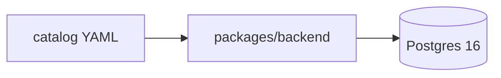

# Base de datos

Tiempo estimado: 30 min
Nivel: Intermedio
Importancia para entrevista: ALTO
Prioridad: ALTO

## 1. Objetivo

Pasar el backend de SQLite a PostgreSQL en local y volver a ver `ms-orders`. Saber revertir.

## 2. Prerrequisitos

Docker. El catálogo en ficheros. `yarn start` funciona con SQLite.

## 3. Concepto

El cliente de base se configura en `backend.database`. SQLite es el default de la app nueva. Postgres se declara así, con la librería `pg` instalada en el paquete backend:

```yaml
backend:
  database:
    client: pg
    connection:
      host: ${POSTGRES_HOST}
      port: ${POSTGRES_PORT}
      user: ${POSTGRES_USER}
      password: ${POSTGRES_PASSWORD}
```

No pongas la password en claro en `app-config.yaml`. Variables de entorno.

Al cambiar de SQLite a Postgres el catálogo se vuelve a llenar desde los locations. No hay un dump que migrar en este lab: la fuente son los YAML. Lo que sí perderías son registros hechos solo por `catalog:register` contra SQLite en memoria. Por eso el repo sigue siendo la fuente.

`pluginDivisionMode: schema` crea un schema de Postgres por plugin. Úsalo cuando no quieras todas las tablas en `public`. El lab no lo exige.

## 4. ¿Por qué existe?

Dos replicas no pueden compartir el fichero SQLite. La entrevista lo pregunta. El lab lo hace una vez para que no sea solo una frase.

## 5. Arquitectura



## 6. Ejemplo real

La base se llama `backstage`. Usuario `backstage`. Password solo en el entorno, valor de lab `backstage`. Es una password de laboratorio, igual que Grafana. No la lleves a ningún entorno compartido.

## 7. Laboratorio

Objetivo: el catálogo carga desde Postgres.

Dónde: `acme-developer-portal`.

1. Compose mínimo. Crea `acme-developer-portal/postgres-lab.compose.yaml` con este contenido. Está al lado de la app, no se commitea si añades el fichero al gitignore. La password está aquí porque es el lab. Si el directorio de la app es un repo, añade `postgres-lab.compose.yaml` a `.gitignore` o acepta que la password de lab queda en un fichero local ignorado. Mejor: no lo commitees.

```yaml
services:
  postgres:
    image: postgres:16
    environment:
      POSTGRES_USER: backstage
      POSTGRES_PASSWORD: backstage
      POSTGRES_DB: backstage
    ports:
      - "5432:5432"
```

2. Arranca:

```bash
cd acme-developer-portal
docker compose -f postgres-lab.compose.yaml up -d
```

3. Instala el driver en el workspace backend, no en la raíz:

```bash
yarn --cwd packages/backend add pg
```

4. En la shell:

```bash
export POSTGRES_HOST=127.0.0.1
export POSTGRES_PORT=5432
export POSTGRES_USER=backstage
export POSTGRES_PASSWORD=backstage
```

5. En `app-config.local.yaml` añade el bloque `backend.database` de la sección 3. No toques el `app-config.yaml` commiteable más de lo que ya estaba, para poder volver a SQLite borrando el bloque local.

6. Reinicia `yarn start` desde esa shell.

Resultado esperado: el log no dice error de conexión. http://localhost:3000 muestra `ms-orders`.

Para volver a SQLite: quita el bloque `database` de `app-config.local.yaml`, para el compose, reinicia. La UI vuelve a la base embebida. Hazlo al final del lab si no quieres dejar Postgres corriendo. El capítulo de deployment no depende de que Postgres siga encendido.

## 8. Validación

Con Postgres arriba, Catalog muestra ACME. `docker compose -f postgres-lab.compose.yaml ps` muestra el contenedor. Tras revertir, el portal sigue abriendo con SQLite.

## 9. Troubleshooting

### `password authentication failed`

¿Por qué ocurre? La variable no llegó al proceso, o el contenedor se creó antes con otra password (el volumen ya inicializado).
¿Cómo diagnosticarlo? `docker compose ... logs postgres`.
¿Cómo solucionarlo: export correcto y reinicio de `yarn start`. Si el volumen está sucio, `docker compose -f postgres-lab.compose.yaml down -v` y otra vez `up`. Eso borra la base de lab. No lo hagas contra una base que no sea esta.

### `Cannot find module 'pg'`

¿Por qué ocurre? Lo instalaste en la raíz del repo del curso o en la raíz de la app, y el backend no lo ve.
¿Cómo diagnosticarlo? `ls packages/backend/node_modules/pg`.
¿Cómo solucionarlo: `yarn --cwd packages/backend add pg`.

### El portal arranca y el catálogo está vacío

¿Por qué ocurre? El location apunta mal, o Postgres está vacío y el location falló en silencio.
¿Cómo diagnosticarlo? Log de catalog, primera ingesta.
¿Cómo solucionarlo: el `target` sigue siendo `../../catalog/all.yaml`. La base nueva no copia sola los YAML si el location está roto.

## 10. Ejercicio

¿Por qué no hace falta un `pg_dump` de SQLite para este lab? Una frase sobre la fuente de verdad.

## 11. Preguntas de entrevista

### ¿Qué base usa Backstage?

Respuesta corta: SQLite en el lab. PostgreSQL en producción.

Explicación: la config es `backend.database.client: pg` y el paquete `pg` en el backend. Los YAML se reingieren.

Qué mencionar: no compartir un fichero SQLite entre replicas. Schemas por plugin si hace falta aislar tablas.

## 12. Conexión con arquitectura

- Microservicios: la base del portal no es `acme-postgres` de los pedidos. Son bases distintas. No las juntes para "ahorrar un Postgres".
- Platform Engineering: la base del portal la opera plataforma.
- DevOps: volumen, backup, usuario que no es superuser en serio.
- CI/CD: el lab no migra datos de negocio porque no hay.
- Cloud: RDS o el Postgres que ya operes. La config no cambia de forma, cambian host y secreto.
- Developer Experience: el usuario no nota la base. Nota que el catálogo sigue ahí después de un reinicio con varias replicas.

## 13. Checklist

- [ ] Vi el catálogo contra Postgres o anoté el error concreto si Docker no pudo
- [ ] La password no está en `app-config.yaml` commiteable
- [ ] Sé volver a SQLite
- [ ] La base del portal no es la de `ms-orders`
