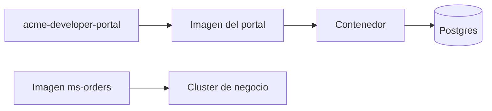

# Despliegue del portal

Tiempo estimado: 20 min
Nivel: Intermedio
Importancia para entrevista: ALTO
Prioridad: ALTO

## 1. Objetivo

Leer el Dockerfile que generó `create-app` y decir cómo se construye la imagen del portal, sin confundirla con la imagen de `ms-orders`.

## 2. Prerrequisitos

`acme-developer-portal/Dockerfile` existe. Lo crea `create-app`.

## 3. Concepto

El Dockerfile de la app empaqueta frontend ya construido y backend Node. El comando de producción no es `yarn start`. `yarn start` es el modo desarrollo, con Rspack y recarga. En la imagen se sirve el build.

No voy a pedirte que construyas la imagen como paso obligatorio. Tarda, pide mucha CPU y no cambia lo que tienes que decir en la entrevista. El lab es leer el Dockerfile y señalar: multi-stage si lo trae, el usuario, el puerto que expone, y que los secretos no son `ARG` de build.

Si tu Dockerfile generado difiere en un detalle (puerto, script), manda el fichero, no este párrafo. Las apps 1.55 siguen el patrón "build del frontend + backend de Node". Si el tuyo no tiene etapa de build, no inventes una: describe la que tienes.

`app-config.production.yaml` es el sitio de las claves de producción (`database`, `integrations` con `${ENV}`, auth sin guest). Se selecciona al arrancar con la variable de config de Backstage (`APP_CONFIG_` / el mecanismo que documente tu versión: en la práctica `yarn build` embebe config de frontend y el backend lee los YAML que le pases). Antes de afirmar el nombre exacto de la variable en la entrevista, mírala en el Dockerfile generado: suele estar en el `CMD` o en un comentario del propio fichero. No memorices una variable que tu árbol no tenga.

## 4. ¿Por qué existe?

El portal se despliega como cualquier otro servicio Node que ya sabes operar. La diferencia es la config y la base, no un runtime especial.

## 5. Arquitectura



## 6. Ejemplo real

Dos imágenes. La de `ms-orders` sale del Dockerfile del skeleton (`node:22-alpine`, usuario `node`, puerto 3000 del servicio). La del portal sale del Dockerfile de la raíz de la app. Publicarlas en el mismo repositorio de imágenes con tags distintos (`portal`, `ms-orders`) está bien. Usar el mismo tag `latest` para las dos, no.

## 7. Laboratorio

Objetivo: ficha de lectura del Dockerfile.

Dónde: `acme-developer-portal`.

```bash
cd acme-developer-portal
wc -l Dockerfile
grep -n "EXPOSE\|USER\|CMD\|ENTRYPOINT\|NODE" Dockerfile | head -n 40
```

Anota:

- qué puerto expone
- si hay `USER` distinto de root
- cuál es el comando de arranque
- si aparece algún secreto en claro (no debería)

Opcional, si tienes tiempo y disco:

```bash
docker build -t acme-portal:lab .
```

No hace falta correr el contenedor contra tu Postgres del lab. El build que termina es la validación opcional. Si falla por un paso del frontend, el error es de tu entorno, no lo tapes cambiando el Dockerfile el día del curso.

## 8. Validación

Tienes cuatro notas tomadas del fichero real, no de memoria de otro proyecto. Sabes que `yarn start` no es el `CMD`.

## 9. Troubleshooting

### El build de Docker se queda sin memoria

¿Por qué ocurre? El frontend de Backstage es grande.
¿Cómo diagnosticarlo? El daemon muere o el paso de build se corta.
¿Cómo solucionarlo: no es obligatorio. Sigue con la lectura. Sube memoria de Docker si quieres el opcional.

### Metiste `GITHUB_TOKEN` como `ARG`

¿Por qué ocurre? Quieres que la imagen "ya venga configurada".
¿Cómo diagnosticarlo? `docker history` puede dejar ver args.
¿Cómo solucionarlo: el token entra en runtime, como env. Quita el ARG.

### Usas el Dockerfile del skeleton para el portal

¿Por qué ocurre? Los dos se llaman Dockerfile.
¿Cómo diagnosticarlo? El del skeleton copia `src/main.ts` de Nest. El del portal no.
¿Cómo solucionarlo: construye cada uno en su contexto.

## 10. Ejercicio

Escribe el tag de imagen que usarías en producción para el portal. Tiene que incluir el sha de git, no solo `latest`.

## 11. Preguntas de entrevista

### ¿Cómo despliegas Backstage?

Respuesta corta: imagen construida con el Dockerfile de la app, config de producción por entorno, Postgres, sin guest, sin secretos en el build.

Explicación: `yarn start` es local. La imagen sirve el build.

Qué mencionar: pipeline distinto del de los microservicios. Tag inmutable.

## 12. Conexión con arquitectura

- Microservicios: el portal es un servicio desplegable con su propia imagen.
- Platform Engineering: platform-team opera esta imagen.
- DevOps: healthcheck del proceso, logs del backend.
- CI/CD: el pipeline del portal corre `docker build` de este Dockerfile.
- Cloud: el registry es ECR u otro. El tag es el sha.
- Developer Experience: los usuarios no ven el deploy. Ven el mismo hostname.

## 13. Checklist

- [ ] Leí el Dockerfile real
- [ ] Distingo imagen del portal e imagen de Nest
- [ ] No hay secretos en el build
- [ ] Sé que `yarn start` no es producción
