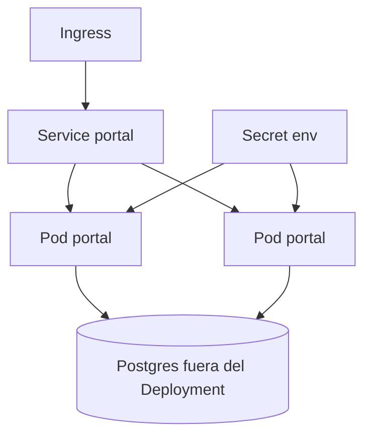

# Backstage en Kubernetes

Tiempo estimado: 20 min
Nivel: Avanzado
Importancia para entrevista: ALTO
Prioridad: ALTO

## 1. Objetivo

Describir el Deployment del **portal**, distinto del Deployment de `ms-orders` que ya aplicaste en el lab de Kubernetes.

## 2. Prerrequisitos

Capítulos de Kubernetes, base de datos y despliegue. No hace falta aplicar este manifiesto: un portal dentro de kind, con la imagen construida y Postgres, es un segundo proyecto. El lab es el manifiesto de lectura y la lista de lo que no debes copiar del lab de `ms-orders`.

## 3. Concepto

El portal en Kubernetes necesita:

- Deployment con al menos 2 replicas cuando hables de producción
- Service interno
- Ingress o el gateway que ya uses
- env `POSTGRES_*` desde un Secret
- env de tokens desde otro Secret
- probes HTTP al backend
- una service account propia

No necesita privilegio para listar todos los secrets del cluster. El plugin de Kubernetes, si apunta al mismo cluster, usa un token de lectura acotado a los namespaces de trabajo, no el default de admin de kind.

SQLite en un `emptyDir` con 2 replicas es un bug de diseño. Ni lo escribas "para el ejemplo".

TechDocs en este despliegue: `builder: external`. Si dejas `local`, cada replica necesita Docker, y no vas a montar el socket de Docker dentro del pod.

## 4. ¿Por qué existe?

"Lo desplegaría en Kubernetes" sin decir probes, secretos y base es una respuesta vacía. Este capítulo te da las piezas para no dejarla vacía.

## 5. Arquitectura



## 6. Ejemplo real

`ms-orders` corre en el namespace `acme` con la imagen de nginx del lab. El portal correría en un namespace `platform`. Mezclarlos en `acme` no está prohibido por Kubernetes. Está mal como límite operativo: un equipo de commerce no debería poder borrar el portal al redeployar pedidos.

## 7. Laboratorio

Objetivo: escribir un manifiesto mínimo de lectura, correcto en lo esencial, sin aplicarlo.

Crea `docs/backstage-course/labs/k8s/portal.yaml` solo si quieres practicar. El contenido que debes ser capaz de justificar, no de aplicar hoy:

```yaml
apiVersion: apps/v1
kind: Deployment
metadata:
  name: acme-developer-portal
  namespace: platform
spec:
  replicas: 2
  selector:
    matchLabels:
      app: acme-developer-portal
  template:
    metadata:
      labels:
        app: acme-developer-portal
    spec:
      containers:
        - name: portal
          image: acme/acme-developer-portal:GIT_SHA
          ports:
            - containerPort: 7007
          env:
            - name: POSTGRES_PASSWORD
              valueFrom:
                secretKeyRef:
                  name: portal-db
                  key: password
          readinessProbe:
            httpGet:
              path: /healthcheck
              port: 7007
```

El puerto del contenedor en producción es el del backend que fije tu Dockerfile. Compruébalo. Muchas imágenes de Backstage sirven UI y API en el mismo puerto del backend (7007) detrás del ingress. Si tu Dockerfile expone otro, usa ese. No copies 7007 a ciegas si `grep EXPOSE` dijo otra cosa.

`/healthcheck` es una ruta habitual del backend de Backstage. Si la probe falla al probarla el día que despliegues, mira el log: la ruta exacta está en el arranque. No inventes un path de Nest.

Este laboratorio **no** ejecuta `kubectl apply` sobre el portal. Justificación: construir la imagen, publicar Postgres accesible desde kind y configurar auth sin guest es más largo que el valor de ver otro pod nginx. El pod que sí aplicaste es `ms-orders`, en el lab 12, y ese demuestra el plugin. Aquí demuestras que sabes escribir el Deployment del portal sin SQLite y sin secretos en el YAML.

Validación: el manifiesto no contiene `emptyDir` para la base, no contiene la password en claro, y el namespace no es `acme`.

## 8. Validación

Lees el manifiesto y corriges tres cosas si las hubieras puesto: una replica, SQLite, password en `value:`.

## 9. Troubleshooting

### La probe mata el pod

¿Por qué ocurre? El path no existe o el proceso tarda más que el `initialDelay` que no pusimos.
¿Cómo diagnosticarlo? `kubectl describe pod` cuando de verdad lo despliegues.
¿Cómo solucionarlo: alarga el arranque. Backstage no es un health de 2 segundos la primera vez, porque corre migraciones de plugins.

### Dos replicas y errores de migración a la vez

¿Por qué ocurre? Los plugins migran el schema al arrancar.
¿Cómo diagnosticarlo? Logs duplicados de migración.
¿Cómo solucionarlo: Postgres aguanta el patrón de migraciones de Backstage en condiciones normales. Si ves un choque, arranca una replica, espera, sube la segunda. No vuelvas a SQLite.

### Montaste el docker.sock para TechDocs

Quítalo. Genera los docs en CI.

## 10. Ejercicio

¿En qué namespace pones el portal y por qué no en `acme`?

## 11. Preguntas de entrevista

### ¿Cómo despliegas Backstage en Kubernetes?

Respuesta corta: Deployment con replicas, Postgres externo, secretos por `secretKeyRef`, probes, service account mínima, TechDocs ya generados.

Explicación: la imagen es la del portal. El catálogo se ingiere desde Git. Guest no está.

Qué mencionar: no es el mismo manifiesto que el de `ms-orders`. El token para ver pods es de lectura.

## 12. Conexión con arquitectura

- Microservicios: el portal tiene su namespace y su ciclo de deploy.
- Platform Engineering: platform opera este Deployment.
- DevOps: probes, réplicas, secretos.
- CI/CD: el pipeline publica `acme/acme-developer-portal:sha`.
- Cloud: el mismo manifiesto vale en EKS cambiando el Postgres y el Ingress.
- Developer Experience: un hostname estable. Las replicas no se ven.

## 13. Checklist

- [ ] El manifiesto del portal no usa SQLite
- [ ] La password va por Secret
- [ ] Namespace `platform`, no `acme`
- [ ] Sé por qué no lo apliqué hoy
