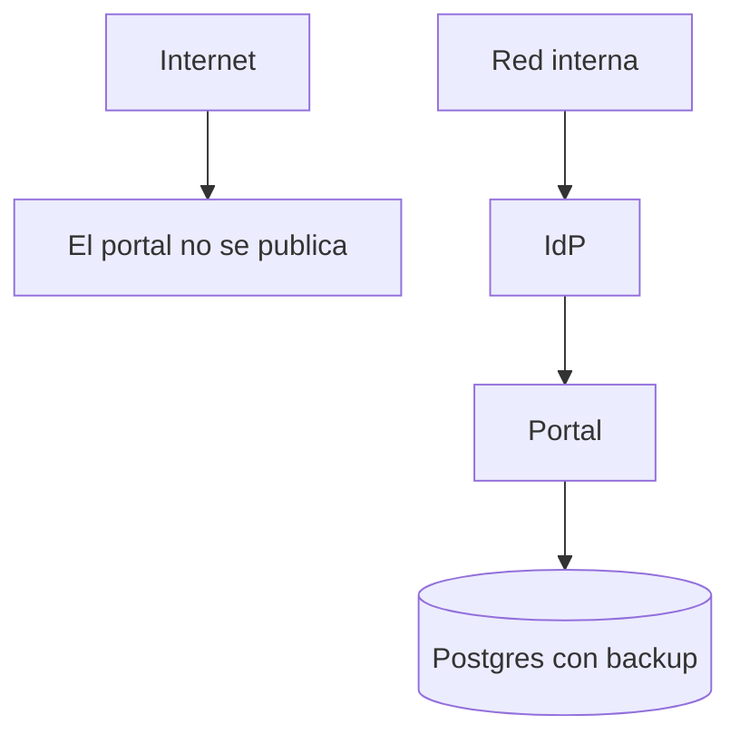

# Seguridad en producción

Tiempo estimado: 15 min
Nivel: Avanzado
Importancia para entrevista: CRÍTICO
Prioridad: ALTO

## 1. Objetivo

Cerrar la lista de cambios de seguridad entre tu laptop y el portal interno de ACME.

## 2. Prerrequisitos

Módulo 08 completo.

## 3. Concepto

Lista que tienes que poder recitar:

1. Quitar guest.
2. Poner el IdP y el sign-in resolver hacia `User` del catálogo.
3. Policy que no sea allow-all, actualizada con los permisos del release.
4. Secretos por entorno, visibilidad secret, nada en anotaciones.
5. Token de Kubernetes de lectura, acotado.
6. Token de GitHub de la integración, acotado a la org, distinto del OAuth de las personas.
7. TechDocs y catálogo legibles por quien deba. Un portal interno sigue siendo un concentrador: no lo publiques a internet "para probar".
8. `npmMinimalAgeGate` activo en el Yarn de la app, para no instalar un paquete npm de hace una hora salvo `@backstage/*`.
9. El usuario del contenedor no es root. Compruébalo en el Dockerfile. Si la imagen generada corre como root, es una mejora que nombras, no la reescribas el día del curso sin tests.
10. Backups de Postgres. El catálogo se puede reingerir desde Git. Las tasks del scaffolder y la búsqueda no siempre. No digas "no hace falta backup" sin ese matiz.

## 4. ¿Por qué existe?

La suma de labs deja secretos y guest en tu máquina a propósito. Producción es la negación ordenada de esos atajos, no un producto distinto.

## 5. Arquitectura

## 6. Ejemplo real

Un desarrollador de commerce entra por el IdP, lee `ms-orders`, lanza el template porque su group está permitido, y no puede leer el token de GitHub ni el de Kubernetes. Platform puede administrar locations. Nadie entra como guest.

## 7. Laboratorio

Objetivo: checklist firmada contra tu árbol real.

Abre `app-config.yaml` y `app-config.local.yaml`. Marca sí o no:

- [ ] guest sigue presente (en local debe seguir)
- [ ] no hay un token en claro en el YAML commiteable
- [ ] `app-config.local.yaml` está gitignored
- [ ] no hay service account token en `catalog/`

Corrige solo la segunda y la tercera si fallan. No quites guest hoy: dejarías de poder entrar.

Justificación de lo que no ejecutas: no hay un IdP de laboratorio en este curso. Configurar uno falso con un client secret de ejemplo enseña a commitear secretos. El diseño está en el capítulo de autenticación.

## 8. Validación

Las cuatro casillas están respondidas con lo que hay en disco, no con lo que te gustaría.

## 9. Troubleshooting

### Encontraste un token en el historial de git

¿Por qué ocurre? Se commiteó `app-config.local.yaml` o un YAML de catalog.
¿Cómo diagnosticarlo? `git log -S` sobre un prefijo del token, sin pegar el token completo en el comando si puedes buscar el nombre de la variable.
¿Cómo solucionarlo: revoca el token en GitHub. Borrar el fichero en un commit nuevo no lo saca del historial. No reescribas historia si no te lo piden. Revocar basta para cortar el acceso.

### Quitaste guest para "ir practicando producción" y ahora no enseñas el portal

Restaura guest en local. Producción es otro fichero de config.

### Publicaste el puerto 7007 en el compose de Postgres por costumbre

El compose de Postgres solo publica 5432. No añadas el backend a ese compose con guest activo y el puerto abierto en la LAN.

## 10. Ejercicio

Ordena los diez puntos de la sección 3 en los tres que harías el primer día y los que pueden esperar una semana. El primero tiene que ser quitar guest si el hostname ya es alcanzable por más gente que tú.

## 11. Preguntas de entrevista

### ¿Cómo aseguras Backstage?

Respuesta corta: IdP, sin guest, policy explícita, secretos fuera del repo y del catálogo, tokens de integración con alcance mínimo, portal en la red interna, backup de Postgres.

Explicación: el catálogo concentra el mapa de la empresa. No es un sitio público.

Qué mencionar: el release puede añadir permisos. La policy deny-by-default se revisa en el upgrade.

## 12. Conexión con arquitectura

- Microservicios: la seguridad del portal no sustituye la de `ms-auth`.
- Platform Engineering: esta lista es trabajo de platform-team.
- DevOps: secretos, probes, backups.
- CI/CD: el pipeline que construye la imagen no embebe tokens.
- Cloud: red privada, base gestionada, secretos gestionados.
- Developer Experience: el login es el de la empresa. No un usuario compartido.

## 13. Checklist

- [ ] Revisé los YAML reales
- [ ] Guest sigue solo en local
- [ ] Sé revocar un token si se coló
- [ ] Puedo recitar la lista corta de producción
