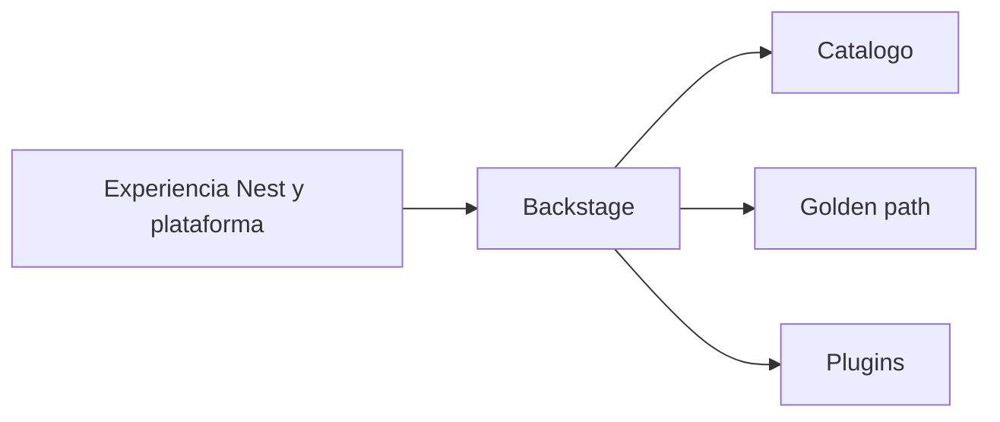

# Tu experiencia y Backstage

Tiempo estimado: 20 min
Nivel: Intermedio
Importancia para entrevista: CRÍTICO
Prioridad: CRÍTICO

## 1. Objetivo

Traducir lo que ya sabes de backend a frases que un entrevistador de Backstage reconoce, usando ACME como ejemplo.

## 2. Prerrequisitos

Haber hecho el catálogo y el template, aunque sea de lectura. Sin eso la tabla es un póster.

## 3. Concepto

Backstage no reemplaza tu oficio. Se sienta delante. Tú sigues diseñando servicios NestJS con límites claros. El portal hace visible ese diseño y estandariza cómo nace el siguiente servicio.

No digas "yo haría el portal en NestJS". Puedes decir "el backend de un plugin es un adapter: un puerto HTTP y un cliente hacia la API interna, que es lo mismo que ya hago en hexagonal". Eso enseña criterio. Reescribir Backstage en Nest no lo enseña.

## 4. ¿Por qué existe?

El entrevistador que sabe que vienes de microservicios va a probar si fuerzas Backstage a ser un runtime de pedidos, o si lo usas como plataforma. Esta tabla es tu guion.

## 5. Arquitectura

## 6. Ejemplo real

| Lo que ya sabes | Dónde vive en Backstage | Frase para la entrevista |
| --- | --- | --- |
| Microservicios | Software Catalog, un Component por servicio | "`ms-orders` es un Component. El proceso sigue siendo Nest." |
| NestJS | Software Template / golden path | "El template genera el esqueleto Nest. El dominio lo escribe el equipo." |
| TypeScript y Node | App, plugins, scaffolder | "El portal es una app Node. Los plugins son paquetes del monorepo." |
| React | Frontend de plugins | "La página no llama a la API interna. Llama al backend del portal." |
| Arquitectura hexagonal | Límite del plugin y del servicio | "El plugin de salud es un adapter. El dominio de pedidos no entra ahí." |
| DDD | Domain y System, con cuidado | "Domain en Backstage es área de negocio, no un aggregate. No los confundo." |
| CQRS | No es una feature de Backstage | "No metería CQRS en el portal. El catálogo ya separa lectura de la metadata y escritura vía PR o scaffolder." |
| PostgreSQL | Resource en el catálogo, y la base del portal | "Son dos Postgres. El de pedidos y el del portal." |
| Redis | Resource `acme-redis` | "Sesiones de auth e idempotencia de pagos. El catálogo lo declara, no lo opera." |
| Kafka | Resource `acme-kafka` | "`order.created` es el acople. `dependsOn` lo enseña. El broker no es un Component." |
| RabbitMQ | Igual que Kafka, kind Resource | "Mismo modelo si ACME tuviera colas. No hace falta otro kind." |
| Docker | Dockerfile del skeleton y del portal | "Dos imágenes. Usuario no root en el servicio. El portal tiene la suya." |
| Kubernetes | Plugin + label `kubernetes-id` | "El plugin lista pods. No despliega. El token es de lectura." |
| AWS | Integraciones y secretos, no el núcleo | "EKS con authProvider aws. Secretos en el gestor. Sin ARNs en el YAML del catálogo." |
| CI/CD y GitHub Actions | Workflow dentro del template | "Backstage genera y enlaza. Actions ejecuta. No hay deploy en la v1." |
| Grafana | `metadata.links` o plugin | "El dashboard sigue en Grafana. La ficha enlaza el uid del servicio." |
| Prometheus | El TSDB, fuera del portal | "No scrapeo desde Backstage. Prometheus scrapea `/metrics` del servicio." |
| ADR | Página de TechDocs | "No hay kind ADR. El porqué va en docs, el qué va en las relaciones." |
| SRS | Fuera de alcance | "Un SRS de producto no se modela como Component. Si hace falta, es documentación." |
| Ownership de equipos | Group + `spec.owner` | "Un owner, el team. No es RBAC." |
| API REST y OpenAPI | Kind API, `spec.definition` | "El contrato es una entidad. El servicio la provee." |
| Event-driven | Resource + podría ser AsyncAPI | "En el lab Kafka es Resource. Un AsyncAPI sería el contrato del topic si quisiera visor." |

## 7. Laboratorio

Objetivo: decir tres filas en voz alta, con ejemplo ACME, en menos de dos minutos.

Elige Microservicios, NestJS y Kafka. Grábate. Si dices "Backstage es un orquestador de microservicios", repite. No lo es.

## 8. Validación

En la grabación aparecen `ms-orders`, el template y `dependsOn`. No aparece la frase "despliega solo".

## 9. Troubleshooting

### Llamas Domain de Backstage a un bounded context

¿Por qué ocurre? La palabra es la misma.
¿Cómo diagnosticarlo? ¿Tiene aggregates y lenguaje ubicuo, o agrupa systems?
¿Cómo solucionarlo: di la diferencia antes de que te corrijan. En ACME el bounded context de pedidos es el servicio. El Domain `commerce` es más grande.

### Prometes CQRS dentro del scaffolder

No hay dos modelos de lectura y escritura del negocio ahí. El scaffolder escribe ficheros. El catálogo lee entidades. Parecido solo en la superficie.

### Quieres reimplementar el catálogo en Nest "porque lo controlo"

El coste es quedarte fuera del ecosistema de plugins. Dílo como trade-off si te empujan. Tu recomendación para ACME es adoptar Backstage, no clonarlo.

## 10. Ejercicio

Añade una fila que no esté en la tabla, sacada de un sistema que hayas operado de verdad, sin nombrar la empresa si no quieres. Mapeala a un kind o a un plugin.

## 11. Preguntas de entrevista

### ¿Por qué tú, viniendo de Nest, para un portal?

Respuesta corta: porque el portal falla cuando alguien lo confunde con el runtime, y ese límite ya lo trabajas.

Explicación: catalogo el servicio, genero el esqueleto, dejo el dominio al equipo, integro observabilidad por enlace y secretos por el backend.

Qué mencionar: una fila de la tabla, con ACME, no una lista de tecnologías.

## 12. Conexión con arquitectura

- Microservicios: siguen siendo tuyos. El portal los nombra.
- Platform Engineering: pasas de construir servicios a construir el camino.
- DevOps: el workflow del template es el puente.
- CI/CD: lo sigues diseñando. Cambia quién lo copia a mano.
- Cloud: igual que antes, con el portal como cliente con rol mínimo.
- Developer Experience: es el nombre del producto que ahora puedes enseñar.

## 13. Checklist

- [ ] Puedo decir tres filas sin leerlas
- [ ] No confundo Domain de Backstage con bounded context
- [ ] No llamo a Backstage orquestador
- [ ] Tengo un ejemplo propio añadido
