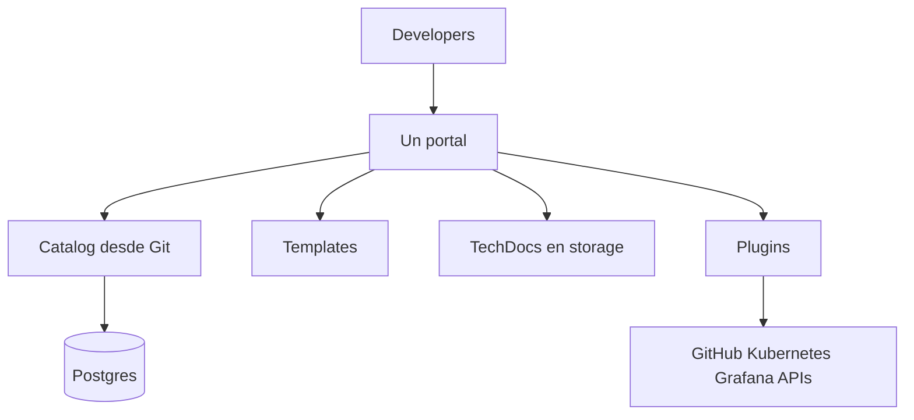

# Preguntas de arquitectura

Tiempo estimado: 40 min
Nivel: Avanzado
Importancia para entrevista: CRÍTICO
Prioridad: CRÍTICO

## 1. Objetivo

Responder preguntas abiertas con la estructura que pide una entrevista de diseño: respuesta corta, diseño, trade-off y error típico.

## 2. Prerrequisitos

El módulo de producción y el mapeo de tu experiencia.

## 3. Concepto

Habla en voz alta el diagrama antes de listar herramientas. ACME es el caso. Si te cambian el número a 500, no cambies el dibujo: cambias discovery, Postgres y permisos.

## 4. ¿Por qué existe?

"Diseña Backstage para esta empresa" es la pregunta que separa a quien instaló el demo de quien puede llevarlo.

## 5. Arquitectura

Usa siempre este esqueleto y marca la caja que la pregunta toca:

## 6. Ejemplo real

Tres servicios hoy. El diseño no depende de que sean tres.

## 7. Laboratorio

Elige la pregunta 1. Habla cuatro minutos. Para cuando digas "y también podríamos". Ese "también" suele ser el scope que no pediste.

## 8. Validación

En esos cuatro minutos salieron: un portal, owner, Git como fuente, Postgres, y algo que no automatizas.

## 9. Troubleshooting

Si no nombraste un trade-off, la respuesta está incompleta aunque sea correcta.

## 10. Ejercicio

Responde la pregunta 4 en seis líneas, sin herramientas de más. AWS solo donde haga falta.

## 11. Preguntas de entrevista

### ¿Cómo diseñarías Backstage para una empresa con 500 microservicios?

Respuesta corta: un portal, cada repo con su descriptor, discovery o locations por dominio, Postgres, IdP, template obligatorio para lo nuevo.

Respuesta técnica: Domains y systems para no tener una lista plana. `spec.type` y `lifecycle` cerrados por plataforma. Owners son groups sincronizados desde el IdP. TechDocs en CI hacia object storage. El portal en varias replicas. Permisos de lectura amplios para gente autenticada y de ejecución del template más cerrados. El plugin de Kubernetes con token de lectura. Nada de SQLite ni de guest.

Arquitectura: el diagrama de la sección 5. La caja que crece es Catalog desde Git, no el proceso de Backstage en sí. 500 YAML no cambian el número de replicas por sí solos. Lo que duele es la ingesta y la búsqueda.

Trade-offs: discovery automático mete basura si no hay una convención de path. Locations a mano no escalan a 500. Se puede mezclar: discovery con reglas de qué repos entran. Un segundo portal solo con otro límite de cumplimiento, no por tamaño.

Errores comunes: un `all.yaml` gigante en el repo del portal. Un Backstage por equipo. Reescribir el legado para que "nazca del template" antes de tener el mapa. Poner el portal en el camino del checkout.

### ¿Cómo evitarías que el catálogo se vuelva inmanejable?

Respuesta corta: jerarquía domain → system → component, taxonomía corta, owner obligatorio y fuentes por repo.

Respuesta técnica: sin owner la entidad no entra. Los types permitidos son pocos (`service`, `website`, `library`). Los resources usan types acordados (`database`, `cache`, `message-broker`). La UI se filtra por system. Lo que no tiene consumidor en un plugin no se modela como kind nuevo.

Arquitectura: el árbol de commerce que ya construiste, repetido por área de negocio.

Trade-offs: más niveles ayudan a navegar y cuestan disciplina. Un domain por equipo parece orden y mezcla el organigrama con el negocio.

Errores comunes: namespaces `default` llenos de nombres con prefijos de equipo en vez de systems. Duplicar el owner dentro de un plugin. Kinds inventados sin UI que los entienda.

### ¿Cómo implementarías ownership?

Respuesta corta: Group, un `spec.owner`, sincronía con el directorio, y el template obliga a elegirlo.

Respuesta técnica: `ownedBy` lo calcula el catálogo. La policy, en una segunda fase, puede impedir que alguien asigne un owner de otro equipo. El CODEOWNERS del repo se alinea, no se importa a ciegas: un admin de GitHub no es el dueño del servicio.

Arquitectura: platform posee el mapa y los resources compartidos. Commerce posee orders. Payments posee el cobro.

Trade-offs: owner persona es más preciso y se pudre cuando se va. Owner team es más estable y más lento para escalar a una persona. ACME elige team.

Errores comunes: dos owners. Usar el campo como RBAC y creer que ya está seguro. Dejar el owner colgando porque el Group no se ingerió y nadie mira el warning.

### ¿Cómo integrarías AWS?

Respuesta corta: el portal corre donde ya operes, con rol mínimo. EKS se consulta con el auth provider de AWS. Los secretos salen del gestor. El catálogo no guarda ARNs sensibles.

Respuesta técnica: `authProvider: aws` en el cluster locator cuando el plugin hable con EKS. La imagen del portal en ECR con tag de sha. RDS para la base del portal, distinta de la RDS de pedidos. No hace falta un plugin por cada servicio de AWS. Un bucket de TechDocs es el publisher, con credenciales de escritura solo en el CI que publica, y de lectura en el portal.

Arquitectura: CI publica docs y la imagen. El portal lee. El rol de deploy de `ms-orders` no es el rol del portal.

Trade-offs: un plugin de la comunidad que liste toda la cuenta AWS da una pantalla vistosa y un alcance IAM enorme. Preferible enlazar la consola o la herramienta que ya tengan, y solo construir plugin si hay una pregunta repetida.

Errores comunes: keys estáticas en `app-config.yaml`. El portal con `AdministratorAccess`. Usar la misma base RDS de pagos.

### ¿Cómo integrarías una plataforma interna de deployment?

Respuesta corta: Backstage pide el servicio y registra la ficha. La plataforma de deploy sigue siendo quien despliega, llamada por CI o por una acción explícita.

Respuesta técnica: el golden path termina en repo + catálogo + workflow. El workflow llama a esa plataforma con un identificador igual a `metadata.name`. Una pestaña o un link muestra el entorno. Si hace falta un botón "desplegar a dev", es una acción con permiso, idempotente, y con el secreto en el backend.

Arquitectura: Developer → Create → repo → Actions → plataforma de deploy → cluster. Backstage observa por el plugin de Kubernetes y por el link.

Trade-offs: un botón de deploy en el portal es mejor DX y peor si el permiso se confunde con el de leer el catálogo. Separar permisos. No desplegar a prod desde el scaffolder.

Errores comunes: `kubectl` dentro del template con el kubeconfig del portal. Dos fuentes del nombre del servicio.

### ¿Cómo implementarías un golden path para NestJS?

Respuesta corta: Template v1beta3, parámetros name, description, owner y repo, skeleton con health, Docker no root, test, CI y catalog-info, steps fetch, create, push y register.

Respuesta técnica: pattern del name en el JSON Schema. `OwnerPicker` filtrado a Group. Escape de expresiones de Actions. Anotación `source-template`. Tag `recommended`. Dueño platform-team. v2 puede añadir la página Overview de TechDocs. No añade Postgres ni el deploy.

Arquitectura: la del capítulo de golden path.

Trade-offs: un skeleton más completo acelera y esconde decisiones. Uno mínimo obliga al equipo a saber Nest. ACME elige mínimo más el contrato con la plataforma.

Errores comunes: compilar el skeleton sin renderizar. Dejar `github:repo:create` con inputs que 1.55 ya no acepta. Publicar con un token de usuario personal.

### ¿Cómo manejarías secretos?

Respuesta corta: referencias de entorno, schema con visibilidad secret, valores en el gestor, rotación si se filtran.

Respuesta técnica: `integrations.github.token: ${GITHUB_TOKEN}`. Kubernetes service account solo en config del backend. `config.d.ts` del plugin de salud con la URL en visibilidad backend y el token futuro en secret. `app-config.local.yaml` gitignored. La imagen no recibe secretos como build args.

Arquitectura: el runtime inyecta env. El frontend no ve la clave. El catálogo no la almacena.

Trade-offs: un secreto por integración es más trabajo de rotación y menos radio de explosión que un token dios.

Errores comunes: anotación con el token. Loguear `config` completo al arrancar. El mismo token para el scaffolder y para el OAuth de las personas.

### ¿Cómo asegurarías Backstage?

Respuesta corta: red interna, IdP, sin guest, policy explícita, tokens acotados, backup de Postgres, dependencias con el age gate de Yarn.

Respuesta técnica: la lista del capítulo de seguridad en producción. Lectura del catálogo para autenticados. Ejecución de templates para groups de build. Administración de locations para platform. Upgrade revisando permisos nuevos del release.

Arquitectura: Internet no llega al Ingress. El IdP está en medio. Postgres no es público.

Trade-offs: deny-by-default estricto el primer día deja el portal inútil y la gente vuelve al wiki. Empieza por quitar guest y cerrar la escritura. Abre la lectura.

Errores comunes: creer que `spec.owner` ya autoriza. Publicar el puerto 7007. Correr el contenedor como root porque el Dockerfile generado lo hacía y nadie lo miró.

### ¿Cómo desplegarías Backstage en Kubernetes?

Respuesta corta: Deployment en el namespace de plataforma, replicas, Postgres gestionado, secretos por referencia, probes, TechDocs externos.

Respuesta técnica: imagen `portal:sha`. `POSTGRES_PASSWORD` con `secretKeyRef`. Readiness al health del backend, con tiempo de arranque para migraciones. Service account distinta de la que despliega `ms-orders`. HPA solo después de medir. El catálogo se reingiere desde Git si el pod es nuevo.

Arquitectura: Ingress → Service → pods → Postgres fuera del Deployment. Sin emptyDir para la base.

Trade-offs: dos replicas cuestan más y evitan que un deploy del portal deje a la empresa sin mapa. Una replica es aceptable el primer mes si lo dices como límite.

Errores comunes: SQLite en el pod. docker.sock para MkDocs. El portal en el namespace `acme` junto a pagos. Token de cluster-admin para "ver pods".

## 12. Conexión con arquitectura

Estas nueve preguntas son el módulo de producción hablado. Si una no te sale, vuelve a ese capítulo, no a memorizar este texto.

## 13. Checklist

- [ ] Hablé cuatro minutos de la pregunta de 500 servicios
- [ ] Incluí un trade-off
- [ ] Incluí un error común
- [ ] No añadí un segundo portal
