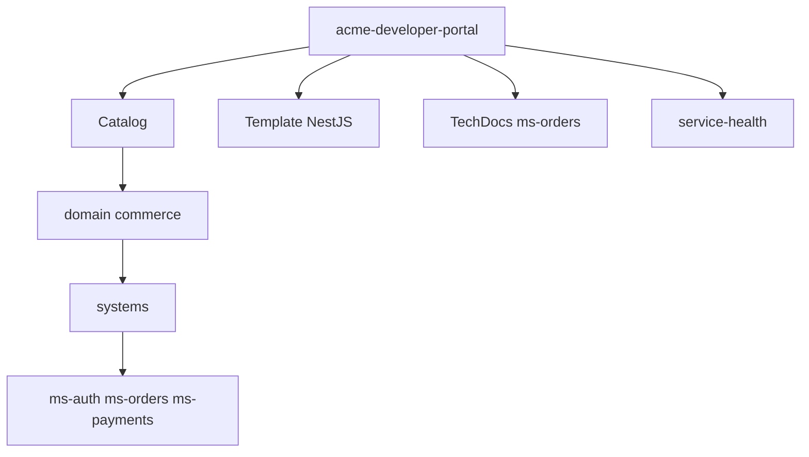

# Proyecto final — ACME Developer Portal

LAB 17. Tiempo estimado: 40 min
Nivel: Intermedio
Importancia para entrevista: CRÍTICO
Prioridad: CRÍTICO

## 1. Objetivo

Recorrer el portal como si se lo enseñaras a un entrevistador, y anotar qué está hecho en la UI y qué está solo diseñado.

## 2. Prerrequisitos

`yarn start` en marcha, catálogo en `all.yaml`. Los labs opcionales (Postgres, kind, token de GitHub, Grafana) pueden estar apagados. El recorrido los marca como hechos o como diseño.

## 3. Concepto

El proyecto no es un cuarto microservicio. Es el portal con el mapa de ACME y el camino para el quinto.

Hecho cuando la UI lo enseña. Diseñado cuando puedes decir el flujo y el fichero, y el lab decía que no se ejecutaba (IdP, deploy del portal, ECR).

## 4. ¿Por qué existe?

Sin este pase, los capítulos quedan sueltos. El entrevistador pide "enséñame", no "léeme el índice".

## 5. Arquitectura

## 6. Ejemplo real

El guion de cinco minutos está en `interview-defense.md`. Este capítulo es la lista que ese guion necesita tener en verde o en "te lo explico".

## 7. Laboratorio

Objetivo: rellenar esta tabla en tus notas, con Hecho o Diseñado.

| Pieza | Dónde mirar | Hecho si... |
| --- | --- | --- |
| Domain commerce | Catalog | Abres el domain y ves dos systems |
| Systems | Ficha del system | Orders y payments bajo commerce-platform. Auth bajo identity |
| Components | Catalog | Los tres servicios |
| APIs | orders-api | El visor OpenAPI muestra `/v1/orders` |
| Resources | acme-kafka | Resource, owner platform |
| Teams | commerce-team | Ana es miembro y el team posee orders |
| TechDocs | Docs de ms-orders | Cinco páginas, o el error de Docker anotado |
| Template | Create | Formulario NestJS Microservice |
| Golden path | template.yaml | Puedes nombrar los cuatro steps |
| GitHub | Ficha | Link o pestaña. 404 de `acme/ms-orders` cuenta como visto |
| Plugin | /service-health | Tabla, o 502 si el mock está parado y sabes por qué |
| CI/CD | ci.yml | Leíste el workflow y no hay deploy |
| Kubernetes | Ficha o manifiesto | Label explicado. Pod solo si aplicaste el YAML |
| Observabilidad | Link Grafana | El link está. El compose es opcional |
| Auth | Settings | Eres guest y sabes que se apaga |
| Producción | Notas | Postgres, replicas, sin guest, lo dices sin abrir un cluster |

No implementes lo que falte durante este pase. Anótalo. Si falta `ms-orders` entero, vuelve al módulo 03. Eso sí es bloqueante.

## 8. Validación

La tabla no tiene filas vacías. Cada "Diseñado" tiene una frase de cómo sería en la empresa.

## 9. Troubleshooting

### Falta una entidad que el curso incluye

El location no es `all.yaml` o la copia de `catalog/` es vieja. `cp -a` de nuevo desde `docs/backstage-course/labs/catalog` y reinicia. No recrees la app.

### La demo de Backstage sigue mezclada

Borra esos locations. El pase tiene que ser solo ACME.

### Quieres dejar el mock y Grafana y Postgres todos arriba para la demo

Súbelos en este orden: Postgres solo si la config local apunta a él, mock en 4010, Grafana en 3001, Backstage el último. Si no tienes RAM, enseña el catálogo y el template. Es suficiente.

## 10. Ejercicio

Haz el pase de cinco minutos con el guion de `interview-defense.md`. Una sola toma.

## 11. Preguntas de entrevista

### ¿Qué tiene tu portal?

Respuesta corta: el mapa de commerce, el template NestJS, docs de orders y un plugin que lee una API de salud por el backend.

Explicación: GitHub, Kubernetes y Grafana están enlazados o explicados, y el deploy automático no está, a propósito.

Qué mencionar: lo que es diseño (IdP, replicas) no lo presentes como un cluster que ya operas.

## 12. Conexión con arquitectura

Este pase es la suma. Si una fila no se entiende, el capítulo de origen está en el roadmap.

## 13. Checklist

- [ ] Recorrí Catalog, Create y el plugin
- [ ] Marqué hecho y diseñado
- [ ] No hay entidades demo en medio
- [ ] Hice una toma de cinco minutos
